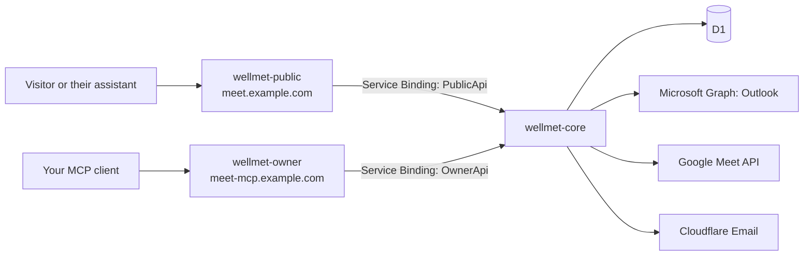

# Wellmet

A self-hosted scheduler, like Calendly, that you set up by talking to your AI assistant. It runs on Cloudflare Workers.

- **You** have no dashboard. You connect Wellmet to Claude, ChatGPT or any other MCP client and say things like "add a 30-minute chat, weekday evenings only, I approve each request".
- **Visitors** book on a plain web page, or paste one line into their own AI assistant and let it find a time.
- **Bookings** land in your Outlook calendar with a Google Meet link, and Outlook sends the guest the invite.

Live at [meet.yuxingzhou.me](https://meet.yuxingzhou.me). The name comes from the old greeting "well met".

## What visitors get

Every page is server-rendered HTML that works with JavaScript turned off. Open times are ordinary links, so an assistant that can only fetch pages can still read them.

| Path | What it is |
|---|---|
| `/` | The kinds of meeting on offer |
| `/<type>` | Description, a month calendar and every open time for the chosen day |
| `/<type>/book` | Name, email, any intake questions, one Confirm button |
| `/b/<token>` | The booking's status, with cancel and reschedule. The token is the guest's private link |

Each page carries one line to hand to an assistant, for example:

> Find a time for a 30-min chat with Tom Zhou: https://meet.yuxingzhou.me/chat (open times and booking steps are on that page, no login; MCP: https://meet.yuxingzhou.me/mcp)

### For visitors' assistants

No sign-in is needed. Assistants can use either interface.

**MCP** at `/mcp` has three tools: `list_event_types`, `find_slots` and `request_booking`. Both MCP endpoints use the official TypeScript SDK and speak the 2026-07-28 revision, falling back to the 2025 `initialize` handshake for older clients. A client that can show forms asks the guest to confirm their own name, email and answers before anything is booked.

**HTTP API**, described in full at [`/openapi.json`](https://meet.yuxingzhou.me/openapi.json) (OpenAPI 3.1):

```bash
curl https://meet.yuxingzhou.me/api/event-types
```

```bash
curl "https://meet.yuxingzhou.me/api/slots?event_type=chat&timezone=Europe/Berlin"
```

```bash
curl -X POST https://meet.yuxingzhou.me/api/bookings \
  -H 'content-type: application/json' \
  -d '{"event_type":"chat","start":"2026-11-17T03:00:00Z","name":"Ada","email":"ada@example.com","timezone":"Europe/Berlin"}'
```

Copy `start` exactly from the slots response. A booking returns `201` when it is confirmed and `202` when it waits for approval. Either way the response includes a `manage_url`.

Use `GET /api/bookings/<token>` to read a booking, and `POST` to `/api/bookings/<token>/cancel` or `/api/bookings/<token>/reschedule` to change it.

The MCP tools and the HTTP API share their schemas: `find_slots` and `GET /api/slots` take the same fields and return the same shape, and so do `list_event_types` and `GET /api/event-types`. `/openapi.json` is generated from the same route table the API runs on, and the tests check every response against it, so the two can't drift apart.

## What the owner gets

The owner MCP server is at `https://meet-mcp.<your-domain>/mcp`. It uses OAuth: your client opens a Microsoft sign-in, and only your own account is let in.

| Area | Tools |
|---|---|
| Meeting types | `list_event_types`, `create_event_type`, `update_event_type`, `duplicate_event_type`, `archive_event_type`, `preview_event_type` |
| Hours | `list_schedules`, `upsert_schedule`, `list_date_overrides`, `set_date_override`, `remove_date_override`, `get_availability` |
| Bookings | `list_bookings`, `get_booking`, `decide_bookings`, `cancel_booking`, `reschedule_booking` |
| Calendar | `block_time`, `list_blocks`, `unblock_time` |
| Running it | `get_health`, `get_connect_links`, `revoke_all_access` |

A meeting type sets:

- one or more lengths;
- how often start times are offered;
- buffers before and after;
- minimum notice and how far ahead visitors can book;
- daily and weekly limits;
- a named weekly schedule;
- instant booking or your approval;
- up to 10 intake questions;
- Google Meet, a phone number or an address;
- whether it is listed on the front page.

When a request needs approval, an email with approve and decline links goes to your inbox. Approving one request declines any others that overlap it.

## How it works



There are three Workers, and each one can reach only what it is bound to.

| Worker | Address | Holds | Job |
|---|---|---|---|
| `wellmet-public` | `meet.` | Nothing: no database and no secrets | Pages, the JSON API and the no-login MCP. Can call only core's public methods |
| `wellmet-owner` | `meet-mcp.` | OAuth grants in KV | Your sign-in, your MCP tools and the approve and decline pages. These pages run no script |
| `wellmet-core` | None | D1, plus Microsoft and Google tokens encrypted with `MASTER_KEY` | Booking rules, Outlook and Meet calls, and email. A job runs every minute to retry unfinished work, expire old requests and refresh tokens |

A bug in the public Worker therefore can't reach your credentials or your owner tools.

Open times are checked against Outlook and checked again when a booking is made, so a time that has just been taken gets "no longer open" with nearby alternatives. Public pages are cached at Cloudflare's edge for up to a minute. A booking, cancellation or move clears the cache at the Cloudflare location that handled it, so the visitor who made the change sees it straight away.

The reasoning behind this split, including the options that were rejected, is in [docs/design/agent-scheduler](docs/design/agent-scheduler/overview.md). The visual rules are in [DESIGN.md](DESIGN.md).

## Self-hosting

### Requirements

- **Cloudflare:** a domain on Cloudflare with Email Routing turned on.
- **Microsoft:** a personal Microsoft account with an Outlook calendar.
  - Work and school accounts are not supported yet: sign-in uses the `consumers` endpoint.
  - To register an app with a personal account, you need an Entra directory. A free Azure signup creates one.
- **Google:** a Google account for Meet.
- **Local tools:** Node 22+ and `npx wrangler login`.

### 1. Install

```bash
git clone https://github.com/LLTOMZHOU/wellmet && cd wellmet && npm install
```

### 2. Create the storage

```bash
npx wrangler d1 create wellmet
```

```bash
npx wrangler kv namespace create OAUTH_KV
```

Put the returned IDs into these files:

- `database_id` in `packages/core/wrangler.jsonc`
- the `OAUTH_KV` `id` in `packages/owner/wrangler.jsonc`

### 3. Make it yours

In all three `wrangler.jsonc` files, change these values:

- the `routes` domains;
- `PUBLIC_URL` and `OWNER_URL`;
- `OWNER_NAME`;
- `OWNER_TIMEZONE`;
- `MAIL_FROM`, an address on your Email Routing domain.

The `ratelimits` `namespace_id` values are numbers you pick. Any number that is unique in your account works.

### 4. Register the two apps

**Microsoft:** in the Entra admin center, register an app.

- **Supported account types:** "Personal Microsoft accounts only".
- **Redirect URIs (Web):**
  - `https://meet-mcp.<domain>/oauth/microsoft/callback`
  - `https://meet-mcp.<domain>/connect/microsoft/callback`
- **Delegated permissions:** `openid`, `email`, `offline_access`, `Calendars.ReadWrite`.
- **Secret:** create a client secret, and set `MS_SECRET_EXPIRES_ON` to its expiry date so `get_health` can warn you before it lapses.

**Google:** in Google Cloud, turn on the Google Meet REST API and create an OAuth client of type "Web application".

- **Redirect URI:** `https://meet-mcp.<domain>/connect/google/callback`
- **Scope:** `meetings.space.created`. Publish the app to production, otherwise refresh tokens expire after seven days.

Put both client IDs into the `vars` sections of the core and owner configs.

### 5. Secrets

Set these on `wellmet-core` with `npx wrangler secret put <NAME>` from `packages/core`. Nothing secret goes in the repo.

| Secret | Value |
|---|---|
| `MASTER_KEY` | 32 random bytes, base64. Generate it with `openssl rand -base64 32` |
| `MS_CLIENT_SECRET` | From the Microsoft app |
| `GOOGLE_CLIENT_SECRET` | From the Google client |
| `OWNER_EMAIL` | Where approval requests and alerts go. Verify it as a destination in Email Routing |
| `OWNER_MICROSOFT_LOGINS` | Your Microsoft account's addresses, comma-separated: the primary address and any aliases you sign in with |
| `OWNER_GOOGLE_EMAIL` | The Google account that hosts the Meet rooms |

### 6. Deploy

Deploy core first, because the other two Workers bind to it.

```bash
cd packages/core && npx wrangler d1 migrations apply wellmet --remote && npx wrangler deploy
```

```bash
cd packages/owner && npx wrangler deploy
```

```bash
cd packages/public && npx wrangler deploy
```

### 7. Connect

Add the owner server to your MCP client. For Claude Code:

```bash
claude mcp add --transport http wellmet https://meet-mcp.<domain>/mcp
```

1. Sign in with Microsoft when asked. This sign-in also connects Outlook.
2. Ask your assistant for `get_connect_links` and open the Google one to connect Meet.
3. `get_health` should report both connections as working. You can then create your first meeting type.

## Development

```bash
npm test
```

```bash
npm run typecheck
```

```bash
npm run preview:pages
```

`preview:pages` renders every public page with sample data, so you can look at the design without deploying.

```
packages/
  contracts/   Shared schemas (zod), MCP plumbing and HTML escaping
  core/        Rules, slot engine, bookings, Graph, Meet and mail; D1 migrations
  owner/       OAuth server, owner MCP tools and owner pages
  public/      Pages, JSON API, visitor MCP, edge cache and static assets
docs/design/   Design brief, options, reviews and decision
scripts/       Page preview and favicon generator
```

## Known limits

- **One owner:** Wellmet is built around a single person's calendar.
- **Personal Microsoft accounts only:** Outlook is the only calendar it reads and writes.
- **Invite sender:** Outlook sends invites from your Microsoft account's primary address. If that address is an auto-generated `outlook_…@outlook.com` mailbox, Gmail may file invites as spam. Make your real address the primary alias.

## License

[MIT](LICENSE)
