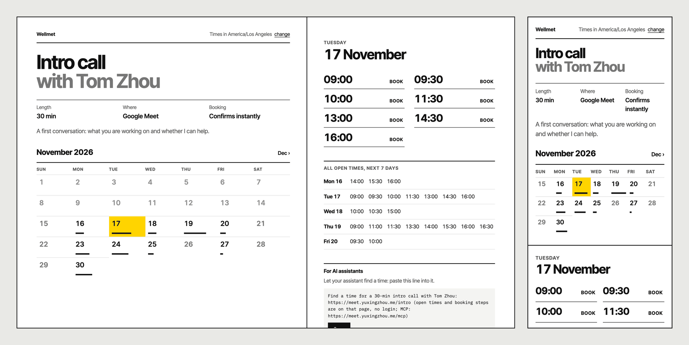
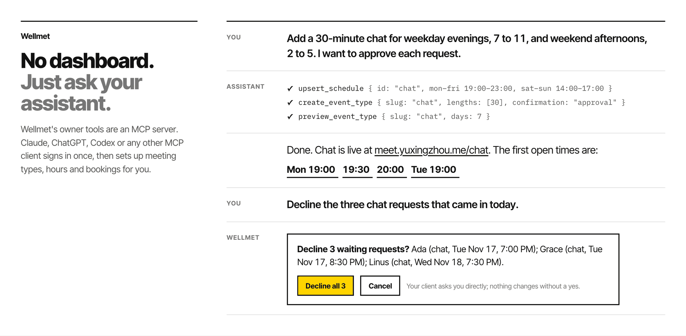
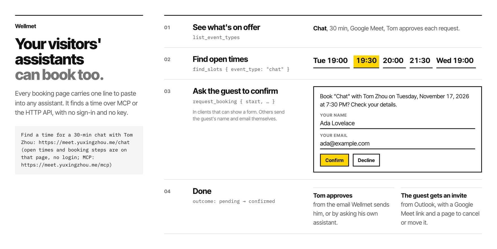
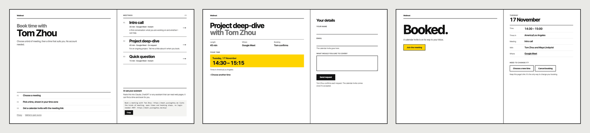

<p align="center">
  
</p>

<p align="center">
  <b>A self-hosted scheduler, like Calendly, that you set up by talking to your AI assistant.</b><br>
  Runs on Cloudflare Workers. Books into Outlook with Google Meet links.
</p>

<p align="center">
  <a href="https://meet.yuxingzhou.me">Live example</a> ·
  <a href="#self-hosting">Self-host it</a> ·
  <a href="https://meet.yuxingzhou.me/openapi.json">API description</a> ·
  <a href="LICENSE">MIT</a>
</p>

---

- **You** have no dashboard. You connect Wellmet to Claude, ChatGPT, Codex or any other MCP client and say what you want: "add a 30-minute chat, weekday evenings only, I approve each request".
- **Visitors** book on a plain web page, or paste one line into their own AI assistant and let it find a time.
- **Bookings** land in your Outlook calendar with a Google Meet link, and Outlook sends the guest the invite.

The name comes from the old greeting "well met".



## Set it up by talking



The owner tools are an MCP server at `https://meet-mcp.<your-domain>/mcp`. Your client signs in with OAuth through Microsoft, and only your own account is let in.

| Area | Tools |
|---|---|
| Meeting types | `list_event_types`, `create_event_type`, `update_event_type`, `duplicate_event_type`, `archive_event_type`, `preview_event_type` |
| Hours | `list_schedules`, `upsert_schedule`, `list_date_overrides`, `set_date_override`, `remove_date_override`, `get_availability` |
| Bookings | `list_bookings`, `get_booking`, `decide_bookings`, `cancel_booking`, `reschedule_booking` |
| Calendar | `block_time`, `list_blocks`, `unblock_time` |
| Running it | `get_health`, `get_connect_links`, `revoke_all_access` |

A meeting type sets its lengths, how often start times are offered, buffers before and after, minimum notice and how far ahead people can book, daily and weekly limits, a named weekly schedule, instant booking or your approval, up to 10 intake questions, the place (Google Meet, a phone number or an address), and whether it is listed on the front page.

When a request needs approval, an email with approve and decline links goes to your inbox, or you can ask your assistant. Approving one request declines any others that overlap it. If your client can show you a question, Wellmet asks before acting on more than one request at once.

## Visitors' assistants can book too



Every booking page carries one line to paste into any assistant, for example:

> Find a time for a 30-min chat with Tom Zhou: https://meet.yuxingzhou.me/chat (open times and booking steps are on that page, no login; MCP: https://meet.yuxingzhou.me/mcp)

No sign-in or key is needed. An assistant can use whichever of these it understands:

- **Web pages.** Every page is server-rendered HTML that works with JavaScript turned off, and every open time is an ordinary link. An assistant that can only read pages can still find a time and hand the visitor a link to it.
- **MCP** at `/mcp`, with three tools: `list_event_types`, `find_slots` and `request_booking`. If the assistant's client can show a form, the guest confirms their own name, email and answers before anything is booked.
- **HTTP API** under `/api`, described in full at [`/openapi.json`](https://meet.yuxingzhou.me/openapi.json) (OpenAPI 3.1).

```bash
curl https://meet.yuxingzhou.me/api/event-types
```

```bash
curl "https://meet.yuxingzhou.me/api/slots?event_type=chat&timezone=Europe/Berlin"
```

```bash
curl -X POST https://meet.yuxingzhou.me/api/bookings \
  -H 'content-type: application/json' \
  -d '{"event_type":"chat","start":"2026-11-17T03:00:00.000Z","name":"Ada","email":"ada@example.com","timezone":"Europe/Berlin","retry_token":"a-random-value-123"}'
```

Copy `start` exactly from the slots response, and make up a random `retry_token`: sending the same request again with the same token never books twice. A booking returns `201` when it is confirmed and `202` when it waits for approval, with a `booking_token` for `GET /api/bookings/<token>` and its `/cancel` and `/reschedule` actions.

The MCP tools and the HTTP API share their schemas. `find_slots` and `GET /api/slots` take the same fields and return the same shape, as do `list_event_types` and `GET /api/event-types`. `/openapi.json` is generated from the route table the API runs on, and the tests check every response against it.

## The pages



| Path | What it is |
|---|---|
| `/` | The kinds of meeting on offer |
| `/<type>` | Description, a month calendar and every open time for the chosen day |
| `/<type>/book` | Name, email, any intake questions, one Confirm button |
| `/b/<token>` | The booking's status, with cancel and reschedule. The token is the guest's private link |

The look is a printed Swiss timetable: a white sheet split by black rules, bold numerals, and one signal yellow for what you've picked. The rules are in [DESIGN.md](DESIGN.md).

## How it works


There are three Workers, and each one can reach only what it is bound to.

| Worker | Address | Holds | Job |
|---|---|---|---|
| `wellmet-public` | `meet.` | Nothing: no database and no secrets | Pages, the JSON API and the no-login MCP. Can call only core's public methods |
| `wellmet-owner` | `meet-mcp.` | OAuth grants in KV | Your sign-in, your MCP tools and the approve and decline pages, which run no script |
| `wellmet-core` | None | D1, plus Microsoft and Google tokens encrypted with `MASTER_KEY` | Booking rules, Outlook and Meet calls, and email. A job runs every minute to retry unfinished work, expire old requests and refresh tokens |

A few more details:

- **Times stay correct.** Open times are read from Outlook and checked again when a booking is made, so a time that has just been taken answers "no longer open" with nearby alternatives.
- **Pages are fast.** Public pages are cached at Cloudflare's edge for up to a minute and rebuilt in the background. A booking, cancellation or move clears the cache at the location that handled it, so the person who made the change sees it straight away.
- **Both MCP endpoints use the official TypeScript SDK.** They speak the 2026-07-28 revision of the protocol (with `server/discover`) and fall back to the older `initialize` handshake for clients that still use it. Batched requests are refused, so one request can't carry many tool calls past the rate limits.
- **It stays out of search.** Every response carries `X-Robots-Tag: noindex`, and `robots.txt` turns away crawlers, AI training crawlers included. The exceptions are search engines, which must fetch a page to see the noindex, and assistants fetching a page because a person asked them to.

The reasoning behind the three-Worker split, including the options that were rejected, is in [docs/design/agent-scheduler](docs/design/agent-scheduler/overview.md).

## Self-hosting

### Requirements

- **Cloudflare:** a domain on Cloudflare with Email Routing turned on.
- **Microsoft:** a personal Microsoft account with an Outlook calendar.
  - Work and school accounts are not supported yet: sign-in uses the `consumers` endpoint.
  - To register an app with a personal account, you need an Entra directory. A free Azure signup creates one.
- **Google:** a Google account for Meet.
- **Local tools:** Node 22+ and `npx wrangler login`.

### 1. Install

```bash
git clone https://github.com/LLTOMZHOU/wellmet && cd wellmet && npm install
```

### 2. Create the storage

```bash
npx wrangler d1 create wellmet
```

```bash
npx wrangler kv namespace create OAUTH_KV
```

Put the returned IDs into these files:

- `database_id` in `packages/core/wrangler.jsonc`
- the `OAUTH_KV` `id` in `packages/owner/wrangler.jsonc`

### 3. Make it yours

In the three `wrangler.jsonc` files, change these values wherever they appear:

- the `routes` domains;
- `PUBLIC_URL` and `OWNER_URL`;
- `OWNER_NAME`;
- `OWNER_TIMEZONE`;
- `MAIL_FROM`, an address on your Email Routing domain.

The `ratelimits` `namespace_id` values are numbers you pick. Any number that is unique in your account works.

### 4. Register the two apps

**Microsoft:** in the Entra admin center, register an app.

- **Supported account types:** "Personal Microsoft accounts only".
- **Redirect URIs (Web):**
  - `https://meet-mcp.<domain>/oauth/microsoft/callback`
  - `https://meet-mcp.<domain>/connect/microsoft/callback`
- **Delegated permissions:** `openid`, `email`, `offline_access`, `Calendars.ReadWrite`.
- **Secret:** create a client secret, and set `MS_SECRET_EXPIRES_ON` to its expiry date so `get_health` can warn you before it lapses.

**Google:** in Google Cloud, turn on the Google Meet REST API and create an OAuth client of type "Web application".

- **Redirect URI:** `https://meet-mcp.<domain>/connect/google/callback`
- **Scope:** `meetings.space.created`. Publish the app to production, otherwise refresh tokens expire after seven days.

Put both client IDs into the `vars` sections of the core and owner configs.

### 5. Secrets

Set these on `wellmet-core` with `npx wrangler secret put <NAME>` from `packages/core`. Nothing secret goes in the repo.

| Secret | Value |
|---|---|
| `MASTER_KEY` | 32 random bytes, base64. Generate it with `openssl rand -base64 32` |
| `MS_CLIENT_SECRET` | From the Microsoft app |
| `GOOGLE_CLIENT_SECRET` | From the Google client |
| `OWNER_EMAIL` | Where approval requests and alerts go. Verify it as a destination in Email Routing |
| `OWNER_MICROSOFT_LOGINS` | Your Microsoft account's addresses, comma-separated: the primary address and any aliases you sign in with |
| `OWNER_GOOGLE_EMAIL` | The Google account that hosts the Meet rooms |

### 6. Deploy

Deploy core first, because the other two Workers bind to it.

```bash
cd packages/core && npx wrangler d1 migrations apply wellmet --remote && npx wrangler deploy
```

```bash
cd packages/owner && npx wrangler deploy
```

```bash
cd packages/public && npx wrangler deploy
```

### 7. Connect

Add the owner server to your MCP client. For Claude Code:

```bash
claude mcp add --transport http wellmet https://meet-mcp.<domain>/mcp
```

1. Sign in with Microsoft when asked. This sign-in also connects Outlook.
2. Ask your assistant to connect Google Meet. It calls `get_connect_links` and gives you the page to open.
3. `get_health` should report both connections as working. You can then create your first meeting type.

## Development

```bash
npm test
```

```bash
npm run typecheck
```

```bash
npm run preview:pages
```

`preview:pages` renders every public page with sample data, so you can look at the design without deploying. The tests run the Workers' code against an in-memory database. They include MCP clients of both protocol generations and a contract test that checks every API response against `/openapi.json`.

```
packages/
  contracts/   Shared schemas (zod), MCP serving on the official SDK, robots rules
  core/        Rules, slot engine, bookings, Graph, Meet and mail; D1 migrations
  owner/       OAuth server, owner MCP tools and owner pages
  public/      Pages, JSON API and OpenAPI, visitor MCP, edge cache, static assets
docs/design/   Design brief, options, reviews and decision
docs/images/   README images; src/ holds the HTML the diagrams are drawn from
scripts/       Page preview and favicon generator
test-support/  Test helpers, including an MCP client for both protocol generations
```

## Known limits

- **One owner:** Wellmet is built around a single person's calendar.
- **Personal Microsoft accounts only:** Outlook is the only calendar it reads and writes.
- **Invite sender:** Outlook sends invites from your Microsoft account's primary address. If that address is an auto-generated `outlook_…@outlook.com` mailbox, Gmail may file invites as spam. Make your real address the primary alias.
- **Asking questions needs a recent client:** the guest form and your confirmations appear only in MCP clients that support elicitation on the 2026-07-28 protocol. Other clients work as before, without the questions.

## License

[MIT](LICENSE)
