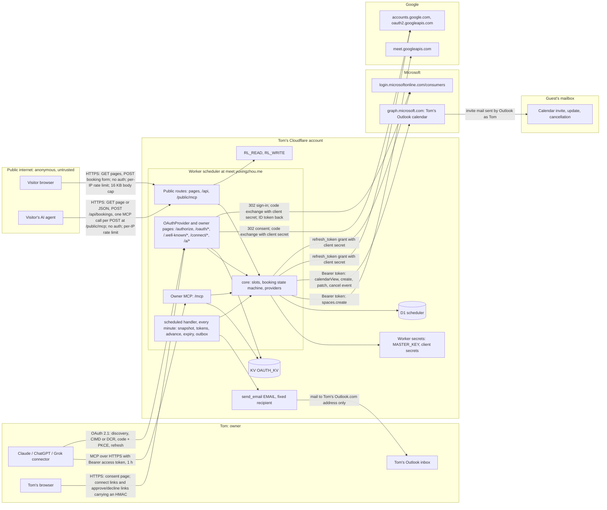

# Option A: One Worker, one database

> **Revision 2 (2026-11-15).** Written against frame revision 2 and the verified review in `review/for-a.md`. Revision 1 (the move to Workers Paid) is superseded.
>
> **Plan: Workers Free, with one stated trigger to move to Paid.** The only reason this option went to Paid was the 30-day restore window; D1 now asks for 7 days, which Free gives. Free needs no spending limit and no billing alert, cannot produce a bill (so the cost half of S4 holds by construction), and passes C2. The trigger: any `exceededCpu` outcome in the spike or in production, or the daily request quota being hit twice in one month. Moving is one account setting and no code change, and $5.00 passes C1.
>
> **Findings and what changed for each**
>
> | Finding | Change |
> |---|---|
> | A1 (must): a repeated call got another guest's manage link | Retries are matched only on a caller-chosen `retry_token` (stored hashed). Without the matching token a repeat is treated as a new request: `slot_taken` for a held time, a separate waiting request otherwise. No response ever returns someone else's link |
> | A2 (must): uncounted reschedules and cancels | At most 2 guest reschedules per booking, enforced in the conditional update; guest answers are no longer written into the Outlook event body. Worst case is 40 Outlook mails a day to guest addresses from instant bookings (calculated) |
> | A3 (must): 100 tool calls in one POST | `/public/mcp` rejects JSON array bodies with 400; every public POST body is capped at 16 KB; so one HTTP request is one tool call and the limiter counts calls |
> | A4 (must): "you are booked" chosen by a timer | The answer is chosen by the state of the Outlook re-check. Nothing says "booked" until `rechecked_at` is stored; the 2.8 s timer only applies after that point |
> | A5 (must): failures that are not `invalid_grant` | Any provider auth or refresh failure lasting 30 minutes marks the connection `broken`: same mail, same hold-as-waiting mode as a revoke. The Entra secret's expiry date is a var, shown in `get_health`, and mailed 30 days ahead |
> | A6 (must): mail owed but not recorded | New `outbox` table. The mail row is written in the same D1 batch as the state change; only cron sends, and it retries until sent or the row expires |
> | A7 (must): reschedule without a fresh Outlook read | `reschedule()` reads `calendarView` for the new interval (ignoring the booking's own event) before the conditional update; on conflict the booking is left as it was |
> | A8 (should): the cap of 30 waiting requests refused everyone | Cap is 100 (L2 x 72 h is 60; calculated). When full, the oldest request that S5 downgraded is evicted instead of the new one being refused. `decide_booking` takes a list of ids or "everything from this source" |
> | A9 (should): Meet never retried; no event until a link | Resolved by the revised A3 order: the event is created right after the re-check, with the link if Meet has answered and without it if not; the link is added afterwards |
> | A10 (should): one crawler at the L3 rate was refused 29% of the time | `RL_READ` is 40 per 60 s (L3 from one source is 28.1 a minute; calculated in the review) |
> | Disputed (R3): is the re-check repeated before a late event create? | Yes, and specified: every attempt to create the event is preceded, in the same `advance()` run, by a fresh `calendarView` that also looks for an event already carrying this booking's `transactionId`. A conflict found on a retry, after the guest was told "booked", does not cancel the booking: the event is created and Tom is mailed |
> | Shared, unverified: Graph paging; reschedule on approval-mode types | The busy read follows `@odata.nextLink`. A guest reschedule of a confirmed booking never needs a second approval |
> | Shared S6: WAF rule cannot be host-scoped on a Free zone | No longer listed as the first response to a flood |
>
> **Revision 2 applied:** a waiting request reserves nothing; committing any booking declines the waiting requests that overlap it; approval is one conditional update, so a second approval is a no-op and a second overlapping request is declined (R5); a booking is confirmed without a Meet link if Meet fails and the link is added later (A3); displayed slots may be up to 5 minutes old with a re-check at commit (R3); a spare Meet room is accepted (R2); restore window is 7 days (D1).
>
> **Machinery removed:** the second snapshot refresh at second 30 of each minute and the 50 s cut-off; the "no Outlook event until a link exists" stop in `advance()`; the overlap hold for waiting requests; the hard refusal at the waiting-request cap; mail sent from `waitUntil` with a one-hour retry; the timer deciding what the guest is told; the Workers Paid subscription, spending limit and billing alert; the WAF rule as a flood response.
>
> **Architecture:** unchanged. Same single Worker, bindings, trust boundaries, routes and tools. One D1 table added (`outbox`), two columns added to `bookings` (`retry_key`, `reschedule_count`), and the step order inside `advance()` changed.
>
> **Not fixed:** none of the confirmed findings is left open. Two gaps remain and are stated under "Worst at": a declined guest is not told, and nothing outside the Worker notices if the Worker and its cron both stop.

**Premise:** Fewest moving parts. One deployable Worker, one D1 database, the OAuth library's own KV namespace, no queue, no Durable Object, no object store, no third-party service beyond the two the frame forces (Microsoft and Google). Every piece that a library or a managed feature can supply is taken from it, so the whole system can be built in one pass (K8) and held in one person's head.

Basis labels used throughout: **measured** (observed in this session), **calculated** (arithmetic, including `capacity.py` output on `a.assumptions.json`), **stated** (a named source), **assumed** (a guess). Nothing is built, so nothing about the system itself is measured.

## Summary

A single Cloudflare Worker named `scheduler`, served at `meet.yuxingzhou.me`, does everything: it renders the public booking pages as plain server-side HTML, answers a small JSON API and a public MCP endpoint for visitors' agents, hosts the owner MCP endpoint, and is its own OAuth authorization server through the single-Worker `OAuthProvider` class of `@cloudflare/workers-oauth-provider`. All scheduler state lives in one D1 database; the library keeps its grants in one KV namespace. Tom signs in to the owner MCP with his Microsoft account, and that same sign-in is the Outlook calendar connection. An instant booking is one atomic conditional `INSERT` in D1 (which settles races and the abuse quotas in one statement), then a fresh Outlook check, then the Outlook event that sends the invite, with the Meet link in it if Google answered in time and added afterwards if not. A request on an approval-mode event type waits and reserves nothing; approving it is one conditional `UPDATE` that fails if the time has been taken, and committing any booking declines the waiting requests that overlap it. A once-a-minute Cron Trigger on the same Worker refreshes the Outlook busy snapshot, keeps provider tokens alive, finishes anything unfinished, expires 72-hour requests and sends the mail queued in an outbox table. It runs on the Workers Free plan at $0.

## Components

### What is deployed

| Unit | Count | Notes |
|---|---|---|
| Workers plan | Free | Move to Paid ($5.00) on the trigger in the revision note; no code change |
| Worker `scheduler` | 1 | Custom domain `meet.yuxingzhou.me`; `fetch` and `scheduled` handlers; Smart Placement on, so it runs next to D1 |
| D1 database `scheduler` | 1 | All application state |
| KV namespace `OAUTH_KV` | 1 | Owned and written only by the OAuth library (the library requires it; stated, library README) |
| Cron Trigger | 1 | `* * * * *` |
| Queues, Durable Objects, R2, Workflows, Turnstile, static-asset binding, second Worker | 0 | |

Bindings in `wrangler.jsonc`:

| Binding | Type | Used for |
|---|---|---|
| `DB` | D1 | everything below under Data |
| `OAUTH_KV` | KV | OAuth clients, grants, tokens, consent handles (library only) |
| `EMAIL` | `send_email` with `destination_address` fixed to Tom's Outlook.com address | approval and alert mail to Tom's Outlook inbox; the binding cannot address anyone else (stated, Cloudflare Email Service send-bindings doc) |
| `RL_READ` | rate limit, 40 per 60 s per key | public GETs and public MCP |
| `RL_WRITE` | rate limit, 5 per 60 s per key | booking POSTs, manage POSTs, `/authorize`, `/oauth/register`, `/oauth/token` |
| vars | `BASE_URL`, `OWNER_EMAIL`, `MS_CLIENT_ID`, `GOOGLE_CLIENT_ID`, `MS_SECRET_EXPIRES_ON` | |
| secrets | `MASTER_KEY`, `MS_CLIENT_SECRET`, `GOOGLE_CLIENT_SECRET` | `MASTER_KEY` is 32 random bytes; HKDF derives three subkeys: `enc` (AES-256-GCM for provider tokens at rest), `link` (HMAC for manage, approval and connect links), `src` (HMAC of client IP) |

Compatibility flags: `nodejs_compat`, `global_fetch_strictly_public` (required for Client ID Metadata Documents; stated, library README).

Libraries (everything else is hand-written, estimated 1,900 lines of TypeScript and 70 of SQL; assumed):

| Library | Replaces |
|---|---|
| `@cloudflare/workers-oauth-provider` (`OAuthProvider`) | The whole authorization server: RFC 8414 and RFC 9728 discovery, DCR, CIMD, PKCE, token endpoint, revocation, consent and upstream-sign-in helpers |
| `agents/mcp/server` `createMcpHandler` + `@modelcontextprotocol/server` | Stateless Streamable HTTP MCP transport with no Durable Object (stated, Cloudflare handler-API doc) |
| `zod` (4.5 or later) | Tool and API input validation |
| `hono` | Routing |
| `temporal-polyfill` | Timezone and daylight-saving arithmetic (R4) |

### Source modules

| Module | Responsibility |
|---|---|
| `index.ts` | Exports `new OAuthProvider({ apiRoute: '/mcp', apiHandler, defaultHandler, authorizeEndpoint: '/authorize', tokenEndpoint: '/oauth/token', clientRegistrationEndpoint: '/oauth/register', clientIdMetadataDocumentEnabled: true, scopesSupported: ['scheduler','offline_access'], requiredScopes: ['scheduler'], refreshTokenIdleTTL: 30 days, clientRegistrationCallback })` and the `scheduled` handler |
| `routes.ts` | Hono app for every unprotected route (below) |
| `mcp-owner.ts`, `mcp-public.ts` | The two tool sets; each tool is a thin wrapper over `core/` |
| `core/slots.ts` | Pure function: event type + committed D1 bookings + busy snapshot -> open slots |
| `core/booking.ts` | `requestBooking()`, `advance()`, `decide()`, `cancel()`, `reschedule()`: the one state machine |
| `providers/calendar.ts` | `CalendarProvider` interface (`busy`, `createEvent`, `updateEvent`, `cancelEvent`) and its only implementation, Outlook over Graph |
| `providers/meeting.ts` | `MeetingProvider` interface (`createRoom`) and its only implementation, Google Meet |
| `providers/tokens.ts` | Encrypted token storage, refresh, broken-connection detection |
| `crypto.ts`, `html.ts`, `mail.ts` | HKDF/AES-GCM/HMAC helpers; HTML templates with escaping; outbox writer and the cron sender |

### Public HTTP routes (no authentication)

| Route | Purpose |
|---|---|
| `GET /` | List of active event types |
| `GET /{slug}` | Booking page: description, the copyable line, an "AI agents" section, and the open slots rendered as links. Slots are in the HTML itself, not loaded by script |
| `GET /{slug}/book?start=...` | Confirm page: one form (name, email, intake answers, timezone, a hidden random `retry_token`) and one Confirm button. Name and email may be pre-filled from the URL fragment (`#name=...&email=...`), which never reaches the server |
| `GET /api/slots?type=&from=&to=&tz=` | Open slots as JSON |
| `POST /api/bookings` | Create a booking. Accepts JSON (answers JSON) or a form post (answers 303 to the new booking's status page) |
| `GET /b/{id}.{mac}` | Status and manage page for one booking: waiting, booked (invite on its way), confirmed with or without the Meet link yet, declined, expired, cancelled, failed ("that time is no longer available"). Also returns JSON when asked |
| `POST /b/{id}.{mac}/cancel`, `GET` and `POST /b/{id}.{mac}/reschedule` | F8 |
| `POST /public/mcp` | Public MCP endpoint. A JSON array body is refused with 400 |

Every public POST body is limited to 16 KB.

Owner-side and protocol routes:

| Route | Purpose |
|---|---|
| `/mcp` | Owner MCP endpoint (Bearer token; 401 with `resource_metadata` otherwise) |
| `/.well-known/oauth-protected-resource/mcp`, `/.well-known/oauth-authorization-server`, `/oauth/token`, `/oauth/register` | Served by the library |
| `GET` and `POST /authorize` | Consent page, then hand-off to Microsoft |
| `GET /oauth/microsoft/callback` | Finishes owner sign-in and stores the calendar connection |
| `GET /connect/microsoft` | Re-consent link used in alert emails (same callback; no MCP client involved) |
| `GET /connect/google?t=...`, `GET /oauth/google/callback` | Google connection for Meet |
| `GET` and `POST /a/{id}.{mac}` | Approval page reached from email: shows the request, two buttons |

### MCP tools

Owner endpoint `https://meet.yuxingzhou.me/mcp` (14 tools):

| Tool | Purpose |
|---|---|
| `get_health` | Connection status for Microsoft and Google, the Entra secret's expiry date, last cron success, today's abuse-limit and platform-quota counters, waiting and unfinished bookings, unsent outbox rows, and the most recent error-log rows (O1) |
| `get_connect_links` | Returns a 10-minute signed link to connect or reconnect Google, and the Microsoft reconnect link |
| `list_event_types` | All event types with their settings, public URL and the copyable line |
| `upsert_event_type` | Create or change one: `slug`, `title`, `description`, `duration_min`, `buffer_before_min`, `buffer_after_min`, `min_notice_min`, `window_days`, `daily_cap`, `timezone`, `working_hours`, `confirmation` (`instant` or `approval`), `questions`, `location`, `active` (F2) |
| `get_availability` | The open slots a visitor would see, for checking a configuration |
| `list_bookings` | Filter by status, date range, event type, source |
| `get_booking` | One booking in full; guest text only inside `guest_supplied` |
| `decide_booking` | Approve or decline. Takes one id, a list of up to 50 ids, or `all_from_source_of: <id>` (decline only). The result says, per request: approved, already approved (nothing done), declined, already declined or expired, or declined because the time is taken |
| `cancel_booking` | Cancel with an optional message; Outlook sends the cancellation |
| `reschedule_booking` | Move to a new start |
| `block_time` | Creates a busy Outlook event with no attendees, tagged as a scheduler block. There is no blocks table: Outlook is already the source of busy time |
| `list_blocks` / `unblock_time` | List or delete those events (two tools) |
| `revoke_all_access` | Revokes every OAuth grant for the owner (S8) |

Public endpoint `https://meet.yuxingzhou.me/public/mcp` (3 tools, rules only, K7):

| Tool | Purpose |
|---|---|
| `list_event_types` | Public fields of active event types |
| `find_slots` | Open slots for one event type and date range, each with an explicit offset |
| `request_booking` | Same function as `POST /api/bookings`; returns status and this booking's own status-and-manage URL, or `slot_taken` with alternatives |

### The three OAuth flows

1. **Owner sign-in for MCP (and the Microsoft calendar connection, in the same consent).** The chat client gets 401 from `/mcp`, reads the two metadata documents, registers by CIMD or DCR, and opens `/authorize`. The Worker calls `parseAuthRequest()`, shows the library-backed consent page (`describeConsent()`, `beginConsent()`: client name, CIMD domain, redirect host), and on Allow calls `approveConsent()` then `beginUpstream()` and redirects to `https://login.microsoftonline.com/consumers/oauth2/v2.0/authorize` with scopes `openid email offline_access Calendars.ReadWrite` and PKCE. At `/oauth/microsoft/callback`, `finishUpstream()` recovers the request, the Worker exchanges the code using `MS_CLIENT_SECRET`, reads the ID token it received directly from Microsoft's token endpoint, and checks issuer (the consumer tenant), audience, and identity. On first sign-in the identity must equal `OWNER_EMAIL`; its `sub` is then pinned in `state.owner` and only that `sub` is accepted afterwards. If it matches, the Microsoft refresh token is encrypted into `connections` and `completeAuthorization({ userId: 'owner', props: { owner: true } })` runs. If it does not match, the Worker answers the client with `access_denied` and stores nothing (S1). `props` carries no upstream token.
2. **Microsoft calendar connection.** The same flow as 1. Standalone reconnection uses `/connect/microsoft`, which runs the Microsoft leg with a signed state cookie and the same owner check, and ends on a "Calendar reconnected" page.
3. **Google connection for Meet.** Tom asks his agent to finish setup; `get_connect_links` returns `https://meet.yuxingzhou.me/connect/google?t=<10-minute HMAC token>`. Opening it redirects to Google with scopes `openid email https://www.googleapis.com/auth/meetings.space.created`, `access_type=offline`, `prompt=consent` and a signed state cookie. The callback exchanges the code, encrypts the refresh token into `connections`, and records the Google account email for `get_health`. Only a link minted by an authenticated owner tool can start this flow, so nobody else can attach their Google account.

### The copyable line (F5 and F6)

Shown on every booking page with a copy button, and returned by `list_event_types`:

```
Book time with Tom: https://meet.yuxingzhou.me/intro  (AI agents: open that URL for open slots and booking instructions, no login or key needed; or connect to the MCP server https://meet.yuxingzhou.me/public/mcp)
```

It works at three capability levels because the page it points to is itself the agent documentation:

- **Agent can connect to MCP servers:** it uses the second URL. No auth challenge; three tools.
- **Agent can make HTTP requests (F5):** it fetches the page, whose visible "AI agents" section gives the two calls: `GET /api/slots?type=intro&from=...&to=...&tz=...` and `POST /api/bookings` with `{ "event_type", "start", "name", "email", "timezone", "answers", "retry_token" }`. The section says: choose a random `retry_token` of 16 or more characters and send the same one if you repeat the call; then a repeat returns the original answer.
- **Agent can only fetch pages (F6):** the slots are already in the fetched HTML, each as a link with its start time and offset. The section tells the agent to give the visitor `https://meet.yuxingzhou.me/intro/book?start=<start>#name=<name>&email=<email>`. That opens the confirm page pre-filled; the visitor presses Confirm once. A GET never books.

### Mail to Tom

All mail goes through one path. Whatever changes state writes an `outbox` row in the same D1 batch (kind, booking id, subject, text, `expires_at`). Cron, once a minute, sends unsent rows with `EMAIL.send()` from `scheduler@yuxingzhou.me` to Tom's Outlook.com address (free on any plan; stated, Email Service limits doc), marks them sent, and retries failures every minute until the row expires: an approval request expires with the request, an alert after 7 days. Nothing is sent from the request path, so a mail that is owed is always on record (finding A6). Tom adds the sender to Outlook's safe senders during setup so it lands in the inbox, not Junk.

The approval mail shows the event type, time with zone, and the guest's name, email and answers under a "typed by the guest" heading, plus one link: `https://meet.yuxingzhou.me/a/{id}.{mac}`. The page behind it shows the same details and two POST buttons. The MAC is `HMAC(link, "approve" + id)`, so the link works for that booking and that purpose only; the decision is a D1 update `WHERE status = 'pending'`, so it works once and dies when the request is decided or expires (S9). GET does nothing, so mail scanners that pre-fetch links cannot approve. At most 10 individual approval mails are queued per day; beyond that one digest row per hour.

### Abuse limits (S4, S5)

| Limit | Value | Where enforced |
|---|---|---|
| Public reads per source | 40 per 60 s | `RL_READ.limit({ key: ip })` before any D1 access |
| Public writes per source | 5 per 60 s | `RL_WRITE` |
| Tool calls per public MCP request | 1 | Array bodies refused with 400 before the handler runs |
| Public POST body | 16 KB | Checked on `Content-Length` and while reading |
| Instant bookings per source | 5 per rolling 24 h | Inside the booking `INSERT` (subquery count on `source_hash`) |
| Instant bookings overall | 10 per rolling 24 h | Same statement |
| What happens beyond either | The row is inserted as `pending` with `mode_applied = 'downgraded'`; no Meet room, no Outlook event, nothing sent to the guest | Same statement, a `CASE` on the two counts |
| Waiting requests per source | 5 per 24 h, then 429 for that source | Same statement |
| Open waiting requests overall | 100. When full, the oldest `downgraded` request is set `expired` to make room; only if there is none is the new request refused with 429 | Same D1 batch |
| Guest reschedules per booking | 2 | `WHERE reschedule_count < 2` in the reschedule update |
| Outlook mail to guest addresses caused by instant bookings | At most 40 a day: 10 bookings x (1 invite + 2 updates + 1 cancellation) (calculated) | Follows from the rows above |
| Graph calls | Independent of request volume: 1 per minute from cron, plus 2 per committed booking | Structure, not a limiter |
| DCR registrations | 10 per day | `clientRegistrationCallback` + counter row in `state`; protects the 1,000-a-day KV write quota |
| `/authorize` page loads | 100 per day | Counter row in `state`; same purpose |
| Guest text | name 100, each answer 500, total 2,000 characters; control characters stripped | zod schemas |

A source is `HMAC(src, client IP)`, with IPv6 truncated to /64. The rate-limit bindings are approximate and per Cloudflare location (stated, Cloudflare rate-limit doc); the booking quotas are exact because they are evaluated inside one D1 statement.

### Booking write: order and recovery

States:

| State | Meaning | Holds its time? |
|---|---|---|
| `pending` | Waiting for Tom | No. Several may wait on the same time (F7) |
| `accepted` | Instant, or approved by Tom; Outlook event not yet created | Yes |
| `confirmed` | Outlook event exists and the invite has gone. `meeting_url` may still be empty | Yes |
| `declined`, `expired`, `cancelled`, `failed` | Terminal | No |

`calendar_dirty` marks a confirmed or cancelled booking whose Outlook event still has to be moved, cancelled or given its Meet link. "Committed" below means `accepted` or `confirmed`.

**`requestBooking()`**

1. Validate input; check `start` is a slot `core/slots.ts` would generate for this event type.
2. If the caller sent a `retry_token`: `retry_key = SHA-256(retry_token + event_type + start_utc + lower(email))`. If a booking has that key, return that booking's answer. Without a token, or with a different one, there is no match and the call is a new request. This is the only retry matching (finding A1).
3. One conditional insert. For an approval-mode event type, or when the S5 counts are exceeded, or when a calendar connection is `broken`: the row is inserted as `pending` if the waiting caps allow, with an approval `outbox` row in the same batch. Respond `pending` with this booking's status URL. Done. Otherwise the row is inserted as `accepted`, with its lease already taken, only if no committed booking overlaps the buffered interval and the daily cap is not reached. Zero rows changed means `slot_taken` (R1): respond 409 with the nearest open slots.
4. For `accepted`: await `advance(id)` up to the commit point (step 2c below).
   - Re-check found a conflict: 409 `slot_taken` with alternatives.
   - Re-check could not be completed (2.5 s timeout or a Graph error): 503 "try again shortly". Nothing was promised.
   - Re-check passed and `rechecked_at` is stored: the guest is now booked. Keep waiting for the event create until 2.8 s from the start of the request, then answer `confirmed`, or 202 "you are booked; the invite is on its way" if it has not finished. The rest runs in `ctx.waitUntil()` and, failing that, cron.

**`advance(id)`** is idempotent and is the only code that touches Outlook and Meet for a booking:

1. Take the lease unless the insert just did: `UPDATE bookings SET lease_until = now + 90 s, attempts = attempts + 1 WHERE id = ? AND (lease_until IS NULL OR lease_until < now)`. No row changed: stop.
2. If `accepted` and there is no `calendar_event_id`:
   - a. In parallel: Graph `calendarView` over the buffered interval, following `@odata.nextLink`, selecting `id, transactionId, start, end, showAs, isCancelled`; and, if `meeting_url` is empty, `POST meet.googleapis.com/v2/spaces`, abandoned after 1.5 s.
   - b. If the view already contains an event whose `transactionId` is this booking's id, adopt it: store its id, set `confirmed`. (This is what makes a retried create safe without relying on how long Graph's own guard lasts.)
   - c. If `rechecked_at` is empty, this is the commit check (R3). Conflict: an instant booking becomes `failed`; an approved one goes back to `pending` and Tom is told. Unreachable: same, with the 503. Clear: one D1 batch stores `rechecked_at`, stores `meeting_url` if Meet answered, and sets every `pending` request that overlaps this booking to `declined` with reason `time_taken` (F7).
   - d. If `rechecked_at` was already set (this is a retry after the guest was told "booked") and the view now shows a conflict, carry on and queue a mail to Tom saying so.
   - e. `POST /me/events` with the guest as attendee, `transactionId = id`, the manage link, and the Meet link if there is one. The body is a fixed template; guest answers are not in it. Store the event id, set `confirmed`, and set `calendar_dirty` if `meeting_url` is empty.
3. If `confirmed` with no `meeting_url`: create the room, store it, `PATCH` the event's body and location, clear the flag. If this has been failing for 15 minutes, queue one mail to Tom and drop to one attempt every 10 minutes (A3).
4. If `calendar_dirty` for a move or cancel: `PATCH` the event or `POST .../cancel`, then clear the flag.

**`decide(id, approve)`**, from the email page or the tool, is one statement: `UPDATE bookings SET status = 'accepted', lease_until = now + 90 s WHERE id = ? AND status = 'pending' AND expires_at > now AND NOT EXISTS (a committed booking overlapping it)`, then `advance()`.

- One row changed: proceed. The answer is "approved".
- No row changed and the row is already `accepted` or `confirmed`: answer "already approved"; nothing else happens. One event, one invite (R5).
- No row changed and it is still `pending`: a committed booking overlaps it. Set it `declined` with reason `time_taken` and say so (R5).
- No row changed and it is terminal: say which.

Because D1 runs one statement at a time, two approvals of overlapping requests cannot both change a row.

**`reschedule(id, new_start)`**: fresh `calendarView` for the new buffered interval, ignoring the booking's own event; on conflict or no answer, stop and leave the booking as it was. Then one conditional update (no committed overlap, `reschedule_count < 2` for guests, sets `calendar_dirty`), then `advance()` to `PATCH` the event. Applies immediately on both instant and approval-mode event types.

**Recovery** is the same function. Every minute cron selects up to 3 rows `WHERE (status = 'accepted' OR calendar_dirty = 1) AND lease_until < now` and calls `advance()`.

| Failure point | State left behind | What recovers it |
|---|---|---|
| Worker dies after the insert, before the re-check | `accepted`, `rechecked_at` empty, nothing promised (the request never answered) | Cron runs `advance()`; the commit check runs then |
| Meet create fails or is slow | Event is created without a link; `confirmed`, `calendar_dirty` | Cron adds the link when Meet answers; mail to Tom at 15 minutes |
| Worker dies after Meet answered, before the D1 write | A spare Meet room nobody was sent (accepted under R2) | Next run creates another and uses it |
| Graph event create times out or the Worker dies after it | `accepted`, `rechecked_at` set | Next run finds the event by `transactionId` in step 2b and adopts it, or creates it. Either way one event, one invite |
| D1 write of `confirmed` fails after the event exists | Same | Same |
| Approve arrives when Graph is unreachable | Back to `pending` | Tom is told to retry; the 72 h clock keeps running |
| `accepted` for 15 minutes for any reason | `accepted` | One mail to Tom; `get_health` lists it |
| Database restored to an earlier point | Rows that were mid-flight at that point are re-driven | Step 2b adopts the event that already exists in Outlook. Bookings made after the restore point exist only in Outlook, which D1 (the scenario) accepts |

## Diagram



## Critical path

The most important request is an instant booking (F4, F5, T3; driver 3). Budgets are from `capacity.py` on `a.assumptions.json`; every hop figure is **assumed**, the sums are **calculated**. The frame's target is p95 under 3 s at the server; the budget holds each hop to a p99 that sums under the same 3 s, which is the stricter reading.

| # | Hop | p99 budget (ms) |
|---|---|---|
| 1 | Worker start, router, `RL_WRITE` check | 30 |
| 2 | D1 batch read: event type, retry key, provider access tokens | 100 |
| 3 | D1 conditional insert: slot hold, S5 mode, daily cap, lease | 100 |
| 4 | In parallel: Graph `calendarView` re-check; Meet `spaces.create` (abandoned at 1,500 ms) | 1,000 |
| 5 | D1 batch: `rechecked_at`, `meeting_url`, decline overlapping waiting requests. The guest is booked from here | 80 |
| 6 | Graph `POST /me/events` with `transactionId` (this sends the invite) | 1,300 |
| 7 | D1 write: `confirmed`, `calendar_event_id` | 80 |
| | **Allocated** | **2,690 of 3,000; 310 headroom** |

Fan-out 2 at hop 4: 2.0% of bookings wait on at least one backend call slower than its own p99 (calculated). The lease write the review found missing from this budget is now part of hop 3, not a separate round trip. The headroom is thin, and that is the premise at work: the external writes are done in the request, in order, with no queue. Provider access tokens are never refreshed on this path because cron refreshes them ahead of expiry. Meet can no longer hold the booking up: it runs beside the re-check and is dropped at 1.5 s. What the visitor is told depends on hop 5, not on a clock: before it, the answer can only be `slot_taken` or "try again shortly"; after it, `confirmed` or "booked, invite on its way". If any of the three provider latencies is twice the guess, the path is over 3 s and visitors see the second answer more often; it is never a duplicate (`retry_key`, lease, `transactionId` lookup).

Other budgets from the same run:

| Workload | Target | Allocated | Headroom | Note |
|---|---|---|---|---|
| Booking page view (T1, at the client) | 1,000 | 440 | 560 | 300 of it is the client's network. No Graph call: the page reads the snapshot cron wrote |
| Slot lookup (T2) | 1,500 | 1,120 | 380 | 980 of it is a fallback (inline Graph refresh) taken only if the snapshot is over 4 minutes old, which means cron has missed four runs; normal path is 140 |
| Guest cancel or reschedule | 3,000 | 2,610 | 390 | Now includes the fresh Outlook read before a move |
| Owner MCP call (T4) | 3,000 | 2,800 | 200 | Worst tool (`decide_booking` approve, which runs the whole commit path); tools that only touch D1 are about 340 |
| Public agent call | 1,500 | 1,140 | 360 | Same fallback note as T2 |
| Refused flood request | 100 | 30 | 70 | |

## Data

Everything is in D1 database `scheduler`. Times are ISO-8601 UTC text (`2026-11-20T15:00:00Z`), which sorts correctly as text.

| Table | Key columns | Holds |
|---|---|---|
| `event_types` | `slug` PK | `title`, `description`, `duration_min`, `buffer_before_min`, `buffer_after_min`, `min_notice_min`, `window_days`, `daily_cap`, `timezone` (IANA), `working_hours` (JSON), `confirmation`, `questions` (JSON), `location`, `active` |
| `bookings` | `id` PK (random UUID); unique partial index on `retry_key` where it is not null; partial index on `block_start_utc` where status is `accepted` or `confirmed`; partial index on `block_start_utc` where status is `pending`; index on `(source_hash, created_at)` | `event_type_slug`, `status`, `mode_applied` (`instant`, `approval`, `downgraded`, `held`), `status_reason`, `start_utc`, `end_utc`, `block_start_utc`, `block_end_utc` (with buffers), `local_date` (for the daily cap), `guest_name`, `guest_email`, `guest_tz`, `answers` (JSON), `via` (`web`, `api`, `mcp`), `source_hash`, `retry_key`, `meeting_url`, `calendar_event_id`, `rechecked_at`, `calendar_dirty`, `reschedule_count`, `attempts`, `lease_until`, `alerted_at`, `expires_at`, `decided_by` |
| `connections` | `provider` PK (`microsoft`, `google`) | `account_sub`, `account_email`, `refresh_token_enc`, `access_token_enc`, `access_expires_at`, `status` (`ok`, `failing`, `broken`), `failing_since`, `last_ok_at`, `last_error` |
| `outbox` | `id` PK autoincrement; index on `(sent_at, expires_at)` | `kind`, `booking_id`, `subject`, `body`, `created_at`, `expires_at`, `sent_at`, `attempts`, `last_error` |
| `state` | `key` PK | Small JSON values: `busy` (the Outlook snapshot: `fetched_at`, window, list of `[start, end]`), `owner` (pinned Microsoft `sub`), `cron` (last success), daily counters (`dcr:<date>`, `authz:<date>`, `mail:<date>`) |
| `log` | `id` PK autoincrement; index on `at` | `at`, `level`, `kind`, `booking_id`, `message`, `detail` (JSON). Owner tool calls, booking transitions, provider errors. Pruned to 30 days by cron |

`bookings` uses provider-neutral column names (`calendar_event_id`, `meeting_url`), so a second provider needs a new `connections` row and a new implementation of a four-method interface, not a schema change (X1).

`OAUTH_KV` holds what the library puts there: clients, grants, tokens and codes stored as hashes, `props` encrypted (stated, library docs). The application never reads or writes it directly.

**Consistency.** All D1 reads and writes go to the primary (no read replicas, no Sessions API), so every read sees every earlier write. D1 runs one query at a time per database (stated, D1 limits doc), so the conditional insert and the approval update are serialisation points: R1, R5, the daily cap and the S5 quotas cannot race. The Outlook busy snapshot is a cache with a known age: cron rewrites it once a minute, so it is normally under about 61 s old, against the 5 minutes R3 allows. A request that finds it older than 4 minutes refreshes it inline or, if Graph does not answer, refuses (A2). Every commit and every move reads Outlook fresh. KV is eventually consistent, which only affects how fast a revoked grant disappears at other locations (up to 60 s; assumed).

**Movement between stores.** D1 is the source of truth for the scheduler's own rows; Outlook is the record of confirmed meetings (frame, D1) and is written only by `advance()`. Outlook is the source of truth for Tom's busy time; D1 holds a snapshot of start and end times only. No titles, attendees or bodies of Tom's other events are ever fetched, so they cannot leak from here.

**Size.** The script's 483.6 MB after 5 years (calculated) assumes nothing is deleted. With `log` pruned to 30 days and sent `outbox` rows to 7, durable growth is bookings and reschedules only: 65 KB per day, 119 MB after 5 years, plus about 6 MB of log (calculated from the frame's per-request sizes). The Free plan caps one database at 500 MB (stated, D1 limits doc).

**Backup.** D1 Time Travel only: any minute in the last 7 days on the Free plan, restored with one command (stated, D1 limits and Time Travel docs). That is exactly what the revised D1 scenario asks for.

## Scaling

**How "instances" map onto Workers.** There are none to size or pay for. I mapped an instance to one Worker isolate with an assumed 10 concurrent in-flight requests, a floor of 1, and a unit cost of 0. The script then reports in-flight requests at peak of 0.03 at L2 and 0.29 at ten times L2 (both in the flood row; calculated), so its answer of 1 instance per workload is the floor, not load. The script's "7 instances" in the cost table is one pool per workload times that floor and means nothing here. What constrains a Free-plan Worker is daily quota, so that is what is modelled below.

| Quota (Free plan; stated, Cloudflare docs) | Limit | L2 use | 10x use |
|---|---|---|---|
| Worker requests per day, whole account | 100,000 | 13,665: 12,225 from the script (10,000 of them the refused flood) + 1,440 cron (calculated) = 13.7% | 123,690 = 124%. Without the flood row: 23,690 = 23.7% |
| CPU per request | 10 ms | Unknown until built. Cloudflare says a typical Worker uses about 2.2 ms and "authentication, server-side rendering" workloads 10 to 20 ms (stated) | Same |
| D1 rows read per day | 5,000,000 | About 115,000: 2,000 lookups x 50 rows (assumed) + cron | About 1.1 million |
| D1 rows written per day | 100,000 | About 2,400: 1,440 snapshot writes + bookings, tokens, outbox, log (calculated on assumed row counts) | About 9,500 |
| D1 size per database | 500 MB | 125 MB at 5 years with log pruning (calculated) | Crosses 500 MB after about 1.9 years (calculated: 0.65 MB per day) |
| KV writes per day | 1,000 | About 250 worst case: 3 clients refreshing hourly, 3 writes each (assumed) | Same; token refresh does not scale with call volume |
| KV reads per day | 100,000 | About 400 | About 4,000 |
| D1 queries and subrequests per invocation | 50 each | At most 8 D1 calls and 4 fetches in a booking; at most about 30 D1 calls in a cron run that advances 3 bookings (assumed) | Same |
| Graph requests | 10,000 per 10 minutes per mailbox (assumed) | About 1,500 a day | About 1,900 a day |

**First bottleneck: the account's 100,000 requests per day.** Legitimate traffic alone reaches it at about 44 times L2 ((100,000 - 1,440) / 2,225; calculated). A flood reaches it much sooner: requests refused by the in-Worker limiter still count, the limiter allows one source about 57,600 a day per location, and the 10x flood row by itself is 100,000. When the quota is gone Cloudflare serves error 1027 for the rest of the UTC day and every Worker on Tom's account shares the outage (stated, Workers limits doc). Cost stays at $0.

What is done then: move the account to Workers Paid, which is the trigger in the revision note. It removes the daily cap within minutes, needs no code change, and costs $5.00 a month (C1 passes; C2 then fails). An edge rate-limiting rule is not offered as a step: on a Free zone it can be scoped by path only, not by hostname (stated, WAF rate-limiting availability table), so it would also apply to the website.

**Second: the 10 ms CPU cap,** which is not a function of load. It is measured in the spike (build step 1). The fix is the same trigger.

**Third: 500 MB per database,** only at sustained 10x and only after about two years. Then: delete bookings older than two years.

## Failure behaviour

| Component | Down | Slow |
|---|---|---|
| Cloudflare Workers (or the daily request quota is spent) | Everything is unreachable; visitors get a Cloudflare error page. No data is at risk. Cron does not run, so unfinished work and queued mail wait. Nothing outside the Worker notices this; Tom finds out from his agent or a visitor | Not controllable |
| D1 | Pages and API answer 503 "try again shortly" (HTML or JSON with `retry_after`). No booking is accepted without the insert, so nothing is half-done. Owner tools return an error naming D1 | Each D1 call has a 3 s timeout, then as down |
| `OAUTH_KV` | Owner MCP answers 503 (the library's behaviour when validation throws). Public booking is unaffected. If the 1,000-writes-a-day quota were exhausted, token refresh would fail until 00:00 UTC; the two anonymous write paths are capped to prevent that | Owner calls are slower; public unaffected |
| Rate-limit bindings | Fail open: the request proceeds. The D1-enforced S5 quotas still hold | Negligible |
| Cron | Snapshot ages; after 4 minutes requests refresh it inline (slower, still correct). Unfinished bookings, expiries and queued mail wait. Access tokens are refreshed inline with a D1 lease. A request that sees `state.cron` older than 10 minutes sends one mail to Tom directly, at most once a day; this is the only mail not sent by cron | Same as down |
| `EMAIL` binding | Outbox rows stay unsent and are retried every minute until they expire. Tom can still see and decide everything through `list_bookings` and `decide_booking`, and `get_health` shows the unsent count. A4's "emailed within 1 hour" is not met while it is down | Not on any request path |
| Microsoft Graph unreachable | Slot pages and `find_slots` keep working while the snapshot is under 4 minutes old, then answer "Tom's calendar is not reachable right now, try again shortly" with HTTP 503 (A2). An instant booking attempt gets the same message and its hold is released. An approval goes back to `pending`. A booking already past its commit check waits for cron | Re-check has a 2.5 s timeout and event create 4 s; a booking past its commit check answers 202 at 2.8 s |
| Microsoft connection broken: `invalid_grant` or `invalid_client` on refresh, or any refresh or 401 failure that has lasted 30 minutes (this covers an expired Entra client secret) | `connections.status = 'broken'`; one outbox mail to Tom with the `/connect/microsoft` link, or, for `invalid_client`, the instruction to renew the secret (A4). While broken, slots are computed from the rules, committed D1 bookings and the last snapshot, are labelled as needing confirmation, and every request is stored as `pending` with `mode_applied = 'held'`. Nothing is sent. Approving re-checks Outlook, so approval works only after Tom reconnects. In the first 30 minutes of a failure that is not yet classed as broken, visitors get the A2 answer | n/a |
| Microsoft sign-in page down | Tom cannot add a new connector or reconnect. Existing grants keep working | n/a |
| Google Meet unreachable, or the Google connection broken (same 30-minute rule) | Bookings are confirmed and the invite goes out without a video link; the status page and the event say the link will follow. Cron adds it when Meet answers. Tom is mailed after 15 minutes without a link, and once when the connection is classed as broken | Abandoned at 1.5 s in the booking path, then as down |
| Visitor's agent repeats a call | With the same `retry_token`: the original answer. Without one: `slot_taken` for an instant slot (the first call holds it), or a second waiting request, which Tom sees beside the first and which is declined automatically when either is approved | n/a |

Known gaps that follow from having no webhook receiver and no mail path to guests: a guest who declines the invite from their mail client, or Tom deleting the event directly in Outlook, does not change the booking in D1. A guest whose request is declined (by Tom, or automatically because the time was taken) or expires is not told; the status page shows it. Whether Outlook mails the attendee when a link is added or a time is changed by `PATCH` has not been confirmed on a personal mailbox (unknown; review fact table).

## Security

**Trust boundaries** are the six subgraphs in the diagram. Inside the Worker, the split that matters is `apiRoute: '/mcp'` (reachable only with a valid token; enforced by the library before any application code) against everything else.

| Caller | Authenticated by | Authorised to |
|---|---|---|
| Anonymous visitor or agent | Nothing | Read active event types and open slot times; create a booking request, subject to the limits above. Responses contain slot start and end only, and only the caller's own booking (S2) |
| Caller repeating a booking call | The `retry_token` it chose on the first call, compared as a hash | Get its own first answer back. No other input returns an existing booking |
| Guest with a manage link | `HMAC(link, "manage" + id)` over a 122-bit random id, compared in constant time | See, cancel or reschedule (twice at most) that one booking. Ids are never listed publicly, and an id without its MAC is useless (S3) |
| Holder of an approval link | `HMAC(link, "approve" + id)` | Approve or decline that one request, once, while it is `pending` (S9). The MAC label differs from the manage label, so neither link can be turned into the other |
| Tom's chat client | Library-issued access token, 1 hour (default `accessTokenTTL` 3,600 s; stated, library docs), audience `https://meet.yuxingzhou.me/mcp` | All owner tools. Refresh tokens rotate; grants idle out after 30 days unused |
| Tom at `/authorize` | Microsoft sign-in on the `/consumers` endpoint; ID token `sub` must equal the pinned owner | Issue a grant to the client shown on the consent page. Anyone else ends with `access_denied` and no token (S1) |
| Tom at `/connect/google` | 10-minute HMAC link minted by an owner tool, plus a signed state cookie | Replace the Google connection |
| Cron | Cloudflare's scheduler | Internal only |
| The Worker calling Graph and Meet | Provider access tokens, refreshed with the client secrets | `Calendars.ReadWrite` on Tom's mailbox; `meetings.space.created` on Tom's Google account. No mail scope, no contacts, no Drive |

**Secrets and sensitive data.**

- Microsoft and Google refresh and access tokens are in `connections`, encrypted with AES-256-GCM under a key derived from `MASTER_KEY`, which exists only as a Worker secret. A copy of the database is not enough to use them (S7).
- OAuth `props` contain only `{ owner: true }`. No upstream token ever enters KV.
- Guest names, emails and answers are in `bookings` in clear text; this is the only personal data held. Client IPs are stored only as a keyed hash.
- All pages send `Referrer-Policy: no-referrer`, `Cache-Control: no-store`, a CSP with no third-party origins, and load nothing from other hosts, so links carrying MACs do not leak through referrers.

**Guest text aimed at an AI (S6).** Length-capped and stripped at input. Returned to Tom's agent only inside a `guest_supplied` object, with every owner tool description stating that its contents were typed by a stranger and are data. HTML-escaped in pages; plain text in mail to Tom; guest answers are not written to the Outlook event at all. No server code branches on it.

**Outlook used to mail strangers (S5).** Only an instant booking makes Outlook mail an address nobody has vetted. Those are capped at 5 per source and 10 overall per day, each can be moved twice and cancelled once, so the ceiling is 40 mails a day (calculated). Everything else waits for Tom.

**Abuse of OAuth endpoints.** The only anonymous KV writes are DCR and the consent handle created at `/authorize`; both are rate-limited per IP and capped per day (10 and 100), so an attacker can stop Tom adding a new connector today but cannot spend the 1,000-write quota that keeps existing connectors refreshing.

**Stolen owner token (S8).** Good for at most 1 hour. `revoke_all_access` lists the owner's grants and revokes each one in a single tool call.

**Tenant isolation.** One owner; not applicable.

## Cost

Everything runs inside free allotments, so the script's cost table (unit costs all 0) totals 0 at both scales. Itemised:

| Item | L2, per month | 10x L2, per month | Basis |
|---|---|---|---|
| Workers requests and CPU | $0 (13.7% of the daily quota, flood included) | $0, but the 10x flood row alone exceeds the daily quota: outage, not a bill | calculated; limits stated, Cloudflare docs |
| D1 reads, writes, storage | $0 (2.3%, 2.4% and 125 MB of 500 MB) | $0 (22%, 9.5%; storage cap reached after about 1.9 years) | calculated on assumed row counts |
| KV | $0 | $0 | calculated on assumed write counts |
| Email to Tom's verified address | $0 | $0 | stated, Email Service limits doc |
| Rate-limit bindings, Cron Trigger, custom domain, DNS | $0 | $0 | assumed (no charge listed) |
| Egress (0.84 GB; 8.4 GB) | $0 | $0 | calculated volume; no egress charge stated on the Workers pricing page |
| Microsoft Entra app, Graph; Google Cloud project, Meet API | $0 | $0 | assumed. Registering the Entra app needs an Azure account with a subscription and a tenant (stated, Microsoft quickstart); a free-tier subscription is assumed to be enough |
| **Total** | **$0** | **$0** | calculated |

The Free plan cannot produce a bill, so no flood, batch trick or bug can push cost over C1. If the trigger fires and the account moves to Workers Paid, the total is $5.00 a month flat at both scales (stated, Workers pricing page), with requests at 4.1% and 37% of the included 10 million a month (calculated). On Paid a spending limit would then be needed to keep the ceiling, and it does not cover KV (stated, spend-management doc).

## Operations

- **Deployed:** one Worker by `wrangler deploy`; schema by `wrangler d1 migrations apply`. One repo, separate from the website (K2, O3).
- **Rollback:** `wrangler rollback` returns the previous Worker version in one command, under a minute (assumed). Migrations are additive only (new tables, new nullable columns), so the previous code always runs against the current schema; a bad migration is fixed forward or the database is restored with `wrangler d1 time-travel restore` to any minute in the last 7 days. After a restore, cron re-drives unfinished rows and adopts events that already exist in Outlook.
- **Monitored:** there is no dashboard. `get_health` returns connection status, the Entra secret's expiry, last cron success, today's counters against each quota, waiting and unfinished bookings, unsent mail, and recent `log` rows. Workers Logs is switched on for raw request traces.
- **What reaches Tom unprompted (mail to his Outlook inbox, never a page):** each approval request (digest after 10 a day); a connection classed as broken; the Entra secret 30 days from expiry; a booking unfinished or without a Meet link for 15 minutes; a conflict found after a guest was told "booked"; cron not seen for 10 minutes.
- **Routine chores:** renew the Entra client secret when the 30-day mail arrives (24 months at most; stated, Microsoft docs) and update `MS_SECRET_EXPIRES_ON`.
- **Shared fate to know about:** the daily request quota is per account. A flood on the scheduler can exhaust it for any other Worker Tom runs on the Free plan, and the reverse.
- **When to move to Paid:** any `exceededCpu` outcome, or the daily quota hit twice in a month.

## Build and rollout

Team: Claude builds in one pass; Tom does only what needs his accounts.

Build order, each step leaving something testable:

1. **Spike, before anything else (about half a day).** A throwaway Worker on the Free plan with the real `OAuthProvider` configuration, all 14 owner tool schemas, one unauthenticated tool at `/public/mcp`. It answers: whether Claude, ChatGPT and Grok each add the connector and survive one token refresh, with the public endpoint on the same hostname (F1, U3; the riskiest assumption); CPU per request on Free; whether a personal Gmail can create a Meet room with `config.accessType = OPEN` (U1); whether a Graph event with an attendee on a personal account mails the invite, and whether a `PATCH` of its time or body mails an update (U4 and the unconfirmed fact above).
2. Schema migration and `core/slots.ts` with unit tests for daylight-saving weeks, buffers, minimum notice, daily cap.
3. `providers/` and `tokens.ts`; the Microsoft and Google connect flows.
4. `core/booking.ts`: conditional insert, `advance()`, `decide()`, `reschedule()`, cron, outbox. Tests with fake providers that fail at each row of the recovery table, and tests for R5 (double approval; two overlapping approvals).
5. Public pages, `/api`, `/public/mcp`.
6. Owner MCP tools, consent page, approval page.
7. Limits, `log`, `get_health`, security headers.
8. Deploy to `meet.yuxingzhou.me`; Tom's steps; a smoke script that books, reschedules and cancels against a test event type.

Tom's hands-on time (assumed; about 43 minutes against "about an hour" in K8): create an Azure account and tenant if he has none (15); register the Entra app for personal accounts with one redirect URI and a secret (8); create the Google Cloud project, enable the Meet API, set the consent screen to External and In production, create the web client (10); paste the two secrets when prompted by `wrangler secret put` (2); click Cloudflare's destination-address verification mail and add the sender to Outlook's safe senders (2); add the connector in three clients and sign in (5); open the Google connect link (1).

There is no existing system, so there is no cutover. Rollout is by event type: the first one is created in approval mode, so every booking passes Tom before anything is sent; after a week of clean runs he asks his agent to switch it to instant.

One-time zone change to be aware of: sending mail needs Email Routing enabled on `yuxingzhou.me`, which adds MX and SPF records at the apex. The apex has no MX or TXT records today (measured, `dig`, 2026-11-14), so nothing is displaced, and the website repo is not touched. The zone today answers requests carrying the `ChatGPT-User`, `Claude-User` and `GPTBot` user agents with 200 and no challenge (measured with `curl` against `yuxingzhou.me`, 2026-11-14; a user-agent test only, so a block by network address would not show), which F5 and F6 depend on.

## Scenario scorecard

Nothing is built, so no row is measured. "Pass" means the design as written meets the measure and rests only on primary-source facts or on arithmetic; "unknown" means it rests on a fact that only third parties or a guess support.

| Scenario or constraint id | Pass / fail / unknown | Number | Basis |
|---|---|---|---|
| F1 | unknown | Library serves RFC 9728, RFC 8414, CIMD and DCR from one Worker; Claude lists both CIMD and DCR as supported; Grok unverified (U3) | stated (library README; Anthropic connector docs via search); Grok assumed |
| F2 | pass | 9 of 9 settings are fields of `upsert_event_type` | calculated (count against the tool schema) |
| F3 | pass | 7 of 7 actions: list, inspect, approve, decline, cancel, reschedule, block | calculated (count against the tool list) |
| F4 | unknown | Invite on event creation: Graph "sends invitations to all attendees" and lists personal accounts for `Calendars.ReadWrite`. Meet room on personal Gmail: U1 | stated (Graph create-event doc); Meet part stated by third party only |
| F5 | pass | 0 logins, 0 keys; 3 public MCP tools and 2 JSON routes | assumed (U5: what a pasted line can drive) |
| F6 | pass | Slots are in the fetched HTML; 1 click on the pre-filled confirm page | assumed (depends on the agent's page fetcher) |
| F7 | pass | A waiting request holds 0 slots; 1 mail per request to Tom's Outlook.com address through the outbox; overlapping waiting requests are declined in the commit batch; expiry at 72 h by cron | stated (Email Service docs for mail to a verified address); rest by design, assumed. Inbox rather than Junk is assumed |
| F8 | pass | Graph cancel is supported for personal accounts; PATCH assumed likewise; 2 reschedules per booking | stated (Graph permissions table) and assumed |
| L1 | pass | 203 requests + 1,440 cron = 1,643 per day, 1.6% of quota | calculated |
| L2 | pass | 2,225 + 1,440 = 3,665 per day, 3.7% of quota | calculated |
| L3 | pass | Peak in flight 0.03 requests; a single crawler producing the whole 20x is 28.1 a minute against a limit of 40 | calculated (script; review arithmetic) |
| T1 | pass | 440 of 1,000 ms allocated | calculated on assumed hops |
| T2 | pass | 1,120 of 1,500 ms on the fallback path; 140 ms normally | calculated on assumed hops |
| T3 | unknown | 2,690 of 3,000 ms; 310 ms headroom rests on guessed Graph and Meet latencies; past the commit check a slow create answers 202, never a duplicate | calculated on assumed hops |
| T4 | pass | 2,800 of 3,000 ms for the worst tool; about 340 ms for D1-only tools | calculated on assumed hops |
| A1 | unknown | No SLA on the Free plan; one day of quota exhaustion is 3.3% of a month against a 0.5% allowance. The waiting-request cap no longer refuses ordinary visitors: cap 100 against 60 at L2, with eviction | assumed; cap calculated |
| A2 | pass | Snapshot older than 4 minutes and no Graph answer: 503 "try again shortly", no slots; no "booked" answer before the re-check has passed | assumed (by design) |
| A3 | pass | Booking confirmed without a link if Meet fails; link added by cron when it succeeds; mail to Tom at 15 minutes | assumed (by design); whether the guest is mailed the added link is unknown |
| A4 | pass | `invalid_grant` or `invalid_client`: at the next cron run, about 1 minute. Any other failure: classed broken at 30 minutes. Mail leaves by outbox within about 1 more minute; requests stored as `pending` | calculated from the cron interval; by design |
| D1 | pass | Time Travel on the Free plan: any minute in the last 7 days, one command; confirmed meetings are in Outlook; restore inside 1 hour is assumed, not rehearsed | stated (D1 limits and Time Travel docs); restore time assumed |
| R1 | pass | 1 conditional insert; D1 "processes queries one at a time" | stated (D1 limits doc) |
| R2 | pass | With a `retry_token`: the same booking back. Without: `slot_taken` or a second waiting request that cannot also be approved. 1 invite: lease plus lookup by `transactionId` before every create. A spare Meet room is possible | stated (Graph event doc for the property); lookup by design |
| R3 | pass | Snapshot about 61 s old normally, 4 minutes at worst, against 5 allowed; fresh Outlook read at every commit, approval and move | calculated |
| R4 | pass | UTC in storage; every output carries an offset and an IANA zone | assumed (by design) |
| R5 | pass | Approval is 1 conditional update: second approval changes 0 rows and answers "already approved"; a request overlapping a committed booking changes 0 rows and is declined | stated (D1 limits doc, one query at a time); by design |
| S1 | pass | Token issued only if the Microsoft `sub` equals the pinned owner | assumed (by design) |
| S2 | pass | Snapshot stores start and end only; titles and attendees are never fetched; no response returns another caller's booking | assumed (by design) |
| S3 | pass | 122-bit random id plus 128-bit MAC per link; a manage link is returned only to the call that created the booking or one presenting its `retry_token` | calculated; by design |
| S4 | pass | One source: 40 reads a minute, 1 tool call per request, 16 KB bodies; 10,000 requests are 10% of the daily quota; Graph calls do not grow with requests; cost cannot exceed $0 | calculated; limiter is approximate (stated) |
| S5 | pass | 5 per source and 10 overall per 24 h, counted inside the insert; the rest wait and send nothing; at most 40 Outlook mails a day to unvetted addresses | calculated; by design |
| S6 | pass | Caps 100 / 500 / 2,000 characters; `guest_supplied` field only; not written to the Outlook event | assumed (by design) |
| S7 | pass | AES-256-GCM; key only in a Worker secret | assumed (by design) |
| S8 | pass | 3,600 s token life; 1 tool call revokes all grants | stated (library docs) |
| S9 | pass | Purpose-bound MAC; single use by state transition; POST only | assumed (by design) |
| C1 | pass | $0 on Free; $5.00 if the trigger moves it to Paid | calculated; price stated |
| C2 | pass | $0 | calculated |
| O1 | pass | 1 tool, `get_health` | assumed (by design) |
| O2 | pass | 1 command, `wrangler rollback`; under 1 minute | assumed |
| O3 | pass | Separate repo, Worker and hostname; `meet.yuxingzhou.me` has no record today. Caveat: shares the account's daily request quota | measured (`dig`); caveat stated (Workers limits doc) |
| X1 | pass | 2 interfaces of 4 and 1 methods; 0 changes to `bookings`. Owner sign-in stays tied to Microsoft | assumed (by design) |
| K1 | pass | 1 Worker at `meet.yuxingzhou.me` | assumed (by design) |
| K2 | pass | Own repo | assumed (by design) |
| K3 | pass | 3 owner pages: consent, connect result, approve/decline | calculated (count of routes) |
| K4 | pass | Streamable HTTP, OAuth 2.1 + PKCE, RFC 9728, RFC 8414, CIMD and DCR all come from the two libraries | stated (library README, handler-API doc) |
| K5 | pass | `/consumers` endpoint; `calendarView` (not `getSchedule`, which personal accounts do not support) | stated (Graph permissions tables) |
| K6 | unknown | 1 `spaces.create` per booking; personal Gmail support is U1 | stated by third party only |
| K7 | pass | 0 model calls | assumed (by design) |
| K8 | pass | 1 Worker, about 1,900 lines; Tom about 43 minutes against about 60 | assumed |
| K9 | pass | `confirmation` is `instant` or `approval`; no verification step | assumed (by design) |

## Worst at

**Resilience under hostile load, and slack of every kind.** Compared with a balanced design:

- **A flood is an outage.** The Free plan's 100,000 requests a day are shared by the whole account, and refused requests count. Two sources at the limiter's full rate, or one large botnet hour, take the scheduler and any other Free-plan Worker of Tom's offline until midnight UTC. It never costs money, and the remedy (Paid) is one setting, but until Tom applies it the service is down.
- **No headroom on CPU.** 10 ms per request on Free against a workload Cloudflare describes as typically 10 to 20 ms. Measured in the spike; the same remedy.
- **Latency slack.** A booking writes to D1 and Outlook inside the request, in sequence, with no queue: 310 ms of headroom on 3,000 ms built from guessed provider latencies.
- **Blast radius.** Public pages, owner tools, the OAuth server and the code that holds `MASTER_KEY` and both provider tokens run in one isolate and ship in one deploy.
- **Nobody watches the watcher.** Alerts are produced by the Worker's own cron. If the Worker and cron both stop (quota spent, platform incident), nothing tells Tom.
- **Guests are told little.** A declined, automatically declined or expired request produces no message; the guest has only the status link. There is no mail path to guests except Outlook's own invite mail.

## Riskiest assumption

**That the library's single-Worker `OAuthProvider`, with Microsoft as the upstream sign-in and an unauthenticated MCP endpoint on the same hostname, satisfies Claude, ChatGPT and Grok with no custom OAuth code.** This is the frame's first driver (F1 against K8) and the premise's central bet: the largest piece of the system is taken whole from a library so it can be built in one pass. The library's README calls split authorization and resource Workers "the recommended shape" and the combined class "fully supported"; client requirements for ChatGPT and Grok are known only from third-party summaries (facts.md, U3); and nothing found says how each client behaves when a no-login MCP endpoint (`/public/mcp`) sits on an origin that also publishes authorization-server metadata. A client that probes the origin's well-known documents before connecting could demand a login for the public endpoint and break the MCP half of F5. If the bet fails for Claude or ChatGPT, the options are hand-written OAuth handling (which defeats the premise) or the split shape (two Workers and a Service Binding, which dents it); if only the same-origin point fails, a second hostname on the same Worker fixes it.

How to test it: step 1 of the build, before any other code. Deploy the spike. In each of Claude, ChatGPT and grok.com: add `/mcp` as a custom connector, sign in, call a tool, wait 65 minutes and call it again (forces one token refresh), then run `revoke_all_access` and confirm the next call is refused. Separately add `/public/mcp` in each client and confirm it connects with no sign-in prompt. Pass: Claude and ChatGPT complete every step (both are musts in F1); Grok is recorded either way. About two hours including the waits.

The Free plan's 10 ms CPU cap is the next risk, tested in the same spike: 200 each of `tools/list`, a token refresh, a booking-page render with 60 days of slots, and a booking; pass if p99 CPU is under 7 ms and no invocation ends `exceededCpu`. It cannot sink the option, because the fallback (Workers Paid) needs no code and passes C1.

## Hard to reverse

- **Owner identity is the Microsoft account.** Sign-in and calendar connection are one consent. Moving Tom's calendar off Outlook later means building a separate owner sign-in.
- **Public URL shapes.** `/{slug}`, `/b/{id}.{mac}`, `/public/mcp` and the copyable line get pasted into emails, chats and other people's agents. Changing them breaks links already in the wild.
- **`MASTER_KEY`.** Rotating it invalidates every outstanding manage and approval link and requires re-encrypting both provider tokens.
- **The MCP resource URL `https://meet.yuxingzhou.me/mcp`.** Every token is bound to it; moving the endpoint means all three clients re-authorise.
- **Single-Worker `OAuthProvider` and its KV layout.** Splitting into separate authorization and resource Workers later is a supported migration (stated, library README) but not a free one.
- **D1 as the only store, with primary-only reads.** The correctness argument for R1, R5 and S5 is "one statement in one single-threaded database". Any later move to replicas or another store has to re-prove it.
- **The plan is not on this list.** Free to Paid is one setting; nothing in the design depends on Paid, and the Free-plan guards (3 bookings per cron run, capped anonymous KV writes) are harmless on Paid.
