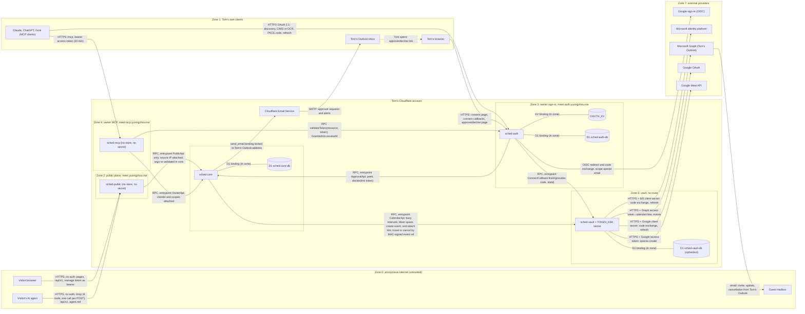

# Option B: Bulkheads (five Workers, one store each)

> **Revision 2 (2026-11-15).** Written against frame revision 2 and the verified review in `review/for-b.md`.
>
> **Plan: Workers Free, with stated triggers to move to Paid.** D1 now needs 7 days, which the free plan gives. On the premise, the free plan is the smaller attack surface: an anonymous flood can only reach a quota that resets at 00:00 UTC, never Tom's card, and no spending limit, billing alert or metered KV exposure has to be managed. It also passes C2. Triggers are under Scaling.
>
> **Findings and what changed**
>
> | Finding | Change |
> |---|---|
> | B1 (S4, must): one POST to public `/mcp` can carry 100 tool calls | `sched-public` rejects any `/mcp` body that is a JSON array (400) before the MCP handler sees it, so one POST is one call and one limiter unit. The core's single-key limiter is split into a read key and a write key with higher ceilings |
> | B2 (R3, must): event could be created long after the only Outlook check | The Outlook check and the event creation are now one attempt: every attempt, first or retried, re-reads Outlook immediately before creating the event. The Meet step no longer sits between them (revised A3) |
> | B3 (A1, should): global caps close booking for everyone | `RL_ALL_WRITE` is deleted. Cancel and reschedule pass only the per-source limiter and the manage token. `pending:all` is sized from L2 × 72 h (120) and, when full, displaces the oldest request of the source holding the most instead of refusing. `requests:all` moves from 200 to 500 a day behind a new per-source cap of 10. Open-request limits are live counts, so declines and expiries free room at once; daily counters are never refunded, stated under Security |
> | B4 (T3, T4, should): budgets left out writes the saga required | The saga now writes twice per booking (claim, finalize) and the vault writes nothing, so the budget lists every write. In-request deadline raised from 2.6 s to 2.9 s. T3 and T4 are scored unknown |
> | Disputed (O1): no route for errors from three Workers | Specified: `reportError(code, message)` on each entrypoint those Workers already hold (`PublicApi`, `OwnerApi`, `ApprovalApi`); the component name is fixed by the entrypoint, the text is capped, and each component is limited to 100 rows a day |
> | Shared S3, F7: waiting requests held slots | A waiting request inserts no `slot_cells` and counts against no slot. Cells are claimed at approval |
> | Shared, R5 and F7: no overlap test or auto-decline at approval | Approval claims the cells in one D1 batch that also declines every other waiting request overlapping it. A request that loses the claim is declined. A second approval of the same request changes nothing and is told so |
> | Shared S4, A3: no event until a Meet link exists | Event is created with the link if Meet answered in time, otherwise without; new `CalendarApi.attachMeetingLink` adds it later; Tom is emailed after 15 minutes |
> | Shared S6: host-scoped WAF rate rule does not exist on a Free zone | Removed from the flood response |
> | Shared S8: Entra registration needs an Azure account and tenant | 10 minutes added to Tom's hands-on estimate |
> | Shared S9: reschedule on approval-mode types; Graph paging | Both specified (Critical path; Data) |
> | Review fact: an expired Entra secret is `invalid_client`, not `invalid_grant` | The vault maps both to a not-healthy status, and the alert email names which |
> | Frame clarification: approval mail must reach Tom's Outlook inbox | The mail binding's fixed destination is Tom's Outlook.com address (`OWNER_MS_EMAIL`), distinct from the Google sign-in identity |
>
> **Not fixed:** nothing in the system can email Tom when the cron or `sched-core` itself is what broke (shared S9); it shows only as a stale "last cron run" in `get_health`. A fault in `sched-mcp` or `sched-auth` still makes `get_health` unreachable (true of any owner path). A phished consent click is mitigated only by the consent page naming the client and redirect URI.
>
> **Machinery removed**
> - The vault's `op_log` table and its two writes per booking. Meet de-duplication is no longer required (R2), and the "vault only touches events it created" rule is now carried by a MAC on the event reference instead of a table.
> - `busy_cache`. One cache (`slot_cache`, 240 s) now carries the R3 staleness; the two stacked 45 s caches are gone.
> - Meet-before-event ordering, `needs_attention` parking with the slot held, and per-step saga persistence (`sync_step`).
> - Slot holds, hold caps and cell clean-up for waiting requests.
> - `RL_ALL_WRITE`, the per-email instant cap, and the vault's stored daily ceiling (replaced by a rate-limit binding that writes nothing).
> - Everything Revision 1 added for the paid plan: spending limit, billing alert, metered-allotment tracking. Access tokens return to 30 minutes and tool schemas are again generated at build time, both for free-plan limits.
>
> **Did the architecture change?** No: the same five Workers, hostnames, bindings and trust zones. Changes are inside them: the order of the booking saga, two fewer tables, three new RPC methods (`attachMeetingLink`, `reportError` on three entrypoints) and MAC-signed event references.
>
> **Revision 1 (2026-11-15, superseded where it conflicts):** moved to Workers Paid for 30-day restore after C1 was corrected to "$5 or less", removed the journal database, shortened tokens to 15 minutes. Revision 2 keeps the journal removal and reverses the rest.

**Premise:** Smallest attack surface and strongest isolation. Anonymous public traffic, the owner's MCP tools and the stored Microsoft and Google credentials live in separate Workers with separate stores and separate hostnames, joined only by narrow, role-specific RPC bindings, so that a flaw in any public-facing part cannot reach owner capabilities or the provider tokens, and every caller holds the least authority it needs.

Basis labels used throughout: **measured**, **calculated**, **stated** (source named), **assumed**. Nothing here is measured on a running system, because nothing is built.

## Summary

The scheduler is five small Cloudflare Workers, not one. `sched-public` is the only thing anonymous visitors and their agents can reach; it holds no database, no key and no secret, and can call exactly one RPC interface (`PublicApi`) on `sched-core`. `sched-auth` is the OAuth authorization server that signs Tom in (Google sign-in pinned to his account) and `sched-mcp` is the owner MCP server; they sit on their own hostnames and reach the core through a different interface (`OwnerApi`). `sched-core` has no internet route at all: it owns the bookings database, the slot rules, the abuse limits and the booking saga. `sched-vault` also has no route: it is the only code that ever sees the Microsoft and Google tokens (encrypted in its own database with a key that exists only as that Worker's secret), and the core can ask it only for busy intervals, for a Meet room, and to create, move or cancel events the vault itself created. A fully compromised public Worker can therefore do nothing to stored data or owner functions that an anonymous caller could not already do, a compromised owner plane cannot read a provider token, and a leaked database contains no usable credential and no usable link. It runs on the Workers Free plan. The price is five deployments, three small databases, three hostnames, extra RPC hops on every request and the largest build of any shape this system could take.

## Components

One repo (`agent-scheduler`), a pnpm workspace with five Worker packages plus two shared packages: `contracts` (TypeScript types for every RPC interface) and `domain` (slot arithmetic, timezone handling, validation). All five Workers set `workers_dev = false` and `preview_urls = false`. Rule that defines the option: **no store is bound to two Workers, and no Worker holds a binding it does not need.**

| Worker | Hostname | Responsible for | Bindings and secrets (complete list) |
|---|---|---|---|
| `sched-public` | `meet.yuxingzhou.me` (Custom Domain) | Booking page, public HTTP API, public MCP endpoint, `agent.md`, manage page. Parses untrusted input, rejects array bodies on `/mcp`, applies per-source rate limits, forwards to core. Built from: Workers static assets, `createMcpHandler` (`agents/mcp`), hand-written router. No third-party scripts. | `CORE` → Service Binding to `sched-core`, entrypoint `PublicApi`. Rate limits `RL_SRC_READ` (60/60 s per source), `RL_SRC_WRITE` (5/60 s per source). Static assets. **No D1, no KV, no secrets.** |
| `sched-auth` | `meet-auth.yuxingzhou.me` (Custom Domain) | OAuth 2.1 authorization server for the owner MCP (`OAuthAuthorizationServer` from `@cloudflare/workers-oauth-provider`): RFC 8414 metadata, CIMD, DCR, token endpoint, consent page, Google sign-in. Also receives the Microsoft and Google connect callbacks and serves the approve/decline page, because these are the only owner-facing browser pages. | `OAUTH_KV` (KV). `AUTH_DB` (D1 `sched-auth-db`, strict daily budgets). `VAULT_CONNECT` → `sched-vault`, entrypoint `ConnectCallback`. `CORE_APPROVAL` → `sched-core`, entrypoint `ApprovalApi`. Rate limit `RL_AUTH_SRC` (20/60 s per source). Secrets: `GOOGLE_SIGNIN_CLIENT_SECRET`. Vars: `OWNER_GOOGLE_EMAIL`, `GOOGLE_SIGNIN_CLIENT_ID`, `ISSUER`, `MCP_SERVER_URL`. Flags: `global_fetch_strictly_public`. One Cron Trigger (daily KV purge). |
| `sched-mcp` | `meet-mcp.yuxingzhou.me` (Custom Domain) | Owner MCP resource server: `OAuthResourceServer` around `createMcpHandler`. Publishes RFC 9728 metadata, rejects requests without a valid token, registers only the tools the token's scopes allow, forwards to core. Tool JSON Schemas are generated at build time. | `AUTH_SERVER` → `sched-auth` default entrypoint (`validateToken`). `AUTH_ADMIN` → `sched-auth`, entrypoint `GrantAdmin`. `CORE` → `sched-core`, entrypoint `OwnerApi`. Rate limit `RL_MCP_SRC` (60/60 s per source, applied before token validation). **No store, no secrets.** |
| `sched-core` | none (no route, no Custom Domain; `fetch` returns 404) | Event types, slot computation, abuse limits, booking state machine and saga, approval tokens, owner notifications, error log, audit log. Exposes three named `WorkerEntrypoint` classes: `PublicApi`, `OwnerApi`, `ApprovalApi`. No outbound `fetch()` to the internet anywhere in its code. | `DB` (D1 `sched-core-db`). `VAULT` → `sched-vault`, entrypoint `CalendarApi`. `OWNER_MAIL` → `send_email` binding with `destination_address` fixed to Tom's Outlook.com address. Rate limits `RL_PUBLIC_READ_ALL` (3,000/60 s, one key) and `RL_PUBLIC_WRITE_ALL` (120/60 s, one key) on `PublicApi` calls. Secret: `LINK_KEY` (HMAC key for manage and approval links). One Cron Trigger (every minute). |
| `sched-vault` | none (no route; `fetch` returns 404) | The only holder of provider credentials. Runs both provider OAuth code exchanges and refreshes; calls Microsoft Graph and the Google Meet API; returns results stripped to what the core needs. Outbound `fetch()` goes through one helper that allows four hosts: `login.microsoftonline.com`, `graph.microsoft.com`, `oauth2.googleapis.com`, `meet.googleapis.com`. | `VAULT_DB` (D1 `sched-vault-db`). Rate limit `RL_VAULT_CREATE` (10 event creations per 60 s, one key). Secrets: `TOKEN_KEK_V1` (AES-256 key; the event-reference MAC key is derived from it), `MS_CLIENT_SECRET`, `GOOGLE_MEET_CLIENT_SECRET`. Vars: `MS_CLIENT_ID`, `GOOGLE_MEET_CLIENT_ID`, `OWNER_MS_EMAIL`, `OWNER_GOOGLE_EMAIL`. **No binding to any other Worker.** |

RPC interfaces (the whole inter-Worker surface):

- `sched-core` `PublicApi`: `getEventType(slug)`, `listEventTypes()`, `findSlots(slug, from, to)`, `requestBooking(input, source)`, `getBooking(manageToken)`, `cancelBooking(manageToken, reason, source)`, `rescheduleBooking(manageToken, newStart, idemKey, source)`, `reportError(code, message)`. Nothing here accepts a booking id, lists bookings, or returns another guest's data.
- `sched-core` `OwnerApi`: one method per owner tool (listed below), plus `reportError(code, message)`. Every call carries `{clientId, scopes}` from the verified token, and core re-checks the scope.
- `sched-core` `ApprovalApi`: `peek(token)`, `decide(token, 'approve' | 'decline')`, `reportError(code, message)`.
- `sched-vault` `CalendarApi` (bound by core only): `getBusy(fromUtc, toUtc, {bookingId})` → `{intervals: [{startUtc, endUtc}], ownEventRef?}`; `createMeetingSpace()` → `{meetingRef, meetingUrl}`; `createEvent(bookingId, {startUtc, endUtc, subject, bodyHtml, attendee, meetingUrl?})` → `eventRef`; `attachMeetingLink(eventRef, meetingUrl)`; `updateEvent(eventRef, {startUtc, endUtc})`; `cancelEvent(eventRef, comment)`; `connectStart(provider)` → consent URL; `disconnect(provider)`; `health({probe})`. An `eventRef` is the Graph event id plus a MAC made by the vault; `attachMeetingLink`, `updateEvent` and `cancelEvent` refuse a reference whose MAC does not verify, so the core cannot point the vault at an event the vault did not create. Every result carries an `errors` array that the core writes to its log.
- `sched-vault` `ConnectCallback` (bound by auth only): `finish(provider, code, state)`.
- `sched-auth` default entrypoint: `validateToken(resource, token)`. `GrantAdmin`: `listGrants()`, `revokeAll()`.

**Error reporting (answers the disputed O1 finding).** `reportError` exists on each of the three entrypoints because those are the only bindings `sched-public`, `sched-mcp` and `sched-auth` hold. The core sets the `component` column from the entrypoint that was called (`public`, `mcp`, `auth`), never from an argument; `code` is one of a fixed list, `message` is cut to 300 characters, and each component may add 100 rows a day (a `counters` key), so a compromised public Worker cannot bury the log. `sched-vault` has no outbound binding; its errors return inside RPC results.

Named entrypoints as role boundaries are the pattern Cloudflare documents: "create a distinct `WorkerEntrypoint` for each permission role" (stated: Workers RPC docs, "Named entrypoints", read 2026-11-14).

### Public HTTP routes (`sched-public`)

| Route | Purpose |
|---|---|
| `GET /` | List of active event types (name, duration, link) |
| `GET /:slug` | Booking page (HTML rendered by the Worker with event details and the copyable line; slots loaded by same-origin JS) |
| `GET /:slug/agent.md` | Agent instructions plus open slots, `text/markdown`. Optional `?from=YYYY-MM-DD` |
| `GET /manage` | Manage page shell; the manage token is in the URL fragment and is sent as a bearer header by page JS |
| `GET /llms.txt` | Pointer to the `agent.md` documents and `/mcp` |
| `GET /api/v1/event-types/:slug` | Public event-type details |
| `GET /api/v1/event-types/:slug/slots?from=&to=&tz=` | Open slots |
| `POST /api/v1/bookings` | Request a booking. `Idempotency-Key` header required |
| `GET /api/v1/booking` | Status of one booking; `Authorization: Bearer <manage token>`; also the "still working" poll |
| `POST /api/v1/booking/cancel`, `POST /api/v1/booking/reschedule` | Guest self-service; bearer manage token |
| `POST /mcp` | Public MCP, stateless Streamable HTTP, no auth. The body must be one JSON object; an array is refused with 400 |
| `GET /assets/*` | Static CSS and JS (served without invoking the Worker; free: stated, Workers pricing) |

Anything else is 404. Bodies over 16 KB are rejected before parsing.

### Public MCP tools (`https://meet.yuxingzhou.me/mcp`, no auth)

| Tool | Purpose |
|---|---|
| `get_event_type` | Public details of one event type: name, duration, location kind, intake questions, timezone, confirmation mode |
| `find_slots` | Open slots for a date range, each with UTC time and an explicit-offset local time |
| `request_booking` | Request a slot with name, email, answers and an `idempotency_key`; returns `confirmed`, `pending_approval`, `still_working` or `slot_taken` with alternatives, plus a manage link |
| `get_booking` | Status of the one booking a manage token refers to |
| `cancel_booking` | Cancel that booking |
| `reschedule_booking` | Move that booking to another open slot |

### Owner MCP tools (`https://meet-mcp.yuxingzhou.me/mcp`, OAuth)

Scopes: `sched.read` (required for any access), `sched.write`, `sched.admin`, `offline_access`. The consent page lets Tom untick `write` and `admin` per client. Tools are registered per request only if the token carries their scope, so a read-only client never sees a write tool (stated: Cloudflare Agents authorization docs, "Permission-based tool access").

| Scope | Tool | Purpose |
|---|---|---|
| read | `list_event_types`, `get_event_type` | Inspect event types |
| read | `list_bookings`, `get_booking` | List by status and date range; inspect one. Guest text only under `guest_supplied` |
| read | `list_blocks` | Show blocked time |
| read | `get_share_line` | The booking page URL and the copyable agent line for an event type |
| read | `get_health` | Connection status, time of the last cron run, bookings still waiting for a Meet link, today's abuse counters, last 50 errors from all five Workers (O1) |
| write | `upsert_event_type` | Create or change: duration, buffers before and after, minimum notice, booking window, daily cap, working hours, timezone, confirmation mode, intake questions, location, slot step (F2) |
| write | `archive_event_type` | Stop offering an event type |
| write | `update_settings` | Owner display name, default timezone and hours, abuse limits |
| write | `approve_booking`, `decline_booking` | Decide waiting requests. Accepts a list of ids, handled in list order |
| write | `cancel_booking`, `reschedule_booking` | Cancel or move a booking; Outlook is updated to match |
| write | `block_time`, `unblock_time` | Block or free an interval |
| write | `retry_booking_sync` | Re-drive a booking whose event or Meet link is still missing |
| admin | `connect_calendar` | Returns the Microsoft consent link |
| admin | `connect_meet` | Returns the Google consent link |
| admin | `disconnect_provider` | Delete a stored provider credential |
| admin | `revoke_all_grants` | Revoke every OAuth grant and token for the owner MCP (S8) |

21 tools.

### The three OAuth flows

1. **Owner sign-in for MCP (Tom → `sched-auth`).** Tom pastes `https://meet-mcp.yuxingzhou.me/mcp` into Claude, ChatGPT or Grok. The client gets 401 with a pointer to `/.well-known/oauth-protected-resource` on `sched-mcp`, which names `https://meet-auth.yuxingzhou.me` as the authorization server; the client reads its RFC 8414 metadata, identifies itself by Client ID Metadata Document or registers through `/oauth/register`, and sends Tom's browser to `/authorize` with PKCE. `sched-auth` shows the library's unframeable consent page (client name, redirect URI, scope checkboxes), then redirects to Google sign-in (`beginUpstream()`; scope `openid email` only; PKCE, state and nonce bound to a `__Host-` cookie). On `/signin/callback` it exchanges the code, verifies the ID token (signature against Google's JWKS, `iss`, `aud`, `exp`, `nonce`), and requires `email_verified`, `email == OWNER_GOOGLE_EMAIL` and `sub` equal to the pinned subject (pinned in KV at the first successful sign-in). Anyone else gets a 403 page and no grant is written. It then calls `completeAuthorization({ userId: "owner", scope, props: { scopes } })`. The Google ID token is discarded; `props` hold no upstream token. Access tokens last 1,800 s (`accessTokenTTL`), refresh tokens rotate (stated: library docs), there is no owner session cookie, so every new authorization passes through Google again.
2. **Microsoft calendar connection (Tom → `sched-vault`).** Tom asks his agent to connect the calendar. `connect_calendar` (scope `sched.admin`) goes `sched-mcp` → `OwnerApi` → `CalendarApi.connectStart('microsoft')`. The vault creates a 256-bit state and a PKCE verifier, stores the state hash with a 10-minute expiry in `connect_states`, and returns a `login.microsoftonline.com/consumers/oauth2/v2.0/authorize` URL (scopes `openid email offline_access Calendars.ReadWrite`, redirect `https://meet-auth.yuxingzhou.me/connect/microsoft/callback`). Tom opens it and consents. The callback lands on `sched-auth`, which passes `(code, state)` unchanged to `ConnectCallback.finish`. The vault checks and burns the state, exchanges the code using `MS_CLIENT_SECRET` and the verifier, requires the ID token's email to equal `OWNER_MS_EMAIL` (so a stolen link cannot attach someone else's calendar), encrypts the refresh token and stores it. `sched-auth` never sees a token; it sees a one-time code that is useless without the vault's secret and verifier.
3. **Google connection for Meet (Tom → `sched-vault`).** Same shape through `connect_meet`: `accounts.google.com/o/oauth2/v2/auth`, scopes `openid email https://www.googleapis.com/auth/meetings.space.created`, `access_type=offline`, `prompt=consent`, redirect `.../connect/google/callback`, account pinned to `OWNER_GOOGLE_EMAIL`. It uses a second Google OAuth client (`GOOGLE_MEET_CLIENT_ID`), distinct from the sign-in client, so the secret that lives in the internet-facing `sched-auth` can obtain nothing but an identity assertion.

### The one copyable line (F5 and F6)

The booking page and `get_share_line` both produce one line, for example:

> Book "Intro call (30 min)" with Tom Zhou: fetch https://meet.yuxingzhou.me/intro-30/agent.md and follow it. MCP server, no login: https://meet.yuxingzhou.me/mcp (event type `intro-30`).

`agent.md` is one plain-text document that serves all three kinds of agent:

- **MCP-capable agent (F5):** the line and the document give the MCP URL and the event-type slug; the six public tools do the rest.
- **HTTP-capable agent (F5):** the document gives the two calls with a worked example: `GET /api/v1/event-types/intro-30/slots` and `POST /api/v1/bookings` with a JSON body and an `Idempotency-Key` it generates. No key, no login.
- **Fetch-only agent (F6):** the same document already contains the open slots for the next 14 days (UTC and the event's zone, explicit offsets), each with a ready link such as `https://meet.yuxingzhou.me/intro-30#t=2026-11-20T15:00:00Z`, and "next page" links for later dates, so the agent needs no second request it has to construct. It is told to append `&name=…&email=…` to the fragment and hand the link to the visitor. The page reads the fragment in the browser, preselects the slot, prefills the form, and the visitor clicks **Confirm** once. A `GET` never books anything, so an agent or link scanner that fetches the link has no effect, and name and email stay in the fragment until the visitor confirms.

### Approval emails

`sched-core` writes an `outbox` row in the same D1 batch that records the waiting request; the outbox is drained in the request's `waitUntil` and again by the minute cron. Mail goes through the `send_email` binding `OWNER_MAIL`, whose `destination_address` is fixed to Tom's Outlook.com address (the frame's clarification: approval requests and alerts arrive in his Outlook inbox), so no code path in the system can email anyone else (stated: Email Service "Send bindings" docs; sending to a verified destination address is free on every plan: stated, Email Service pricing). The email shows the request (guest text HTML-escaped and labelled as guest-supplied), says how many other requests are waiting on an overlapping time, and carries two links, `https://meet-auth.yuxingzhou.me/decide#t=<token>&d=approve` and `…&d=decline`. The token is in the fragment, so mail scanners that prefetch the link send nothing to the server. The page posts the token to `/decide/peek`, shows the request, and Tom presses one button, which posts to `/decide/commit` → `ApprovalApi.decide`. If the request was already decided, by the other link, by his agent, or automatically because an overlapping request was approved, the page says which and when, and nothing else happens. The first five waiting requests of a day send one email each; after that they are batched into one digest per hour (numbers assumed).

## Diagram

## Critical path

The most important request is an **instant booking** (drivers 2 and 3; scenarios F4, F5, R1, R2, R3, A3, T3, S5). It is the same path whether it arrives from the web form, `POST /api/v1/bookings` or the `request_booking` tool. Budget from `capacity.py` on `b.assumptions.json`; the frame's T3 is a p95 of 3 s and I hold the p99 to the same number.

| # | Hop | What happens | p99 budget (ms) |
|---|---|---|---|
| 1 | `sched-public` | Method and size check, JSON schema validation, `RL_SRC_WRITE` | 30 |
| 2 | RPC → `sched-core` `PublicApi.requestBooking` | Core re-validates every field (it does not trust the public Worker), caps and strips guest text | 10 |
| 3 | D1, two round trips (**write 1 of 2**) | (a) Conditional `UPDATE`s on `counters` decide instant or approval mode (S5) and enforce the event type's daily cap. (b) One `db.batch()`: insert `bookings` row (`claimed`), insert one `slot_cells` row per 5-minute cell of the slot plus buffers, delete affected `slot_cache` rows. A primary-key conflict on any cell aborts the batch: "slot taken" (R1). A conflict on the idempotency key returns the existing booking (R2) | 300 |
| 4 | RPC → `sched-vault` `CalendarApi` | | 10 |
| 5 | `sched-vault` | Read and decrypt both access tokens from `sched-vault-db` (refresh first if within 5 minutes of expiry). The vault writes nothing on this path | 150 |
| 6 | In parallel | Microsoft Graph `calendarView` for the slot plus buffers, uncached (the R3 commit re-check); Google Meet `spaces.create` with `config.accessType = OPEN`. The Meet call is abandoned at 900 ms and the booking goes on without a link | 900 |
| 7 | Microsoft Graph | `POST /me/events` with the guest as attendee, `transactionId = <booking id>`, and the Meet link in body and location if hop 6 produced one. Graph sends the invite | 1,200 |
| 8 | D1 (**write 2 of 2**) | Finalize batch: status `confirmed`, `calendar_event_ref`, `meeting_url` or `meet_state = 'pending'`, audit row | 150 |
| | **Total** | **2,750 of 3,000 ms; 250 ms headroom** (calculated from assumed hop budgets) | |

This table now lists every write the recovery design needs: there are two, and neither sits between the Outlook check and the event. Fan-out 2 at hop 6: 2.0% of requests wait on a call slower than that provider's own p99 (calculated). If the in-request deadline of 2.9 s passes at any point after hop 3, the guest gets `202 still_working` with the manage link, the work continues in `waitUntil`, and the minute cron picks up anything left. The slot is already claimed, so a retry or a second click cannot make a duplicate. The three provider figures (900, 900, 1,200 ms) are guesses; if any one is twice as slow the request is over 3,000 ms and answers `still_working`. T3 is therefore scored unknown.

The isolation costs about 330 ms of this budget that a single-Worker design would not spend: two RPC hops (20 ms), a second D1 database read for tokens (150 ms), and the split of counters and claim into two D1 round trips so that the core, not the public Worker, owns the limit decision (about 150 ms) (assumed).

Other budgets from the same run (all calculated from assumed hop budgets): page view 840 of 1,000 ms; slot lookup 1,310 of 1,500 ms; guest cancel or reschedule 2,750 of 3,000 ms; owner MCP worst tool (`approve_booking`) 2,980 of 3,000 ms; public agent slot call 1,330 of 1,500 ms; refused flood request 20 of 100 ms.

### Booking write order and recovery

State lives in `bookings.status` and `bookings.meet_state`. A 30-second lease column lets only one driver (the request, its `waitUntil`, or the cron) work on a booking at a time. An **attempt** is hops 6 and 7 together: read Outlook, then create the event. Nothing is persisted inside an attempt, so a retried attempt always starts with a fresh Outlook read (this closes finding B2).

| Step | Action | If it fails |
|---|---|---|
| 0 claim (instant) | D1 batch as in hop 3. Status `claimed` | Cell conflict → `slot_taken` and three nearest alternatives. Idempotency hit → return the stored outcome. D1 down → 503, nothing written |
| 1 attempt: check | `getBusy(window, {bookingId})`: a fresh Graph read. The vault drops the booking's own event from the result (matched by `transactionId`) and returns it as `ownEventRef` if it is there | Busy → one batch deletes the cells and sets `rejected_conflict`; answer `slot_taken`. Graph unreachable → status stays `claimed`, answer `still_working`, the cron repeats the whole attempt each minute; no event is ever created without a check in the same attempt (A2, R3) |
| 1 attempt: Meet, in parallel | `createMeetingSpace()` | Slow or failed → continue with no link, `meet_state = 'pending'` |
| 2 attempt: event | If `ownEventRef` came back, an earlier attempt already created the event: use it and skip creation. Otherwise `createEvent(bookingId, …)` with `transactionId` = booking id | Retry is a new attempt from step 1. One invite rests on two things: the own-event lookup in step 1, and Graph's `transactionId` guard (stated purpose: Graph docs; its duration is not documented) |
| 3 finalize | D1 batch: `confirmed`, refs, audit row | Retried by cron; the next attempt finds `ownEventRef` and only finalizes |
| Meet follow-up | Only if `meet_state = 'pending'`: each minute the cron calls `createMeetingSpace()`, then `attachMeetingLink(eventRef, url)`, then stores the URL | After 15 minutes still without a link: `meet_state = 'failed'`, Tom is emailed (A3). The booking stays confirmed; `retry_booking_sync` tries again. A retry may leave an unused Meet room, which R2 now accepts |

**Approval mode (F7, R5).** Step 0 writes the `bookings` row as `pending_approval` with `expires_at` = now + 72 h and an `outbox` row. It inserts **no cells**, runs no provider call, and the time stays on offer to everyone else, so several requests can wait on one time. The request must still be for a slot that is open at that moment by the normal slot rules.

Deciding, from the tool or the email link, is the same core function:

1. `UPDATE bookings SET status = 'approving' WHERE id = ? AND status = 'pending_approval'`. If no row changed, the request was already decided: return `{ already_decided, decision, decided_at }` and stop. This makes a second approval of the same request a no-op: one event, one invite (R5).
2. One `db.batch()`: insert the request's `slot_cells`; set it to `claimed`; set every other `pending_approval` row whose held interval overlaps this one to `declined` with reason `superseded`. If a cell is already taken, by a booking or by another request approved a moment earlier, the batch aborts and the request is set to `declined` with reason `slot_taken`. Two overlapping requests therefore cannot both be approved (R5), and approving one declines the rest (F7), in the same transaction.
3. The normal attempt (steps 1 to 3 above), including the fresh Outlook check. If Outlook is now busy, the request ends `rejected_conflict` and Tom is told in the tool result or on the page.

`approve_booking` with a list handles the ids in order; a later id that overlaps an earlier one comes back `declined (superseded)`. A crash between 1 and 2 leaves `approving`, which the cron completes. Decline, or the cron finding `expires_at` passed, sets `declined` or `expired`; there is nothing to release. Guests of declined requests are not emailed (the only mail binding reaches Tom alone); their manage link shows the outcome.

**Cancel:** status `cancelling` → `cancelEvent` (Outlook sends the cancellation: stated, Graph docs) → delete cells, `cancelled`. **Reschedule, instant event types:** claim the new cells under the same booking id → fresh `getBusy` for the new time → `updateEvent` → swap times and delete the old cells; any failure before the Graph update releases the new cells and leaves the booking untouched. Whether Outlook mails the guest for a plain time change is not confirmed by the Graph page (review, 2026-11-15) and is checked in build step 3. **Reschedule by a guest on an approval-mode event type:** it files a new waiting request with `reschedule_of` set; the existing booking stays as it is; on approval the existing event is moved with `updateEvent` instead of a new one being created. Tom's own `reschedule_booking` moves it at once.

## Data

| Store | Bound to | Tables / keys (key columns) | Consistency a read gets |
|---|---|---|---|
| D1 `sched-core-db` | `sched-core` only | `settings(key PK, value_json)`. `event_types(id PK, slug UNIQUE, name, duration_min, buffer_before_min, buffer_after_min, min_notice_min, window_days, daily_cap, working_hours_json, timezone, confirmation_mode, intake_questions_json, location_kind, location_text, slot_step_min, active)`. `bookings(id PK uuid, event_type_id, status, meet_state, start_utc, end_utc, hold_start_utc, hold_end_utc, guest_name, guest_email, guest_tz, guest_notes, answers_json, idem_key_hash UNIQUE, source_hash, channel, downgraded, reschedule_of, decline_reason, calendar_provider, calendar_event_ref, meeting_provider, meeting_ref, meeting_url, attempts, next_attempt_at, lease_until, expires_at, decided_at, last_error, created_at, updated_at)` with a partial unique index on `(event_type_id, start_utc, guest_email)` for live statuses, an index on `(status, next_attempt_at)` and one on `(status, hold_start_utc)`. `slot_cells(cell PK = unix time / 300, booking_id)`, written only for `claimed`, `confirmed` and `cancelling` bookings. `blocks(id PK, start_utc, end_utc, reason)`. `counters(day, key, n, PK(day, key))`. `slot_cache(event_type_id, bucket_start, computed_at, slots_json, PK(event_type_id, bucket_start))`. `outbox(id PK, kind, payload_json, done_at, attempts)`. `errors(id PK, at, component, code, message, booking_id)` kept 30 days. `audit(id PK, at, actor, action, target, detail_json)` kept 90 days. `health(component PK, status, checked_at, detail)` | Strong: one primary, every read and write goes to it. `db.batch()` is a transaction (stated: D1 Worker API docs) |
| D1 `sched-vault-db` | `sched-vault` only | `provider_tokens(provider PK, account_sub, account_hint, refresh_ct, refresh_iv, access_ct, access_iv, access_expires_at, key_version, scopes, status, last_ok_at, last_error)`. `connect_states(state_hash PK, provider, verifier_ct, expires_at, used_at)` | Strong |
| D1 `sched-auth-db` | `sched-auth` only | `budget(day, key, n, PK(day, key))` | Strong |
| KV `OAUTH_KV` | `sched-auth` only | The library's clients, grants and tokens (tokens and codes stored as hashes, `props` encrypted: stated, library storage schema), plus `owner:sub` | Eventual: a write can take 60 s or more to be seen at other locations (stated: KV docs). This bounds how fast a revocation takes effect |

How data moves:

- Times are stored as UTC instants. Working hours are stored in the event type's IANA zone and converted per day, so a slot across a daylight-saving change is computed from that day's offset. Every time returned carries `start_utc`, a local time with explicit offset, and the zone name (R4). Graph events are written with `timeZone: "UTC"`.
- Slot lookups read `slot_cache` (per event type, per ISO-week bucket). A bucket older than 240 s is recomputed from `event_types`, the intervals of bookings that hold cells, `blocks`, and a fresh `CalendarApi.getBusy` for that week. Any write that adds or removes cells deletes the affected `slot_cache` rows in the same batch. Displayed slots are therefore at most 240 s behind Outlook, inside R3's 5 minutes, and every booking attempt re-reads Outlook before it creates the event. Waiting requests are not subtracted from the slots.
- The vault asks Graph only for `start`, `end`, `showAs`, `isCancelled`, `isAllDay` and `transactionId`, with `$top=100`, and follows `@odata.nextLink` for up to 5 pages per week bucket; a bucket with more than 500 events is treated as unreadable and offers no slots (limits assumed). It returns only merged intervals. Event titles and attendees are never fetched, so they cannot leak from any Worker (S2).
- Guest name and email pass through the vault once, to build the invite, and are not stored there. The vault stores nothing per booking.
- Manage and approval tokens are not stored. A manage token is `base64url(booking_id ‖ HMAC-SHA256(k_manage, booking_id)[0..16])`; an approval token adds the expiry time and uses `k_approve`; both keys are derived from `LINK_KEY`. A database leak therefore yields no working link.
- Backup: each database is covered by D1 Time Travel, 7 days on the free plan (stated: D1 limits), which is what D1 now asks. Tom's Outlook calendar is the record of confirmed meetings: every confirmed booking is an Outlook event carrying the booking id. A booking confirmed after the restore point keeps its event, invite and Meet link and loses its scheduler row and manage link, which the frame accepts. Because event references are verified by MAC and not by a table, a restore of either database leaves the vault able to move or cancel every event whose reference the core still holds.

## Scaling

**How "instances" map to Workers.** There are no instances to size or buy. Cloudflare starts isolates on demand at each location; I mapped one script "instance" to one isolate able to hold 50 I/O-bound requests at once (assumed), with `min_instances` 1 and `instance_month` 0. The "Instances" column is therefore informational; the useful numbers are requests per day against free-plan quotas and "in flight at peak". At L2 the busiest workload has 0.12 requests in flight at peak and at ten times L2 it has 1.16 (calculated). Compute is not a bottleneck at any load in the frame.

Quotas at L2 and at 10x (requests calculated from the frame's assumed load; limits stated by Cloudflare's limits and pricing pages, read 2026-11-14):

| Quota (Workers Free) | Limit | L2 | L2 on a flood day (S4) | 10x | 10x on a flood day |
|---|---|---|---|---|---|
| Worker requests per day, account-wide (2,225 public and owner requests + 1,440 cron runs; static assets free; Service Binding calls assumed not counted) | 100,000 | 3,665 (3.7%) | 13,665 (14%) | 23,690 (24%) | **123,690 (124%)** |
| D1 rows written per day (assumed row counts) | 100,000 | about 3,700 | same | about 25,000 | same |
| D1 rows read per day (assumed: 2 rows on a cache hit, about 160 on a recompute) | 5,000,000 | about 250,000 | about 270,000 | about 2,500,000 | about 2,700,000 |
| D1 database size | 500 MB each, 5 GB total | 483.6 MB after 5 years with nothing pruned (calculated by the script); about 137 MB with `audit` at 90 days (calculated from the frame's assumed bytes) | | **4.84 GB unpruned; about 1.4 GB pruned, past 500 MB after about 2 years** | |
| KV writes per day | 1,000 | at most 652 (3 clients × 48 refreshes × 3 writes + DCR budget 20 + authorize budget 100 × 2; writes per operation assumed) | same | same bound | same |
| CPU per invocation | 10 ms | not measured; see below | | | |
| Cron Triggers per account | 5 | 2 used | | 2 | |

A flood day adds only refused requests: one POST is one call (array bodies are refused before the MCP handler runs), and a refused request stops in `sched-public`.

**First bottleneck: the account-wide 100,000 requests per day, reached only by a flood ten times the frame's S4.** It bites at about 100,000 requests a day in total, because a refused request still invokes `sched-public`. When it bites, every Worker on the account returns error 1027 until 00:00 UTC (stated: Workers limits). Nothing is billed. What is done then: Tom blocks the source address with a WAF custom rule (assumed available on a Free zone; not checked), and if it happens twice in a month the account moves to Workers Paid. The free WAF rate-limiting rule is not used: on a Free zone it cannot be scoped to a hostname (stated: WAF docs, re-checked by the review), so it would also throttle Tom's personal website.

**Second bottleneck: the 500 MB per-database cap**, at about 2 years of 10x load with pruning (calculated from assumed row sizes). Then: delete bookings older than a year, or move to Paid (10 GB per database).

**CPU.** The free plan allows 10 ms of CPU per invocation, not counting time waiting on the network (stated: Workers limits). Each Worker parses one request and does a few hash or AES operations. The heaviest is `sched-mcp` building 21 tool definitions per request; their JSON Schemas are generated at build time to keep it under the limit (assumed; measured in build step 1).

**Triggers to move to Workers Paid ($5.00 a month, still inside C1):** build step 1 measures any Worker over 8 ms CPU at p99; the daily request cap is reached twice in one month; `sched-core-db` passes 400 MB. Moving is a billing change only; no binding or code changes. On Paid a flood can cost money, so the move also means setting a Workers spending limit, which is account-wide and does not cover KV (stated: spending-limit docs).

**L3** (20 times average for an hour) is 1,854 requests in that hour (calculated), far below every limit. The S5 global cap of 10 instant bookings a day will be hit on such a day; later requests wait for approval as the frame specifies.

Provider limits: at most one Graph read per event type per week bucket per 240 s whatever the traffic (so at most about 3,200 a day for one event type with a 60-day window: calculated), plus two Graph calls and one Meet call per booking.

## Failure behaviour

| Component or dependency | Down | Slow |
|---|---|---|
| `sched-public` | Booking page and public API return Cloudflare errors. Owner MCP, approvals and already-running sagas are unaffected (different Workers) | Pages slow; nothing else affected |
| `sched-core` or `sched-core-db` | Public: "try again shortly" (503 with `Retry-After`) from `sched-public`. Owner tools return a tool error naming the component. No booking is half-written: the claim is one transaction. The cron lives here, so nothing can email Tom about this failure; it shows as a stale "last cron run" once `get_health` answers again (not fixed) | Requests over the 2.9 s deadline before the claim return 503; after the claim they return `still_working` |
| `sched-vault` or `sched-vault-db` | Same visible behaviour as "Graph unreachable" below; the core cannot tell the difference and does not need to | Same as slow Graph |
| `sched-auth` or `OAUTH_KV` | Owner MCP returns 401/503; Tom cannot sign in or refresh, and `get_health` is unreachable. Approval links fail. Public booking is unaffected; waiting requests still expire on schedule | Owner calls slow |
| `sched-mcp` | Owner tools unavailable, including `get_health`; Tom can still approve by email link, and alert emails still arrive. Public booking unaffected | Owner calls slow |
| Microsoft Graph unreachable | Slot lookups: served from `slot_cache` if under 240 s old, otherwise "try again shortly" and no slots (A2). Instant bookings already claimed: `still_working`, the attempt repeats each minute, never confirmed without a fresh check; after 15 minutes Tom is emailed and the slot stays claimed until the attempt succeeds or he cancels. Approval-mode requests are still accepted and wait | A lookup that would exceed 1.5 s is cut off and answered as unreachable; bookings go to `still_working` |
| Outlook connection not healthy: refresh token revoked or expired (`invalid_grant`), or the Entra client secret expired (`invalid_client`, AADSTS7000222) | The vault marks the provider `revoked` or `secret_expired`; the core emails Tom on the status change, naming which, at the latest at the next 15-minute probe (A4). Until fixed, lookups return `mode: "request_only"`: times from working hours and local bookings, marked unconfirmed; every request is stored as a waiting request, reserves nothing, and sends nothing. Tom reconnects with `connect_calendar`, or replaces the secret; approving re-checks Outlook | n/a |
| Google Meet API down, or Google connection revoked | Bookings are confirmed and the invite goes out without a link; the body says the link will follow. The cron retries each minute and adds the link with `attachMeetingLink`; after 15 minutes Tom is emailed (A3). On `invalid_grant` or `invalid_client` the email goes at once (A4) | The Meet call is abandoned at 900 ms inside the request; same follow-up |
| Google sign-in (OIDC) down | Tom cannot start a new authorization. Existing grants keep refreshing | Sign-in slow |
| Cloudflare Email Service down | Approval and alert emails queue in `outbox` and retry each minute; waiting requests remain visible through `list_bookings`; `get_health` shows the mail backlog | Same |
| Cron Trigger missed | Attempts, Meet follow-ups, expiries and outbox wait for the next minute. Expiry is also checked on read. `get_health` shows the time of the last run | n/a |
| Daily request quota reached (flood beyond S4) | Every Worker on the account returns error 1027 until 00:00 UTC (stated). Nothing is billed | n/a |
| A bad release of one Worker | Only that Worker's zone is affected; `npm run rollback` reverts all five to the last recorded versions | n/a |

## Security

**Trust boundaries.** Eight zones, drawn above. Hostname, Worker and trust zone coincide: `meet` is anonymous, `meet-auth` is owner sign-in, `meet-mcp` is owner tools; core and vault have no hostname. Separate origins mean a script-injection flaw on the public page cannot read cookies of, or send credentialed requests to, the consent page.

**Authentication and authorization at each hop.**

| Hop | Authenticated by | Authorized to |
|---|---|---|
| Anyone → `sched-public` | Nothing (by requirement) | Public event-type details, open slots, request a booking within the S4 and S5 limits |
| Guest → own booking | Manage token (128-bit MAC over a random UUID), verified in the core | That one booking: view, cancel, reschedule (S3). No endpoint accepts a bare booking id |
| `sched-public` → `sched-core` | The Service Binding itself, fixed to entrypoint `PublicApi` in Wrangler config | The eight `PublicApi` methods. Core re-validates all input and applies global limits that do not depend on anything the public Worker says |
| MCP client → `sched-mcp` | OAuth access token, audience-bound to `https://meet-mcp.yuxingzhou.me/mcp`, validated by `sched-auth` on every request | Tools of the granted scopes only |
| Tom → `sched-auth` | Google ID token with pinned `sub` and email, after consent (S1) | Issue a grant with the scopes he ticked |
| `sched-mcp` → `sched-core` | Binding fixed to `OwnerApi` | Owner operations; core re-checks scope per method |
| Email link → `sched-auth` → `sched-core` | Approval token: MAC over booking id and expiry | Approve or decline that one request while it is waiting and unexpired (S9). The state change is a conditional update, so the link works once |
| `sched-core` → `sched-vault` | Binding fixed to `CalendarApi` | Busy intervals; create events (at most 10 per 60 s, approximate); attach a link to, move or cancel only events whose reference carries the vault's MAC; never a token, a title or an attendee |
| `sched-auth` → `sched-vault` | Binding fixed to `ConnectCallback` | Hand over a `(code, state)` pair. Useless without a state the vault issued in the last 10 minutes |
| `sched-vault` → Microsoft, Google | Client secrets and tokens held only in the vault | `Calendars.ReadWrite` on one Outlook account; `meetings.space.created` on one Google account. No mail, files or contacts scope is ever requested |

**What a full compromise of each part yields** (the test of the premise):

| Compromised | Attacker gains | Attacker still cannot |
|---|---|---|
| `sched-public` (for example through its MCP or parsing dependencies) | Guest details and manage tokens of requests passing through while compromised; the ability to submit requests and lie about their source | Read any stored booking, reach an owner tool, approve anything, read a provider token, email anyone. Bookings stay inside the core's global caps: 10 instant a day, 500 stored requests a day, 120 waiting at once (last two assumed) |
| `sched-mcp`, or a stolen owner access token | Owner tools. For a stolen token: only its scopes, until it expires (30 minutes) or `revoke_all_grants` takes effect (about 60 s). For the Worker itself: until it is redeployed | Read a provider token; read Outlook event details; send more than the core's 50 invites a day (assumed ceiling, applies to every actor) |
| `sched-auth` | Ability to mint owner grants, so everything `sched-mcp` has | Provider tokens; anything in the vault |
| `sched-core` | All booking data and guest details; ability to create events at up to 10 a minute | Read tokens; read, change or delete any Outlook event the scheduler did not create (no valid MAC); email anyone but Tom |
| `sched-vault` | The Microsoft and Google tokens, limited to calendar read/write and Meet-space creation | Bookings database, owner tools |
| `sched-core-db` contents leak | Guest names, emails, notes, booking times | Any credential; any working manage or approval link (keys are Worker secrets) |
| `sched-vault-db` contents leak | AES-256-GCM ciphertext | The tokens: the key is `TOKEN_KEK_V1`, a secret of `sched-vault` only (S7) |
| `OAUTH_KV` contents leak | Hashes and encrypted props | A usable owner token (stated: library storage schema) |

**Abuse limits (S4, S5).** Three layers, the last one authoritative.

1. `sched-public`: an array body on `/mcp` is refused, so every POST is one tool call. Rate Limiting bindings per source (IPv4 address or IPv6 /64): 60 reads and 5 writes per 60 s. These are approximate and per Cloudflare location (stated: Rate Limiting binding docs), so they shed load but are not relied on for the S5 numbers. There is no global write limiter in front of the core any more; cancel and reschedule need a valid manage token and pass only the per-source limiter.
2. `sched-core`, on `PublicApi` calls: two single-key Rate Limiting bindings, 3,000 reads and 120 writes per 60 s. They exist for one case, a public Worker that has stopped limiting, and are set so that honest traffic needs 50 sources at their own read limit, or 24 at their write limit, to reach them (calculated).
3. `sched-core`, strict, in D1.
   - **Daily counters**, by `UPDATE counters SET n = n + 1 WHERE day = ? AND key = ? AND n < ?` and a check that one row changed: `instant:src:<hash>` (5), `instant:all` (10), `requests:src:<hash>` (10 a day, assumed), `requests:all` (500 a day, assumed: 25 times L2), `invites:all` (50 a day, assumed). Daily counters are never refunded: a booking that is later cancelled, declined or rejected still counts until 00:00 UTC.
   - **Open-request limits**, by counting rows with status `pending_approval` at request time, so a decline or an expiry frees room at once: 3 per source (assumed) and 120 in total (assumed: six days of L2 volume if every request waited, twice the 60 that 72 hours of L2 can produce).
   - A request that fails an `instant:*` test is stored as a waiting request with `downgraded = 1` and sends nothing to anyone but Tom. A request that fails `requests:src` or the per-source open limit gets 429. When the total of 120 is full, a new request is still accepted and the oldest waiting request of whichever source holds the most is set to `expired` with reason `displaced`; a source that floods the queue therefore pushes out its own requests first. Only `requests:all` refuses everyone, and reaching it takes 50 sources each at their daily limit; that residual is accepted.
   - SQLite runs one write at a time, so the counters are exact (calculated from the statement's semantics). Source addresses are stored only as a hash salted per day.

Waiting requests reserve nothing, so filling the queue no longer takes any time off the page; what it costs Tom is email, which the hourly digest bounds.

Reads cannot amplify: slot answers come from `slot_cache`, so a flood of lookups costs about two row reads each, and Graph is called at most once per bucket per 240 s. On the free plan there is no metered charge to run up; the worst outcome of any flood is the daily quota cut-off described under Scaling, not a bill (stated: Workers Free limits).

The owner plane has its own strict budgets in `sched-auth-db` because its endpoints are also reachable anonymously: 20 dynamic client registrations a day (through the library's `clientRegistrationCallback`), 100 authorization starts a day, 100 approval-link attempts a day (all assumed). These protect the 1,000 KV writes a day and keep anonymous callers from filling the owner's auth store.

There is deliberately no Turnstile or CAPTCHA: agents cannot solve one, the HTTP API has to stay open for F5, and a third-party script on the page would enlarge the surface this option exists to shrink.

**Guest text (S6).** Name is capped at 80 characters, notes and each answer at 500, control characters stripped, in the core. Owner tools return it only inside `guest_supplied: { name, email, notes, answers }` next to a fixed notice that the content was typed by an unauthenticated guest. It is never placed in a tool description, an error message or an event-type field, and no server code branches on its content (K7).

**Secrets and sensitive data.**

| Secret | Lives in | Used for |
|---|---|---|
| `TOKEN_KEK_V1` | `sched-vault` secret | AES-256-GCM over provider tokens (`key_version` column allows rotation); the event-reference MAC key is derived from it |
| `MS_CLIENT_SECRET`, `GOOGLE_MEET_CLIENT_SECRET` | `sched-vault` secrets | Provider code exchange and refresh. The Microsoft secret lasts at most 24 months (stated: Entra docs, re-checked by the review); `get_health` reports its age and Tom is emailed 30 days before it lapses |
| `GOOGLE_SIGNIN_CLIENT_SECRET` | `sched-auth` secret | Owner sign-in; grants identity only |
| `LINK_KEY` | `sched-core` secret | Manage and approval link MACs |
| Owner access and refresh tokens | Chat clients; hashes in `OAUTH_KV` | 30-minute access tokens; `revoke_all_grants` removes every grant (S8) |

Browser hardening: `Content-Security-Policy: default-src 'none'; script-src 'self'; style-src 'self'; connect-src 'self'; form-action 'self'; frame-ancestors 'none'; base-uri 'none'` on both HTML hosts, `Referrer-Policy: no-referrer`, HSTS, `__Host-` cookies only on `meet-auth` and only for the minutes a sign-in takes. Logs never contain tokens, guest text or raw source addresses.

**Tenants.** One owner; there are no tenants to isolate. Guests are isolated from each other by the manage token and by the absence of any list or lookup-by-id method on `PublicApi`.

**Considered and not taken.** Cloudflare Access in front of `meet-auth` would stop anonymous callers before `sched-auth` runs at all, which is stronger still; it is left out to keep Tom's setup to steps only he can do and because the pinned Google sign-in already refuses everyone else (assumed sufficient).

## Cost

Unit prices are zero on the Workers Free plan, so the script's total is 0 at L2 and at 10x (calculated; `instance_month`, `storage_gb_month`, `egress_gb` all 0 because Cloudflare bills none of them on this plan: stated, Workers pricing: "no additional charges for data transfer").

| Item | L2, per month | 10x, per month | Basis |
|---|---|---|---|
| Worker requests (5 Workers; Service Binding calls not billed) | $0: 3,665 a day of 100,000 | $0: 23,690 a day of 100,000 | calculated; quota and binding rule stated (Workers pricing) |
| D1 (3 databases of 10 allowed; rows and storage) | $0: about 137 MB after 5 years, pruned | $0 until `sched-core-db` passes 500 MB (about year 2); then prune, or move to Paid | calculated from assumed row sizes; limits stated (D1 limits) |
| KV | $0: at most 652 writes a day of 1,000 | $0, same bound | calculated from assumed writes per operation |
| Email to Tom's verified Outlook address | $0 | $0 | stated (Email Service pricing) |
| Rate Limiting bindings, Cron Triggers (2 of 5), Custom Domains, certificates, egress (0.84 GB and 8.41 GB) | $0 | $0 | stated (Workers limits, pricing); egress volume calculated |
| Microsoft Graph, Google Meet API, Google sign-in | $0 | $0 | assumed (no charge for these APIs at this volume) |
| Azure account for the Entra app registration | $0 | $0 | assumed (an app registration itself is not billed; the account needs an active subscription: stated, Entra quickstart) |
| **Total** | **$0** | **$0** | calculated |
| If a trigger under Scaling moves the account to Workers Paid | $5.00 | $5.00 | stated (Workers pricing: $5 minimum); inside C1 |

## Operations

**What is deployed.** Five Workers (deploy order: vault, core, auth, mcp, public, because each binds to the ones before it), three D1 databases with migrations, one KV namespace, three Custom Domains, Email Routing on the zone with Tom's Outlook address as a verified destination, two Cron Triggers. `npm run deploy` does all of it and records the five version ids in `deploy-log.json`.

**Rollback.** `npm run rollback` runs `wrangler rollback` for the five Workers to the previous recorded set, in reverse order. Schema changes are additive only (new columns and tables first, removal one release later), so the previous code always runs against the current schema. Time: about 1 minute for five rollbacks (assumed), inside O2's 5 minutes. The RPC contracts are the thing to watch: a release that changes a method signature must deploy the callee first and keep the old method for one release.

**Restore.** `wrangler d1 time-travel restore sched-core-db --timestamp <time>` returns a database to any minute of the last 7 days and prints a bookmark that undoes the restore (stated: D1 Time Travel docs; 7 days on the free plan). The same command covers the other two databases. One command per database; under 1 hour is assumed and rehearsed on a scratch database in build step 4. Bookings confirmed after the restore point remain in Outlook and lose their scheduler row, as D1 now allows.

**Monitored.** `get_health` is the one pane: provider connection status and last successful call, time of the last cron run, oldest unfinished attempt, bookings waiting for a Meet link, outbox backlog, today's counters against each limit, today's request count as seen by the core, age of the Microsoft client secret, last 50 rows of `errors` from all five Workers (through `reportError` and the vault's RPC results). Workers Logs is on for all five.

**What pages someone.** Nothing pages. Tom gets an email in his Outlook inbox when: a provider connection is revoked, expired, or its client secret has expired (A4); a booking has had no Meet link for 15 minutes (A3); an instant booking has been unable to check Outlook for 15 minutes; the outbox is over 15 minutes behind; a daily limit is reached for the first time that day; a provider refresh token was last used over 60 days ago; the Microsoft client secret is within 30 days of expiry. If email itself is down, the same facts are in `get_health`. If the cron or the core is down, nothing sends (not fixed).

**Routine work.** The 15-minute probe refreshes both provider tokens, which keeps Microsoft's 90-day rolling refresh token (stated: Entra refresh-token docs) and Google's six-month idle limit (stated: Google OAuth docs) from lapsing. `sched-auth`'s daily cron runs the library's `purgeExpiredData()`.

## Build and rollout

**Effort.** Built by Claude in one pass (K8). Rough size: 6,900 lines of TypeScript and 2,300 of tests across seven packages (assumed; about 300 fewer than revision 1 after removing the op log, the second cache, hold handling and per-step saga state, net of the approval claim and `attachMeetingLink`), about 1.4 times a single-Worker build of the same features (assumed), the extra being contracts, five Wrangler configs, double validation at each boundary, and multi-Worker integration tests.

**Order.**

1. Walking skeleton: five empty Workers with all bindings, the library's split-Worker example on `meet-auth` and `meet-mcp`, one `whoami` tool with all 21 tool schemas registered. Add it as a connector in Claude, ChatGPT and Grok. Measure CPU per invocation. This is the test of the riskiest assumption and of F1, K4 and U3, before anything else is written.
2. `domain` package: slot arithmetic and timezone conversion with tests across daylight-saving changes (R4).
3. `sched-vault`: token encryption, both connect flows, Graph and Meet clients behind `CalendarApi`, signed event references, with recorded-response tests; then a real run that answers U1 and U4 (create a Meet space on the personal Gmail account; create an event with an attendee on the personal Outlook account; repeat the create with the same `transactionId`; change its time and its body and see what the guest receives).
4. `sched-core`: schema, `OwnerApi`, slot cache, attempt loop, approval claim, cron, counters, outbox, audit and error logs; a rehearsal of `wrangler d1 time-travel restore` on a scratch database.
5. `sched-mcp` tools on top of `OwnerApi`; `sched-auth` approval page.
6. `sched-public`: API, public MCP with the array-body refusal, `agent.md`, booking and manage pages.
7. Abuse and failure tests: concurrent claims (R1), retries (R2), the same request approved twice and two overlapping requests approved together (R5), an attempt interrupted after the event is created, Meet failing for 15 minutes (A3), a 100-element array posted to `/mcp`, a simulated compromised public Worker calling `PublicApi` in a loop.

**Tom's hands-on time** (all assumed): Azure account and tenant, if he has none, 10 min; Microsoft app registration 7 min; Google project, Meet API, consent screen published, two OAuth clients 10 min; verify his Outlook address as an email destination 1 min; paste three client ids and secrets into `npm run setup` 3 min; add the connector in three clients 5 min; two consent links for calendar and Meet 3 min. **Total 39 minutes** against K8's "about an hour". The second Google client is about 2 of those minutes and exists only because of the premise.

**Rollout.** Nothing exists today, so there is no cutover. Stages: (1) owner plane only: deploy vault, core, auth, mcp; Tom connects and creates event types; `meet.yuxingzhou.me` does not exist yet. (2) Deploy `sched-public` with every event type in approval mode, share the link with a few people. (3) After a week of clean `get_health`, switch chosen event types to instant.

## Scenario scorecard

"Pass (design)" means the property follows from the structure described here and has not been run. "Pass (budget)" means the allocated hop budgets fit the target; it is not a measured latency.

| Scenario or constraint id | Pass / fail / unknown | Number | Basis |
|---|---|---|---|
| F1 | unknown | 3 clients; 0 pasted secrets | stated: library supports RFC 9728, RFC 8414, CIMD and DCR with split Workers (Cloudflare docs); client behaviour stated by third parties only; resolved by build step 1 |
| F2 | pass (design) | all 10 fields named in the frame, plus timezone and slot step, in `upsert_event_type` | stated: this document, owner tools |
| F3 | pass (design) | 7 actions over 9 tools | stated: this document, owner tools |
| F4 | unknown | 1 invite, 1 Meet link | stated: Graph sends invitations when an event has attendees (Microsoft Graph create-event docs); Meet on personal Gmail stated by third parties (U1); neither measured |
| F5 | pass (design), agent side unknown | 0 logins, 0 keys; 6 MCP tools, 2 HTTP calls | stated: this document; U5 unknowable |
| F6 | pass (design), agent side unknown | 1 fetch, 1 click | assumed: fetch-only agents can read a `text/markdown` URL given in the pasted line |
| F7 | pass (design) | 0 cells held while waiting; overlapping requests declined in the approving transaction; 72 h expiry; mail to Tom's Outlook inbox | stated: this document; email delivery assumed |
| F8 | pass (design), guest notice unknown | | stated: delete and cancel notify attendees (Microsoft Graph docs); a mail on a plain time change is not confirmed by the docs (review, 2026-11-15) |
| L1 | pass | 1,643 requests a day, 1.6% of quota | calculated (203 from frame + 1,440 cron); quota stated |
| L2 | pass | 3,665 requests a day, 3.7% of quota | calculated; quota stated |
| L3 | pass | 1,854 requests in the hour; 0.12 in flight at peak | calculated |
| T1 | pass (budget) | 840 of 1,000 ms | calculated from assumed hop budgets |
| T2 | pass (budget) | 1,310 of 1,500 ms | calculated from assumed hop budgets |
| T3 | unknown | 2,750 of 3,000 ms with every write counted; miss → `still_working`, never a duplicate | calculated from assumed hop budgets; three provider latencies are guesses, and one twice as slow breaks it |
| T4 | unknown | 2,980 of 3,000 ms for the worst tool (`approve_booking`); 20 ms headroom | calculated from assumed hop budgets; same guesses |
| A1 | unknown | target 99.5% | assumed: no SLA on the free plan; the booking path depends on Workers and two D1 databases. A flood past 100,000 requests a day, or 50 sources at their daily request limit, closes booking until 00:00 UTC |
| A2 | pass (design) | cache at most 240 s; otherwise no slots; no event without a check in the same attempt | stated: this document |
| A3 | pass (design) | booking confirmed without the link; link retried each minute; email at 15 minutes | stated: this document. Whether the guest is mailed when the link is added: unknown, checked in build step 3 |
| A4 | pass (design) | detected within 15 minutes; email within 1 hour; covers `invalid_grant` and `invalid_client` | assumed: email delivery time; error codes stated (Entra error reference, re-checked by the review) |
| D1 | pass | any minute of the last 7 days; 1 command per database; Outlook holds every confirmed meeting | stated: 7-day Time Travel on Workers Free (D1 limits); restore inside 1 hour assumed, rehearsed in build step 4 |
| R1 | pass (design) | exactly 1 | stated: `db.batch()` is a transaction (D1 docs); primary key on `slot_cells` |
| R2 | pass (design) | 1 booking, 1 invite; a spare Meet room possible | stated: idempotency key and own-event lookup (this document), `transactionId` purpose (Graph docs); both together assumed sufficient on a personal account, tested in build step 3 |
| R3 | pass (design) | at most 240 s stale; fresh Outlook read in every attempt | stated: this document |
| R4 | pass (design) | | stated: this document |
| R5 | pass (design) | second approval changes 0 rows and creates 0 events; of two overlapping requests exactly 1 can claim the cells | stated: conditional update and primary key on `slot_cells` (this document); transaction semantics stated (D1 docs) |
| S1 | pass (design) | 0 tokens to a non-owner | stated: this document (pinned Google `sub` and email) |
| S2 | pass (design) | 0 title or attendee fields ever fetched | stated: this document (`$select` in vault) |
| S3 | pass (design) | 128-bit MAC over 122-bit random id | calculated |
| S4 | pass | 13,665 requests a day on a flood day, 14% of quota; 1 tool call per request; $0 | calculated; quota stated; array refusal stated (this document), default batch of 100 stated (review, 2026-11-15) |
| S5 | pass (design) | 5 per source, 10 overall, exact | calculated from conditional-update semantics; source identity assumed honest unless `sched-public` is compromised, in which case the overall cap of 10 still holds |
| S6 | pass (design) | caps 80 / 500 characters | stated: this document |
| S7 | pass (design) | key in 1 Worker secret, ciphertext in a separate database | stated: this document |
| S8 | pass (design) | 30 min expiry; revoke visible within about 60 s | stated: `accessTokenTTL` (library docs), KV propagation (KV docs) |
| S9 | pass (design) | 1 request, 1 use, 72 h | stated: this document |
| C1 | pass | $0; $5.00 if a trigger moves the account to Paid | calculated (script total 0; free quotas stated); Paid fee stated |
| C2 | pass | $0 | calculated |
| O1 | pass (design) | 1 tool; errors from 5 of 5 Workers | stated: this document (`reportError`, vault RPC results). Unreachable while `sched-mcp` or `sched-auth` is down |
| O2 | pass (design) | 1 command, about 1 minute | assumed |
| O3 | pass, with a caveat | 0 shared code or repo | stated: this document. Caveat: the free plan's 100,000 requests a day is account-wide, so a flood past it would also stop any other Worker on Tom's account until 00:00 UTC (stated: Workers limits); Email Routing adds MX and SPF records at the zone apex, which has no MX today (measured: `dig MX yuxingzhou.me`, 2026-11-14) |
| X1 | pass (design) | 0 bookings-schema changes | stated: provider-neutral columns and `CalendarApi` |
| K1 | pass, with a note | 3 sibling subdomains: `meet`, `meet-auth`, `meet-mcp` | stated: this document. The frame says "a subdomain"; guests only ever see `meet` |
| K2 | pass | own repo | stated: this document |
| K3 | pass | 0 dashboard pages; 2 owner pages (consent, approve/decline) | stated: this document |
| K4 | unknown | | stated: library capabilities (Cloudflare docs); confirmed only by build step 1 |
| K5 | pass (design) | `/consumers` endpoint, account pinned | stated: Graph permissions table lists personal accounts for `Calendars.ReadWrite` |
| K6 | unknown | 1 space per booking | stated by third parties (U1) |
| K7 | pass | 0 model calls | stated: this document |
| K8 | pass (hands-on), unknown (one pass) | 39 of about 60 minutes; about 1.4 times the code | assumed |
| K9 | pass | 2 modes, 0 verification steps | stated: this document |

## Worst at

Build size and everything that follows from it: five Workers, three databases, three hostnames and typed contracts between them are about 1.4 times the code of a balanced design (assumed), the hardest version to get right in one pass (K8), and the most to deploy, roll back and debug through a single health tool. It is also slowest: roughly 330 ms of every booking goes to hops and second lookups that exist only for separation, leaving 250 ms of headroom on T3 and 20 ms on the slowest owner tool (calculated from assumed budgets), so a provider having a slow day turns into "still working" here before it would anywhere else. Because limits are enforced per source without any login, visitors whose agents share an egress address will be sent to approval sooner than in a design that trusted the public tier more. And by staying on the free plan it accepts that a flood ten times the frame's S4 stops the scheduler, and anything else on Tom's Workers account, until midnight UTC.

## Riskiest assumption

**That this much structure can be built correctly in one pass (K8), specifically that the three chat clients accept an authorization server on a different origin from the MCP server (`meet-auth` versus `meet-mcp`) with tokens validated across a Service Binding, and that `sched-mcp` does it inside the free plan's 10 ms of CPU.** The split-Worker shape is Cloudflare's documented example (stated), but no primary source confirms Grok's behaviour (U3), the CPU cost of the MCP handler with 21 tools is not measured, and if any client fails here the hostnames, redirect URIs and issuer all change. Tom's hands-on time is no longer part of the risk: the estimate is 39 minutes against about an hour.

Test, before anything else is written: build step 1, the walking skeleton. Five empty Workers with the final bindings and hostnames, the library's split-Worker example, a `whoami` tool with all 21 tool schemas registered; Tom adds it to Claude, ChatGPT and Grok; CPU per invocation is read from Workers Logs. In the same sitting, a 20-line probe Worker bound to `PublicApi` tries to call an `OwnerApi` method and the default export; both must fail, which confirms that a named-entrypoint binding is a real boundary and not a convention. If the three connectors work, CPU is under 8 ms and the probe fails as expected, the rest of the option is ordinary work. If a client rejects the split origin, fall back to one owner hostname with path routes, which costs a day and none of the isolation between public, core and vault. If CPU is over, move to Workers Paid, which costs $5.00 a month and C2.

## Hard to reverse

- **The three hostnames.** `meet-mcp` is registered as a connector in three chat clients, `meet-auth` is the OAuth issuer baked into every grant and into redirect URIs registered at Microsoft and Google, and `meet/<slug>` links will be in other people's hands.
- **Link tokens derived from `LINK_KEY`.** Rotating the key invalidates every manage link already sent inside an Outlook invite. There is no table to migrate them from.
- **Token encryption, key custody and signed event references.** The ciphertext format, the `key_version` scheme, and the rule that the key exists only as a `sched-vault` secret. Because the event-reference MAC key is derived from it, rotating the key needs the old key kept for verification until old bookings have passed.
- **The 5-minute cell grid** in `slot_cells`. Changing granularity means rebuilding every live claim.
- **Booking id as Graph `transactionId`.** The one-invite guarantee for every past booking depends on it.
- **Email Routing on the zone apex.** Adds MX and SPF records to `yuxingzhou.me`; if Tom later wants a different mail provider on the apex, the sender domain has to move.

The plan is not on this list: moving to Workers Paid is a billing change, and nothing in the code depends on either plan. The split itself is the easy direction to undo: merging Workers later is a refactor, whereas splitting a single Worker after launch would mean moving live credentials and data.

## Appendix: facts checked while writing this option

Not a template section; kept after the template's last heading so the template order above is untouched.

| Fact in facts.md | Result | Source |
|---|---|---|
| "D1 offers point-in-time restore (Time Travel) covering the last 30 days" (assumed) | **True only on Workers Paid:** 30 days on Paid, 7 days on Free. Frame revision 2 asks for 7, so this option relies on the free plan's 7 | Cloudflare D1 limits and Time Travel pages, read 2026-11-14; re-checked by the review 2026-11-15 |
| Free plan: 100,000 requests a day, 5 GB D1, 5 million row reads a day | Confirmed; also 100,000 D1 rows written a day, 500 MB per database, 10 ms CPU, 50 subrequests, 5 Cron Triggers, 1,000 KV writes a day | Cloudflare Workers limits, D1 pricing and limits, KV limits |
| Workers Paid is $5 a month; network wait does not count as CPU time (assumed) | Confirmed. The Workers spending limit is account-wide, is "not an exact maximum bill" and does not cover KV | Cloudflare Workers pricing, limits and spending-limit pages |
| Durable Objects with SQLite are on the free plan (assumed) | Confirmed (not used by this option) | Cloudflare Durable Objects pricing |
| Email to arbitrary recipients needs the paid plan | Confirmed, and sending to a verified destination address is free on every plan; a `send_email` binding can be locked to one `destination_address` | Cloudflare Email Service pricing, limits, "Send bindings" |
| MCP authorization library: split authorization and resource servers, `OAUTH_KV`, CIMD flag, optional DCR | Confirmed. New: `accessTokenTTL` defaults to 3,600 s, refresh tokens rotate, grants last 30 days by default, `clientRegistrationCallback` exists, the library can list and revoke a user's grants | Cloudflare Agents authorization page (updated 2026-10-27); `workers-oauth-provider` README and docs on GitHub |
| (review) `createMcpHandler` accepts a JSON array of up to 100 messages by default | Taken from the review's re-check; this option refuses arrays on the public route | `review/for-b.md`, citing the MCP TypeScript SDK and `cloudflare/agents` |
| (review) A Free-zone WAF rate-limiting rule cannot be scoped to a hostname | Taken from the review's re-check; the rule is no longer used | `review/for-b.md`, citing Cloudflare WAF docs |
| Entra client secrets expire (assumed) | Confirmed: 24 months at most; an expired secret returns `invalid_client` (AADSTS7000222), not `invalid_grant`; registering an app needs an Azure account with a subscription and a tenant | `review/for-b.md`, citing Microsoft Entra docs |
| Google app in "testing" loses refresh tokens after 7 days (assumed) | Confirmed, except when only name, email and profile scopes are requested; also a refresh token unused for six months stops working | Google "Using OAuth 2.0 to Access Google APIs" |
| U4: does Graph send invites on event creation? (unknown) | Docs say yes: "When you create an event that includes attendees, the server sends invitations to all attendees… can't be configured", and personal accounts are listed for `Calendars.ReadWrite`. Not measured on a personal account. A mail on a plain time change is not confirmed by the update-event page | Microsoft Graph "Create event"; `review/for-b.md` |
| U4: idle refresh-token lifetime (unknown) | 90 days, replaced on every use | Microsoft Entra "Refresh tokens" |
| Meet rooms default to knock-to-join on personal accounts | New: `spaces.create` accepts `config.accessType = OPEN` ("anyone with the join information can join without knocking"). Whether a personal account honours it is not measured | Google Meet REST reference, `spaces` |
| (new) `yuxingzhou.me` has no MX records | Measured with `dig MX yuxingzhou.me`, 2026-11-14 | this session |
