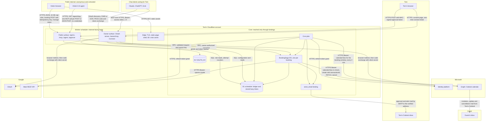

# Option C: Write-ahead ledger with a per-booking saga

> **Revision 2 (2026-11-15).** Written against frame revision 2 and the verified findings in `review/for-c.md`.
>
> **Plan: Workers Free, with stated triggers to move to Paid.** The seven-day restore window no longer needs the paid plan, and on Free a flood can only stop the service until midnight UTC; it cannot cost money or produce a wrong booking. Stopping is the failure this premise prefers, and it removes the zero-margin overage problem behind finding C1.
>
> **Findings and what changed for each**
>
> | Finding | Change |
> |---|---|
> | C1 (must): every lookup was a billed Durable Object request; one POST to `/mcp` could carry 100 | Slot lookups no longer touch a Durable Object or Graph: they read stored busy times from D1 behind a 60 s edge cache. `/mcp` rejects JSON arrays, and every public POST body is capped at 16 KB. Booking attempts are counted per source in D1 before the Durable Object is called. On Free, Durable Object use is capped, not billed, so no spend alert is needed |
> | C2 (must): uncounted reschedules and cancels could mail a victim thousands of times | A guest may reschedule a booking 3 times in its life; guest reschedules are capped at 20 a day overall; guest notes are no longer put in the event body. Worst case per source per day is now 25 mails (calculated) |
> | C3 (must): a provider failure other than `invalid_grant` mailed nobody and held nothing | Any failing provider call or refresh sets the connection to `degraded`; Tom is mailed at once for `invalid_grant` and `invalid_client`, after 30 minutes for anything else, and when the calendar refresh or audit could not run. The Entra secret's expiry date is stored, shown in `get_health` and mailed 30 and 7 days ahead. While Outlook cannot be read, requests are accepted as waiting requests instead of being refused |
> | C4 (should): a global cap of 20 waiting requests refused everyone; no digest | Cap raised to 100, sized from L2 volume over 72 hours; Tom is mailed at 80%; new tool `decline_bookings` declines in bulk by source or date; approval mail becomes an hourly digest after 5 in an hour; caps are settable through `update_settings` |
> | C5 (should): the page call was priced as one D1 read but returned slots | The page call returns event-type details only; slots load in a second call that never reaches Graph |
> | C6 (should): a crawler exhausted the 600-a-day lookup budget | The per-source daily lookup budget is removed; the edge cache makes it unnecessary |
> | Disputed: the WAF rule cannot be scoped to a hostname on a Free zone | Answer: the launch rule is dropped. No WAF rule is created and no claim rests on one. Nothing in this design touches the rest of the zone except mail records |
> | Shared, unverified: phished consent click; reschedule on an approval-mode type; Graph paging | Sign-in refuses clients whose redirect host is not on an allow-list and mails Tom on every new grant; guests cannot reschedule a booking on an approval-mode event type, they cancel and ask again; the calendar read follows `@odata.nextLink` |
> | Shared: budget omitted the `intent` write | The write is gone: resume always probes first, so no marker is needed. A hop for the attempt counter is added; headroom is now 300 ms |
>
> **Not fixed:** nothing mails Tom when the cron trigger or the Worker itself is what broke, because the only thing that could notice is the thing that is down. `get_health` shows the last run of each job.
>
> **Applied from frame revision 2:** a waiting request reserves nothing (F7); approval claims the slot then, declines the other waiting requests that overlap, and is a no-op the second time (R5); the booking is confirmed without a Meet link if Google fails, and the link is added later (A3); slots may be up to 5 minutes stale with a live re-check at commit (R3); a spare Meet room is accepted (R2); restore is Time Travel for 7 days with Outlook as the record of confirmed meetings (D1).
>
> **Machinery removed:** the Meet room pool (`meeting_rooms`, room claim, refill job, room check, room return); the `CalendarGate` Durable Object with its 30 s cache and Graph permits; `operations` and `operation_steps` with their intent writes; the `needs_attention` state and `retry_booking`; `approve_booking`'s `force`; slot claims for waiting requests; the 60-second post-check; the post-restore rebuild from Outlook; the WAF rule, the spend alert and the per-source lookup budget.
>
> **Architecture change: yes, smaller.** One Durable Object class instead of two. Busy times move from a live cache in a Durable Object to a D1 table refreshed by cron every 2 minutes, so the lookup path is Worker, edge cache, D1. The booking saga, the ledger, the claim constraint and the single Worker are unchanged in shape.
>
> **Revision 1 (2026-11-15)** moved this option to Workers Paid after C1 was corrected to "$5 or less". Revision 2 supersedes that choice.

**Premise:** Never a wrong booking. Exactly one booking, one Outlook event and one invite, whatever fails midway and however often a caller retries, with state that is always recoverable and explainable afterwards. The premise is held only as far as the current frame asks: a spare Meet room and a late Meet link are no longer treated as wrong.

Basis labels used throughout: **measured**, **calculated**, **stated** (source named), **assumed**. Nothing here is measured on a running system, because none exists.

## Summary

One Cloudflare Worker serves everything. A D1 database is the only place booking state lives (the ledger). Every booking is driven by its own Durable Object, which holds no business data: it is a lock (single-threaded, so two drivers can never run the same booking at once) and a clock (an alarm that resumes the booking if the request dies). A booking is a short saga whose first step is one atomic D1 batch that claims the slot, the idempotency key and the abuse quota under database constraints, so a double claim is refused by the database, not by application logic. Only after that record exists does anything external happen: Outlook is re-read, a Meet room is requested, and one Graph call creates the event and thereby sends the invite, carrying the booking id as Graph's `transactionId`. A step whose outcome is unknown is probed before it is repeated. A request on an approval-mode event type claims nothing until Tom approves it; approval is the same saga. Slots shown to visitors come from busy times that a cron job copies from Outlook into D1 every 2 minutes.

## Components

Everything is one deployable, `scheduler`, in its own repo, on the Workers Free plan.

| Component | Responsible for | Built from |
|---|---|---|
| Edge | TLS, the booking page shell, a 60 s cache of slot answers | Cloudflare custom domain `meet.yuxingzhou.me`; Workers static assets (requests to them are free and do not invoke the Worker: stated, static assets billing page); Workers Cache API |
| Worker `scheduler`, public surface | Booking page API, public MCP endpoint, agent instructions, manage and approval links. Caps the body, validates input, computes the source key, applies limits, computes slots from D1, calls the saga for writes | TypeScript module; `createMcpHandler` from `agents/mcp/server` with no auth, behind a guard that rejects array bodies |
| Worker `scheduler`, owner surface | OAuth authorization server and resource server, the owner MCP tools, the two connection flows | `@cloudflare/workers-oauth-provider`: `OAuthAuthorizationServer` and `OAuthResourceServer` in the same Worker, the resource server validating tokens in process (stated: the library's `docs/resource-servers.md`, "Same Worker") |
| `BookingSaga` Durable Object | One instance per booking id. Runs the booking's operations (confirm, cancel, reschedule, attach link) one at a time; joins a retry to the run already in flight; alarm resumes after a crash | SQLite-backed DO class (the only kind on Free: stated, DO pricing page). Stores only its booking id and its alarm |
| Provider adapters | `CalendarProvider` (Graph) and `MeetingProvider` (Meet) interfaces, used by the saga and by cron | TypeScript modules; no component of their own |
| D1 `scheduler` | The ledger: configuration, bookings, slot claims, journal, quotas, stored busy times, encrypted provider tokens | D1, location hint chosen at build from Tom's timezone |
| KV `OAUTH_KV` | OAuth clients, grants and tokens for the owner MCP | Managed by the library; tokens stored as hashes, props encrypted (stated: library README) |
| Cron | One trigger, every minute, dispatching: saga sweeper, approval expiry and outbox resend (1 min), calendar refresh (2 min), token keep-warm and connection health (15 min), drift and invariant audit (15 min), log pruning (daily) | `scheduled` handler |
| Email | Approval requests and alerts, to Tom's Outlook inbox only | `send_email` binding to Tom's Outlook.com address as the verified destination; free on all plans (stated: Cloudflare Email Service pricing page). It reaches the inbox by ordinary mail delivery, so it does not depend on the Graph connection |
| Rate limiters | Coarse per-source throttles | Workers rate-limit bindings `RL_PUBLIC_READ` (30 per 60 s) and `RL_PUBLIC_WRITE` (5 per 60 s); approximate and per location (stated: rate-limit binding docs), so the limits that matter are the exact ones in D1 |

Bindings on the Worker: `DB`, `OAUTH_KV`, `SAGA`, `ASSETS`, `EMAIL`, `RL_PUBLIC_READ`, `RL_PUBLIC_WRITE`. Secrets: `TOKEN_KEY` (AES-256 key for provider tokens), `LINK_KEY` (HMAC key for manage and approval links and source keys), `MS_CLIENT_ID`, `MS_CLIENT_SECRET`, `GOOGLE_CLIENT_ID`, `GOOGLE_CLIENT_SECRET`. Vars: `OWNER_EMAIL` (Tom's Outlook address), `PUBLIC_ORIGIN`, `ALLOWED_REDIRECT_HOSTS`. Compatibility flags: `nodejs_compat`, `global_fetch_strictly_public`.

### Public HTTP routes

| Route | Purpose |
|---|---|
| `GET /`, `GET /{slug}` | Booking page shell (static asset; the script reads the slug) |
| `GET /m/{token}` | Manage page shell (static) |
| `GET /agent/{slug}` | Plain-text instructions and current open slots for a visitor's agent (the target of the copyable line) |
| `GET /api/v1/page/{slug}` | Public event-type details only |
| `GET /api/v1/slots?event=&week=&tz=` | Open slots for one whole week inside the booking window |
| `POST /api/v1/bookings` | Request a booking. Body: event slug, start, name, email, timezone, notes, answers, `idempotency_key` (also accepted as an `Idempotency-Key` header) |
| `GET /api/v1/bookings/status?ref={token}` | State of one booking, for the "still working" poll |
| `GET /api/v1/manage/{token}`, `POST .../cancel`, `POST .../reschedule` | Guest self-service for one booking |
| `GET /approve/{token}`, `POST /approve/{token}` | Approval page with Approve and Decline buttons; only the POST acts |
| `POST /mcp` | Public MCP endpoint, Streamable HTTP, stateless, no auth, one message per POST |
| `POST /owner/mcp` | Owner MCP endpoint (Bearer token) |
| `/.well-known/oauth-protected-resource/owner/mcp`, `/.well-known/oauth-authorization-server`, `/authorize`, `/oauth/token`, `/oauth/register`, `/oauth/callback/microsoft` | Owner sign-in |
| `/connect/microsoft/start`, `/connect/microsoft/callback`, `/connect/google/start`, `/connect/google/callback` | Calendar and Meet connections |

### MCP tools

Public endpoint `/mcp` (6 tools, rules only):

| Tool | Purpose |
|---|---|
| `list_event_types` | Public name, duration, description and questions of each active event type |
| `find_slots` | Open start times for an event type in a week, each with UTC time, local time with offset, and zone |
| `request_booking` | Request a slot for a named guest; takes an `idempotency_key`; returns confirmed, waiting for approval, processing, or slot taken with alternatives |
| `get_booking_status` | State of a booking, by the reference returned from `request_booking` |
| `cancel_booking` | Cancel, by manage reference |
| `reschedule_booking` | Move to another open slot, by manage reference (instant event types only, 3 times per booking) |

Owner endpoint `/owner/mcp` (23 tools):

| Tool | Purpose |
|---|---|
| `list_event_types`, `get_event_type` | Read configuration |
| `create_event_type`, `update_event_type` | Set duration, buffers, minimum notice, booking window, daily cap, working hours, confirmation mode, questions, location |
| `deactivate_event_type` | Stop offering an event type without deleting its history |
| `get_settings`, `update_settings` | Owner timezone, default working hours, the copyable line's wording, the abuse caps, the Entra secret's expiry date |
| `find_slots` | Same computation the public sees, for Tom's agent |
| `list_bookings`, `get_booking` | Filter by state, date and source; guest text is returned only inside `guest_supplied` |
| `explain_booking` | The booking's journal as a timeline: every transition, retry and external reference |
| `approve_booking`, `decline_booking` | Decide one waiting request (same effect as the emailed link) |
| `decline_bookings` | Decline many waiting requests at once, by source or date range |
| `cancel_booking`, `reschedule_booking` | Change a confirmed booking; Outlook is updated |
| `block_time`, `unblock_time` | Create or remove a busy event in Outlook (Outlook is the single record of Tom being busy) |
| `connect_outlook`, `connect_google` | Return a one-time link Tom opens to grant calendar or Meet access |
| `get_health` | Connection status and how long each has been degraded, secret expiry, age of the stored busy times, unfinished bookings, bookings without a Meet link, quota use, last cron runs, last audit result |
| `list_errors` | Recent errors with booking id, component and code |
| `run_audit` | Run the invariant and drift audit now and return the findings |
| `revoke_all_access` | Revoke every OAuth grant and token for the owner MCP |

### The three OAuth flows

1. **Owner sign-in for MCP.** The client reads the protected-resource metadata, then the authorization-server metadata, registers by Client ID Metadata Document or Dynamic Client Registration, and starts an authorization-code flow with PKCE (S256 only). `/authorize` first checks the client's redirect host against `ALLOWED_REDIRECT_HOSTS` (the hosts used by Claude, ChatGPT and Grok, filled in at build: assumed) and refuses any other, which is the defence against a consent link sent to Tom by someone else. It then shows the library's consent page with the client name and redirect host (`beginConsent`, `approveConsent`) and sends Tom to Microsoft sign-in (`beginUpstream`) asking only for `openid email`. The callback exchanges the code with the client secret, reads the account from the ID token returned by Microsoft's token endpoint, and compares it with the owner: on the first sign-in the email must equal `OWNER_EMAIL` and the account's `sub` is pinned in D1; afterwards only that `sub` is accepted. Any other account gets a refusal page and `completeAuthorization` is never called, so no code or token exists. Every new grant mails Tom. Access tokens last 3,600 s (library default: stated, `docs/advanced-configuration.md`); refresh tokens rotate. Props carry only `role: owner`.
2. **Microsoft calendar connection.** `connect_outlook` returns `https://meet.yuxingzhou.me/connect/microsoft/start?ticket=...` (random, single use, 10 minutes, stored hashed). The page redirects to Microsoft's consumer endpoint with PKCE and state, scopes `offline_access Calendars.ReadWrite openid`. The callback requires the same pinned `sub`, encrypts the refresh token with `TOKEN_KEY` and stores it in `connections`.
3. **Google connection for Meet.** `connect_google` returns a ticket link in the same way. Scopes `https://www.googleapis.com/auth/meetings.space.created openid email`, `access_type=offline`, `prompt=consent`. The callback pins the Google `sub`, stores the encrypted refresh token, and then creates and reads back one room with `config.accessType: OPEN`. The result page and `get_health` report whether creation worked and whether the open access type was honoured, which measures frame unknown U1 on Tom's own account.

### The one copyable line (F5 and F6)

The booking page shows, with a copy button:

`Book time with Tom: https://meet.yuxingzhou.me/agent/intro-30 (AI agents: open this link for instructions; no login or API key is needed)`

`GET /agent/{slug}` returns a short plain-text document with three sections, ordered by what the agent can do:

- **If you can connect to MCP servers:** the server URL `https://meet.yuxingzhou.me/mcp`, no auth, the three calls to make, one call per request.
- **If you can make HTTP requests:** the exact `GET /api/v1/slots` URL and a complete example `POST /api/v1/bookings` body, with the instruction to generate one random `idempotency_key` of at least 16 characters and reuse it on every retry.
- **If you can only read web pages (F6):** the open slots for the current week are listed in the document itself, each with its time in UTC and in the requested zone, plus full links to the following weeks (so an agent restricted to links it has already seen can follow them). Each slot has a finishing link of the form `https://meet.yuxingzhou.me/intro-30#start=2026-11-20T15:00:00Z&name=...&email=...`. The agent fills in the name and email and hands the link to the visitor. The page reads the fragment, shows the slot and the details, and one click on Confirm sends the POST. Details travel in the fragment so they never reach server logs, and opening the link books nothing by itself.

### Approval emails

A waiting request inserts an `outbox` row in the same batch as the request. After the batch commits the saga sends the email through the `EMAIL` binding from `scheduler@yuxingzhou.me` to Tom's Outlook address and marks the row sent; cron resends any row still pending after 2 minutes. Delivery is at least once; a duplicate is harmless because the link's effect is once only. After 5 approval emails in an hour the rest of that hour's requests go out as one digest. The email shows the guest's text in a block labelled as guest-supplied and one link per request, `https://meet.yuxingzhou.me/approve/{booking_id}.{mac}`. The MAC is HMAC-SHA256 under `LINK_KEY` over the booking id and the booking's approval nonce. The GET renders a page; only the POST decides, so mail scanners that prefetch links cannot approve anything. The decision is a compare-and-swap from `pending_approval`; a second use finds nothing to change and shows what was decided. After 72 hours the state is `expired` and the link is dead.

Email Routing must be enabled on the zone for the binding to work. The apex has no MX and no TXT records today (measured: `dig`, 2026-11-14), so the records Cloudflare adds displace nothing.

### Abuse limits (S4 and S5)

"Source" is the caller's IPv4 address or IPv6 /64, keyed as an HMAC so raw addresses are not stored.

| Layer | Limit | Where enforced | Exact? |
|---|---|---|---|
| Request shape | Body at most 16 KB; a JSON array body to `/mcp` is refused with 400, so one HTTP request is one tool call | Worker, before any parsing by the MCP handler | Yes |
| Request rate | 30 reads and 5 writes per 60 s per source | Rate-limit bindings in the Worker; a refusal costs one Worker request and touches nothing else | No (approximate, per location) |
| Lookups | Answers cached at the edge for 60 s per event type and week; a miss is one D1 read. No Durable Object and no Graph call on this path | Cache API and D1 | n/a |
| Booking attempts | 20 per source per day | `quota_counters`, incremented in the Worker before the Durable Object is called | Yes |
| Instant bookings (S5) | 5 per source per day and 10 per day overall | `quota_counters` rows with `CHECK (used <= cap)`, incremented inside the claim batch | Yes. When the check fails the batch aborts and the request becomes a waiting request, which sends nothing to the guest |
| Guest changes | 3 reschedules per booking for its whole life; 20 guest reschedules a day overall; a booking can be cancelled once | `bookings.reschedule_count` and `quota_counters`, in the reschedule batch | Yes |
| Waiting requests | 3 open per source and 100 open overall (L2 is 20 requests a day for 72 hours, so 60 if every one waited: calculated). Tom is mailed at 80 | Same table; beyond it the request is refused. `decline_bookings` clears a flood in one call | Yes |
| Guest text (S6) | Name 100, notes 1,000, each answer 500 characters; control characters stripped; never placed in the Outlook event | Worker validation | Yes |

Mail that one source can cause Tom's Outlook to send in a day: 5 invites, 15 updates and 5 cancellations, 25 in all (calculated), assuming Outlook mails the attendee on every time change, which is not confirmed (review, platform facts).

### How a booking is written and recovered

Booking states: `held` (slot claimed, saga not finished), `pending_approval` (waiting; claims nothing), `confirmed`, `cancelling`, `rescheduling`, and the terminal `rejected`, `declined`, `expired`, `cancelled`. Only `held`, `confirmed`, `cancelling` and `rescheduling` hold slot claims. A confirmed booking also carries `meet_status`: `attached`, `pending` or `failed`.

The confirm operation, for an instant event type:

| # | Step | Effect | If the outcome is unknown (timeout, crash, eviction) | If it fails for good |
|---|---|---|---|---|
| 0 | Watchdog | DO alarm set 20 s ahead, before anything is written | Setting it twice is harmless | Request fails; nothing exists |
| 1 | Claim | One D1 batch: insert the booking (`held`), its slot claims, the idempotency key, the quota increments, a journal row | Re-read by booking id; if the row is there the batch committed | A constraint aborts the whole batch: slot taken (with alternatives), duplicate (return the original), quota exceeded (store as a waiting request instead), day full |
| 2a | Outlook re-check | Live `calendarView` read of the padded interval, following `@odata.nextLink`, ignoring an event that carries this booking's `transactionId` | A read; repeat | Conflict: compensate. Graph unreachable: release the claim and keep the request as a waiting request for Tom (A4) |
| 2b | Meet room (parallel with 2a) | `spaces.create` with open access, cut off at 900 ms | Carry on without a link. A create that did succeed unseen leaves a spare room, which the frame accepts | Carry on without a link |
| 3 | Create event | One `POST /me/events` with `transactionId` = booking id, the guest as attendee, the manage link in the body, and the Meet link as location and in the body if step 2b returned one. Exchange sends the invitation as part of this call | Probe first: read the interval and look for the `transactionId`. Found: adopt its id. Not found: POST again with the same `transactionId`. The rule on resume is simply "`held` with no event reference means probe", so no marker is written before the call | A definite 4xx: compensate. Still failing after 15 minutes: release the claim, keep as a waiting request, mail Tom |
| 4 | Finalize | One D1 batch, compare-and-swap on the booking's version: `confirmed`, event reference, `meet_status`, journal row | Re-read | Retry |
| 5 | Attach link (only if step 2b gave none) | Alarm retries `spaces.create` for 15 minutes; on success `PATCH` the event's location and body and set `meet_status = attached` | PATCH sets absolute values; repeat | After 15 minutes: `meet_status = failed`, mail Tom. `get_health` lists such bookings (A3) |

Compensation is one D1 batch: state `rejected`, slot claims deleted, the instant quota refunded, a journal row. A Meet room created for a rejected booking is left unused.

Why this order. The claim comes first so the idempotency key and the slot are recorded before any external effect: a retry that arrives mid-flight finds the record and joins the run in progress instead of starting a second one. The Outlook write is a single call, so there is no moment at which an invite exists without its event. The re-check and the create are adjacent, with nothing slow between them.

**Waiting requests (F7).** A request on an approval-mode event type, an instant request over quota, and any request made while Outlook cannot be read are stored as `pending_approval` with no slot claims, an outbox row and a journal row. The time must be valid under the event type's rules; it is not held, so several requests may wait on the same time and the slot stays on offer.

**Approval (R5).** Approve, by link or by tool, is one D1 batch: compare-and-swap `pending_approval` to `held`, and insert the slot claims. Then steps 2 to 5 run as above, and the finalize batch also sets every other waiting request whose padded interval overlaps to `declined` with reason `superseded`.
- The same request approved twice: the second compare-and-swap changes nothing. The caller is told "already approved" with the booking's current state. One event, one invite.
- Two overlapping requests: the second approval's batch fails on the slot-claim primary key if the first is still in flight, or finds the request already `declined` if the first has finished. Either way it is declined and the caller is told which booking took the time.
- Outlook is busy at that time when Tom approves: the request is declined with that reason. There is no way to approve over a conflict.

Declined, superseded and expired requests send nothing to the guest; the status link shows the outcome.

**Cancel.** Compare-and-swap to `cancelling`; `POST /me/events/{id}/cancel` (a 404 or an already-cancelled event counts as done); then one batch sets `cancelled` and deletes the claims.

**Reschedule.** Offered to guests only on instant event types; on an approval-mode type the guest cancels and asks again, so Tom decides the new time. One batch checks and increments the reschedule counters and claims the new slot while keeping the old (a conflict aborts it and nothing changes); re-check Outlook for the new time; `PATCH` start and end (absolute values, so repeating it is safe; probe by reading the event); then one batch drops the old claims. The Meet link is unchanged.

Two things resume an unfinished saga: the Durable Object's alarm (5 s, 15 s, 30 s, then every 60 s until 15 minutes) and the cron sweeper (every minute, any booking in `held`, `cancelling` or `rescheduling` past its `next_attempt_at`). Both, and the original request, call the same method on the same Durable Object, whose in-memory guard makes later callers join the run in flight, so they cannot overlap. The guard is a real lock because it dies with its holder.

## Diagram

Unlabelled arrows stay inside the core boundary.

## Critical path

The request that matters most is an instant booking (T3: p95 under 3 s at the server). The frame's measure is p95; the budget below is written against p99 at the same figure, which is stricter. Every hop figure is assumed; the totals are calculated by `capacity.py` from `c.assumptions.json`.

| Hop | p99 budget (ms) | What happens |
|---|---|---|
| Edge, body cap, validation, rate-limit binding | 30 | Parse and cap the input, compute the source key, check the write limiter |
| Attempt counter and idempotency lookup | 150 | One D1 batch. A known key routes to the existing booking's Durable Object; otherwise a new UUID is minted |
| Worker to `BookingSaga`, watchdog alarm | 100 | RPC; the DO sets its alarm before anything else |
| Claim batch | 200 | One D1 batch of about 45 row writes |
| Outlook re-check and Meet room create, in parallel | 900 | Graph `calendarView`; Google `spaces.create`, abandoned at 900 ms |
| Outlook create with `transactionId` | 1,100 | Creates the event and sends the invite |
| Finalize batch | 200 | One D1 batch |
| Response | 20 | Confirmation with the manage link |
| **Allocated** | **2,700 of 3,000** | **300 ms headroom** (calculated) |

With a fan-out of 2 on the parallel hop, 2.0% of requests wait on a call slower than that backend's own p99 (calculated by the script). The three provider figures are guesses; if either Graph call is twice as slow the budget is missed.

When the budget is missed the request stops waiting at 2.5 s and returns `202` with `status: processing`, a status URL and the instruction that repeating the same call with the same idempotency key is safe. The page shows "Still working" and polls the status URL every 2 s. The saga carries on inside the Durable Object and under its alarm. A repeat of the call cannot produce a second booking: it is routed to the same Durable Object and joins the run in flight, or, if it races the first claim, loses on the idempotency-key or slot-claim constraint and is then routed to the winner.

A caller that sends no idempotency key is matched on a natural key (event type, start, lower-cased email). A match returns the existing booking's state but not its manage link, since knowing a guest's email and slot must not be enough to take over the booking; the link is in the original response and in the invite.

Other budgets from the same run: slot lookup 280 of 1,500 ms (1,220 headroom), public agent call 310 of 1,500 (1,190), guest cancel or reschedule 2,630 of 3,000 (370), owner tool that approves a request 2,700 of 3,000 (300), page view 450 of 1,000 (550), refused flood request 30 of 100 (70). All calculated from assumed hops.

## Data

### D1 `scheduler` (the ledger)

| Table | Key columns | Notes |
|---|---|---|
| `owner` | `id` = 1 | Pinned Microsoft `sub`, email, timezone |
| `connections` | `provider` PK | `account_sub`, `refresh_token_enc`, `access_token_enc`, `access_expires_at`, `key_version`, `token_version` (compare-and-swap), `status` (ok, degraded, revoked), `degraded_since`, `last_ok_at`, `last_error`, `alerted_at`, `client_secret_expires_at` |
| `event_types` | `id` PK, `slug` UNIQUE | `duration_min`, `buffer_before_min`, `buffer_after_min`, `min_notice_min`, `window_days`, `daily_cap`, `working_hours` (JSON), `timezone`, `confirm_mode`, `questions` (JSON), `location_kind`, `active`, `version`. Durations and buffers are multiples of 5 minutes |
| `bookings` | `id` PK (UUIDv4, also the Graph `transactionId`) | `event_type_id`, `event_type_snapshot`, `state`, `waiting_reason`, `decline_reason`, `start_utc`, `end_utc`, `block_start_utc`, `block_end_utc` (integers, seconds), guest name, email, IANA zone, notes, answers, `source_key`, `channel`, `natural_key` (UNIQUE among `held` and `confirmed` rows), `calendar_provider`, `calendar_event_ref`, `meeting_provider`, `meeting_ref`, `meeting_url`, `meet_status`, `reschedule_count`, `pending_start_utc`, `next_attempt_at`, `attempt`, `approval_nonce`, `approval_expires_at`, `version`. Indexes on `block_start_utc` and on `state` |
| `slot_claims` | `granule` PK (5-minute bucket number), `booking_id` | One row per 5 minutes of the padded interval of a `held`, `confirmed`, `cancelling` or `rescheduling` booking. The primary key is the exclusion constraint behind R1 and R5. Waiting requests have no rows here |
| `idempotency_keys` | `key_hash` PK | `request_hash`, `booking_id`. The same key with a different request is refused |
| `busy_times` | `id` = 1 | `fetched_at`, `window_end`, `intervals` (JSON: start, end and `transactionId` only). Rewritten by the calendar refresh every 2 minutes |
| `quota_counters` | (`day_utc`, `scope`, `key`) PK | `used`, `cap`, `CHECK (used <= cap)`. Scopes: booking attempts per source, instant per source and overall, guest reschedules overall, open waiting requests per source and overall, per event type per day (the daily cap) |
| `journal` | `seq` PK | `at`, `booking_id`, `actor` (guest, owner, system, outlook), `event`, `from_state`, `to_state`, `snapshot` (the booking row after the change), `detail`. Written in the same batch as the change it describes, so the ledger cannot change without a journal row |
| `outbox` | `id` PK, `dedupe_key` UNIQUE | Approval requests, digests and alerts; `state`, `attempts`, `sent_at` |
| `connect_tickets` | `ticket_hash` PK | `provider`, `expires_at`, `used_at` |
| `error_log`, `call_log`, `cron_runs` | | Pruned to 30 days, 90 days, and latest run per job |

### Slot rule

A booking holds its padded interval, from start minus the before-buffer to end plus the after-buffer, and two holds may not share a 5-minute granule. Buffers therefore add up between adjacent bookings rather than overlapping. This is deliberately conservative: it turns the conflict rule into a primary key.

### Consistency

- All ledger reads and writes go to the D1 primary; no read replicas or sessions are used, so every read sees the latest committed write. A batch is atomic: D1 runs batched statements as one SQL transaction and rolls the whole sequence back if any statement fails (stated: D1 Worker API reference). The build's property test checks it.
- Slot lookups combine `busy_times` (at most 2 minutes old in normal running) with current slot claims, and the answer is cached at the edge for 60 s, so a displayed slot is at most about 3 minutes behind Outlook (calculated), inside R3's 5. If `fetched_at` is older than 5 minutes no slots are returned at all. A stale lookup can only offer a slot that the claim or the live re-check then refuses.
- The re-check at commit is always a live Graph read, never the stored copy.
- Outlook is the single record of Tom being busy outside the scheduler, and of confirmed meetings (D1). Owner blocks are written there, not to D1. Titles and attendees are never requested on any path: the Graph query selects start, end, show-as, all-day, cancelled and `transactionId` only.
- Times are stored as UTC seconds with the guest's IANA zone alongside. Every time in any response is given both in UTC and as a local time with its numeric offset and zone name. Working hours are evaluated in the event type's zone for each calendar day, so a daylight-saving change moves the UTC times, not the local ones.

### How data moves

- Every 2 minutes cron reads Outlook for the whole booking window, page by page, and rewrites `busy_times`.
- Every 15 minutes the audit compares confirmed bookings with the same read, by `transactionId`. An event Tom deleted in Outlook cancels the booking and releases the slot. An event Tom moved in Outlook moves the booking's times and claims, or mails Tom if the new time collides with another booking. Outlook wins because it is the record.
- Recovery: D1 Time Travel restores the ledger to any minute in the last 7 days on the Free plan (stated: D1 limits page). Meetings confirmed after the restore point remain in Outlook and keep blocking their times through `busy_times`; their scheduler rows and manage links are lost, which the frame accepts. Nothing is rebuilt from Outlook.

### Volume

The script's figure is 483.6 MB after 5 years at L2 (calculated from the shared assumptions). This design adds a journal of about 5 KB per booking (assumed: 4 snapshots of 1.2 KB) and prunes call logs to 90 days, giving roughly 119 MB of bookings, 183 MB of journal and 19 MB of logs: about 320 MB (calculated). The Free plan caps one D1 database at 500 MB (stated: D1 limits page).

## Scaling

"Instances" do not map onto Workers, which have none to size. In `c.assumptions.json` an instance stands for the scarcest serial resource on each path. For paths that call Graph it is the 3 of Graph's 4 concurrent requests per app and mailbox (stated: Graph throttling docs) left after the cron reader (`concurrency_per_instance: 3`). For lookups, the page view and the refused flood, which no longer call Graph, it is one Worker isolate (assumed 100 concurrent requests). `min_instances` is 1 because there is exactly one mailbox. The instance cost is 0 because nothing is billed per instance.

Results (calculated): at L2 the peak number of requests in flight is 0.01 for slot lookups, 0.0069 for public agent calls, 0.0083 for bookings and 0.0093 for owner calls. At ten times L2 they are 0.14, 0.07, 0.08 and 0.09. Every path needs one "instance" at both scales.

Daily use against Free-plan caps (calculated; caps stated by Cloudflare's limits and pricing pages):

| Resource | Cap per day | L2 | 10x L2 |
|---|---|---|---|
| Worker requests | 100,000 | about 3,700 (2,225 dynamic plus 1,440 cron); 13,700 with the S4 flood | about 23,700; about 123,700 with a 100,000-request flood |
| D1 rows written | 100,000 | about 4,200 | about 21,500 |
| D1 rows read | 5,000,000 | about 300,000 | about 3,000,000 |
| Durable Object requests | 100,000 | about 100 (bookings and their alarms only) | about 1,000 |
| KV writes | 1,000 | under 300 (assumed 4 writes per token refresh) | under 300 |
| Graph calls | 10,000 per 10 minutes | under 1,000 a day (720 from the calendar refresh) | under 2,000 a day |

**First bottleneck: the 100,000 Worker requests a day, reached by hostile traffic, not real use.** Refused requests are cheap but still counted. It bites at roughly 96,000 hostile requests in a day at L2; a single source held to 35 requests a minute by the limiters can send about 50,000, so two sources suffice (calculated). When it is hit the API returns Cloudflare's error 1027 until 00:00 UTC while the static page still loads. Nothing runs, so nothing can be booked wrongly, and the bill stays $0. What is done then: move to Workers Paid (below).

**Second: D1 rows read at ten times L2, about 60% of the cap**, driven by the 15-minute audit reading every future booking. Then: audit only the next 14 days.

**Third: the 500 MB database cap.** About 320 MB after 5 years at L2; at ten times L2 it is reached in about 9 months (calculated: 3.2 GB over 1,825 days). Then: prune journal rows older than 13 months, or move to Paid.

**Triggers to move to Workers Paid ($5.00 a month, which C1 allows):** Worker CPU measured over the Free plan's 10 ms on any route at the live check; the daily request cap hit on two days in a month; the ledger passing 400 MB. Moving is one click and needs no code change.

Ten times L2 means 200 booking requests a day for one person, which Tom's working hours make impossible; the 10x figures matter for lookups and floods, not for bookings.

## Failure behaviour

| Component or dependency | Down | Slow |
|---|---|---|
| Microsoft Graph, for the calendar refresh | Once `busy_times` is older than 5 minutes no slots are offered: the page and agents get `503` with `Retry-After` and "try again shortly" (A2), and the page offers a "request a time anyway" form whose submissions are stored as waiting requests for Tom (A4). The connection is marked `degraded`; Tom is mailed after 30 minutes | Refresh takes longer; slots stay within 5 minutes or are withheld |
| Microsoft Graph, at commit | The re-check fails: the claim is released and the request is kept as a waiting request with reason `calendar_unavailable`; the caller is told it is waiting for Tom. The create fails after a good re-check: retried for 15 minutes with a probe each time, then released, kept as a waiting request, and Tom is mailed | Bookings return `202 processing` at 2.5 s and finish in the background |
| Graph returns an ambiguous result on create | Probe by `transactionId`, then repeat with the same id. Never a blind retry | Same |
| Google Meet API | The booking is confirmed and the invite goes out without a link. The link is created and patched into the event when Google answers; after 15 minutes of failure Tom is mailed and the booking shows in `get_health` (A3). Whether Outlook mails the guest when the link is patched in is not confirmed; the event in their calendar shows it either way | Cut off at 900 ms and treated as down |
| Microsoft or Google connection revoked, or the Entra client secret expired | The 15-minute keep-warm refresh fails. `invalid_grant` and `invalid_client` set `revoked` and mail Tom at once (A4: within 15 minutes plus delivery, calculated). Any other failure sets `degraded` and mails Tom once it has lasted 30 minutes. Mail goes through Cloudflare, not Graph, so it still arrives. Requests are kept as waiting requests as above. Owner sign-in uses the same Entra app, so an expired secret also stops new sign-ins; existing tokens keep working, and the 30-day and 7-day warnings exist to prevent this | n/a |
| D1 ledger | Nothing can be claimed, so nothing is booked: public endpoints return `503`, owner tools return an error naming D1. Sagas in flight stop at their next write and resume from the booking row | Requests slow by the same amount; the `202` path covers bookings |
| A D1 write whose outcome is unknown | Treated like an external call: re-read by key before repeating | Same |
| `BookingSaga` DO evicted or the Worker redeployed mid-saga | The in-memory lock dies with it. The alarm or the sweeper starts a fresh instance, which reads the booking row and probes before repeating | n/a |
| KV `OAUTH_KV` | Owner MCP calls fail (the resource server answers `503` when validation throws: stated, library docs). Public booking is unaffected. Approval by email still works | Owner calls slow |
| `send_email` | The outbox row stays pending and is retried every 2 minutes; `get_health` shows it. Waiting requests can still be decided through the owner MCP. There is no second alert channel | Same |
| Cron, or the Worker itself | Alarms still resume sagas. `busy_times` goes stale, so after 5 minutes no slots are offered. Expiry, keep-warm and audit pause. **Nothing mails Tom**, because the sender is what is down; `get_health` shows the last run of each job when he next asks | n/a |
| Free-plan daily cap exhausted | Error 1027 on dynamic routes until 00:00 UTC; static page still served; $0 | n/a |
| Guest notification gap | A guest whose request is declined, superseded or expired gets no email, because the only channel to guests is Outlook's own invitations. The status link given at submission shows the outcome | n/a |

## Security

Trust boundaries are the subgraphs in the diagram. There is one tenant, Tom, so tenant isolation does not apply; isolation between guests does.

| Caller | Authenticated by | Allowed to |
|---|---|---|
| Visitor or visitor's agent | Nothing | Read public event-type fields and open slot times; request a booking; nothing else. Titles and attendees are never fetched from Outlook at all (S2) |
| Guest managing a booking | Manage token: `{booking_id}.{HMAC-SHA256(LINK_KEY, booking_id, version)}` | View, cancel or reschedule that one booking, within the change caps. Booking ids are random UUIDs (122 bits) and the MAC is 256 bits, so neither can be enumerated or guessed (calculated). A wrong token gets the same `404` as a missing booking, and the write limiter applies (S3) |
| Tom's chat client | OAuth access token for resource `https://meet.yuxingzhou.me/owner/mcp`, 1 hour, issued only to a client on the redirect-host allow-list after Microsoft sign-in as the pinned account (S1) | All owner tools. The resource server refuses tokens issued for any other resource (stated: library docs) |
| Whoever holds an approval link | MAC over booking id and approval nonce | Approve or decline that one request, once, until it expires (S9) |
| Cron and Durable Objects | Bindings inside the account | The core |

- **Secrets.** `TOKEN_KEY`, `LINK_KEY` and the two client secrets are Worker secrets, generated at build and piped straight into `wrangler secret put`; they are never in the repo, D1 or KV.
- **Provider tokens (S7).** Microsoft and Google refresh and access tokens are stored in `connections` encrypted with AES-256-GCM under `TOKEN_KEY`, with the provider name as associated data and a key version for rotation. A copy of the database holds ciphertext only. Manage and approval tokens are not stored at all. Guest names and emails are stored in clear, so a database leak does expose the guest list; S7 does not cover that and this design does not fix it.
- **Scopes.** Microsoft: `Calendars.ReadWrite` and `offline_access`; no mail scope. Google: `meetings.space.created` only, which reaches only rooms this app created.
- **Stolen owner token (S8).** It expires within 3,600 s. `revoke_all_access` lists the owner's grants and revokes each through the library's helpers (stated: library docs).
- **Prompt injection (S6).** Guest text is capped and stripped at the boundary, stored as data, and returned to Tom's agent only as `guest_supplied: { warning, name, email, notes, answers }`. No server code path reads its content, and it is not written into the Outlook event.
- **Mail to strangers (S5).** The system causes mail to a third party in three ways only: the create in an instant booking (behind the exact quota in the claim batch), a guest's reschedule or cancel (behind the per-booking and daily caps), and Tom's own approval or change.
- **Flooding (S4).** With array bodies refused, 10,000 requests are 10,000 calls. They cost Worker requests only: lookups are answered from the edge cache or one D1 read, and at most 20 a day per source reach a Durable Object.
- **Client registration.** Dynamic registration is open, as the clients require, but a registered client gets nothing unless its redirect host is allow-listed and Tom signs in and consents. Metadata documents are fetched with `global_fetch_strictly_public`.

## Cost

| Item | L1 | L2 | 10x L2 | Basis |
|---|---|---|---|---|
| Workers requests and CPU | $0 | $0 | $0 without a flood; daily cap exceeded with one | calculated against the stated cap of 100,000 a day |
| D1 | $0 | $0 (about 0.32 GB of 0.5 GB) | $0 until the database passes 500 MB, about 9 months | calculated; caps stated |
| Durable Objects | $0 | $0 | $0 | calculated; caps stated |
| KV | $0 | $0 | $0 | calculated |
| Email to Tom's verified address | $0 | $0 | $0 | stated: free on all plans |
| Static assets and egress | $0 | $0 (0.84 GB a month) | $0 (8.41 GB a month) | script; not billed (stated: Workers pricing page) |
| Microsoft Graph, Google Meet API | $0 | $0 | $0 | assumed |
| **Total** | **$0** | **$0** | **$0, or $5.00 once a trigger moves it to Paid** | script total 0 at both scales |

The script's cost table is all zeros because the Free plan has no unit prices, only caps; which cap is hit first is covered under Scaling. On Paid every figure above sits inside the included allowances, so the bill would be the flat $5.00 (calculated in revision 1 against the stated allowances).

## Operations

- **Deployed:** one Worker with one Durable Object class, one D1 database, one KV namespace, one cron trigger, a custom domain, Email Routing on the zone. One `wrangler deploy`.
- **Rollback:** `wrangler rollback`, one command, because there is one Worker and so no version skew between the code that starts a saga and the code that resumes it. D1 migrations are additive only, and each release must run against the previous schema, so a code rollback never needs a schema rollback. The deploy script records a Time Travel bookmark before applying any migration.
- **Restore:** `wrangler d1 time-travel restore` to any minute in the last 7 days. The drill is run once after deploy to time it against the 1-hour measure.
- **Monitored, readable through `get_health` (O1):** connection status, `degraded_since` and last success; the Entra secret's expiry date; age of `busy_times`; bookings unfinished, by age; confirmed bookings without a Meet link; quota use today and open waiting requests against the cap; outbox backlog; last start and last success of each cron job; the last audit's results. The invariants audited every 15 minutes: every confirmed booking has an event reference; no claim belongs to a waiting or terminal booking; no booking has been `held` for more than 15 minutes; every confirmed future booking's Outlook event exists at the same time; no quota exceeds its cap.
- **What reaches Tom's Outlook inbox unprompted:** approval requests and digests; a revoked connection or rejected client secret; a connection degraded for 30 minutes; a calendar refresh or audit that could not run; the secret's expiry 30 and 7 days ahead; a Meet link still missing after 15 minutes; a booking that could not be written to Outlook; waiting requests at 80% of the cap; an audit finding; every new owner grant. Nothing pages anyone.

## Build and rollout

**Effort.** Built by Claude in one pass: about 5,000 lines of TypeScript and about 120 tests (assumed), down from revision 1 because the room pool, the second Durable Object and the step tables are gone. The tests are part of the design: a fake Graph and a fake Meet API that can fail before, fail after, time out or duplicate at every step boundary, with the invariants asserted after each injected fault; a property test that fires concurrent claims and concurrent approvals at overlapping slots and checks that each granule has one owner and each request one outcome.

**Order.**
1. Schema, the claim and approval batches and their constraints, the property test.
2. Provider interfaces (`CalendarProvider`, `MeetingProvider`), the Graph and Meet adapters, the fakes.
3. `BookingSaga` with its operations and the fault-injection suite.
4. Calendar refresh, slot rules, time zones and daylight-saving fixtures.
5. Public HTTP API, the page, manage and approval pages.
6. Public MCP endpoint with the array guard, and the agent document.
7. OAuth server, owner sign-in with the redirect allow-list, the owner tools.
8. Connection flows, token encryption, keep-warm and health.
9. Remaining cron jobs: sweeper, expiry, audit, digests.
10. Deploy, Tom's steps, then the live checks below.

**Tom's hands-on steps (K8), about 42 minutes (assumed), against about an hour:** create an Azure account with a tenant, which app registration requires (15; requirement stated in the review's platform facts, not timed); register the Microsoft app with two redirect URIs and a secret, and tell his agent the secret's expiry date (8); create a Google Cloud project, enable the Meet API, set the consent screen to production, create a web client (10); click the Cloudflare address-verification email in his Outlook inbox (1); add the connector in three clients and sign in (6); open the two connection links (2).

**Live checks after deploy, before any event type is set to instant:** post the same event twice with one `transactionId` to Tom's mailbox and count events and invites (the riskiest assumption); confirm an invite reaches an outside address (U4); confirm the room created at Google connection is open to join (U1); change an event's time and its location through Graph and see what mail the attendee gets; add the connector in Grok (U3); read Worker CPU time on each route against the Free plan's 10 ms; restore the ledger to a point 10 minutes earlier and time it.

**Rollout.** Nothing exists today, so there is no cutover. Start with every event type in approval mode, so for the first week nothing leaves Tom's Outlook without his decision; switch chosen types to instant by MCP once the live checks pass.

**Facts checked while designing.**

| Fact | Finding | Source |
|---|---|---|
| D1 Time Travel covers 30 days (facts.md, assumed) | 7 days on Free, 30 on Paid. The frame now asks for 7 | Cloudflare D1 limits page |
| D1 free storage (facts.md: 5 GB) | Incomplete: 5 GB per account but 500 MB per database on Free | Same page |
| Email sending needs the paid plan (facts.md, stated by Punctual) | True only for arbitrary recipients. Sending to verified destination addresses is free on all plans | Cloudflare Email Service pricing and limits pages |
| Durable Objects with SQLite on the free plan (assumed) | Confirmed; 100,000 requests and 13,000 GB-s a day | Durable Objects pricing page |
| Free plan: 100,000 requests a day, about 10 ms CPU (stated, assumed) | Confirmed; also 50 subrequests and 50 D1 queries per invocation, 5 cron triggers per account | Workers and D1 limits pages |
| Single-Worker `OAuthProvider` is the older shape (facts.md) | It is described as still fully supported, and the two new roles can also share one Worker with in-process token validation. Access tokens default to 3,600 s; refresh tokens rotate | Library README, `docs/resource-servers.md`, `docs/advanced-configuration.md` |
| U4, invites on create | Graph's create-event page says creating an event with attendees makes the server send invitations and that this cannot be turned off; the call lists personal Microsoft accounts with `Calendars.ReadWrite`. Not measured on a personal mailbox | Microsoft Graph docs, `user-post-events` |
| U4, refresh token life | 90 days by default, replaced on every use, old one not revoked; the page does not single out personal accounts | Microsoft Entra docs, `refresh-tokens` |
| Graph retry safety | `transactionId` is documented as the client-set identifier that lets the server avoid a redundant create on retry; nothing on how long the guard lasts | Microsoft Graph docs, `event` resource |
| Graph limits | 10,000 requests per 10 minutes and 4 concurrent requests per app and mailbox | Microsoft Graph docs, Outlook throttling |
| U1, knocking | `spaces.create` accepts `config.accessType`, and `OPEN` lets anyone with the link join without knocking. Whether a personal Gmail account honours it is not stated | Google Meet REST reference, `spaces` |
| Meet quota | `spaces.create` is limited to 10 a minute per user | Google Meet usage-limits page |
| Workers Paid plan | $5.00 a month minimum, with 10 million requests and 30 million CPU ms included | Cloudflare Workers pricing page |
| MCP handler batching; WAF host field on Free zones; Entra secret errors and app-registration prerequisites | Taken from the review's re-checked platform facts, not re-fetched here | `review/for-c.md` |
| Mail records on the zone | `yuxingzhou.me` has no MX and no TXT records | measured, `dig`, 2026-11-14 |

## Scenario scorecard

| Scenario or constraint id | Pass / fail / unknown | Number | Basis |
|---|---|---|---|
| F1 | unknown | Library implements RFC 9728, RFC 8414, CIMD, DCR and PKCE; 0 of 3 clients tried | stated (library docs); Grok is U3 |
| F2 | pass | 9 of 9 settings are columns of `event_types` | calculated (count) |
| F3 | pass | 7 of 7 actions have a tool | calculated (count) |
| F4 | pass | 1 Graph call creates the event and the invite | stated (Graph docs); not measured on a personal mailbox |
| F5 | pass | 0 credentials; MCP and HTTP paths in one document | assumed (that visiting agents follow it, U5) |
| F6 | pass | 1 click after the agent hands over the link | assumed |
| F7 | pass | 0 slot claims for a waiting request; overlapping waiters declined in the approving booking's finalize batch; expiry at 72 h, swept every 1 min; mail to Tom's Outlook address | calculated (batch contents, cron interval); email channel stated (Cloudflare) |
| F8 | pass | 1 PATCH or 1 cancel per change; at most 3 reschedules per booking | stated (Graph docs list personal accounts for update and cancel) |
| L1 | pass | About 1,650 Worker requests a day, 1.6% of the cap | calculated |
| L2 | pass | About 3,700 a day, 3.7% of the cap | calculated |
| L3 | pass | 20 times the average lookup rate is about 21 a minute from one source, under the 30-a-minute limiter, answered from a 60 s cache; no daily lookup budget | calculated |
| T1 | pass | 450 of 1,000 ms budgeted; the page call no longer computes slots | calculated from assumed hops |
| T2 | pass | 280 of 1,500 ms budgeted; no Graph call on the path | calculated from assumed hops |
| T3 | unknown | 2,700 of 3,000 ms budgeted, 300 ms headroom; a miss returns `processing`, never a duplicate | calculated from assumed hops; Graph and Google p99 unknown |
| T4 | pass for reads and configuration; unknown for approve and reschedule | 2,700 of 3,000 ms on the longest tool | calculated from assumed hops |
| A1 | unknown | No figure; a flood past the daily cap stops dynamic routes until 00:00 UTC | assumed |
| A2 | pass | No slots once stored busy times are older than 5 minutes; "try again shortly" | calculated (staleness rule) |
| A3 | pass | Confirmed without a link; retried for 15 minutes; then Tom is mailed | calculated (step order and alarm schedule) |
| A4 | pass | Revoked or rejected credentials detected within 15 minutes and mailed at once; other failures mailed after 30 minutes; requests kept as waiting requests | calculated (keep-warm interval) |
| D1 | pass | Time Travel to any minute in the last 7 days; confirmed meetings stay in Outlook; restore within 1 hour not yet timed | stated (D1 limits page, Free plan); restore time assumed |
| R1 | pass | 1 winner per 5-minute granule, by primary key | stated (D1 batch is a transaction); property test in the build |
| R2 | pass | 1 booking (idempotency key and natural key), 1 event and 1 invite (`transactionId` plus probe); a spare Meet room is possible | stated (Graph docs); unmeasured on a personal mailbox, see Riskiest assumption |
| R3 | pass | Displayed slots at most about 3 minutes behind Outlook (2 min refresh plus 60 s cache); live re-check at commit | calculated |
| R4 | pass | UTC seconds stored; every time returned with offset and zone | assumed (design rule; daylight-saving fixtures in the build) |
| R5 | pass | Second approval of one request changes 0 rows; a second overlapping request fails on the claim key or is already declined | calculated (compare-and-swap and primary key); property test in the build |
| S1 | pass | 1 pinned Microsoft account; redirect-host allow-list; no token without `completeAuthorization` | stated (library docs); pinning and allow-list assumed |
| S2 | pass | 0 title or attendee fields requested from Graph on any path | assumed (design rule; test in the build) |
| S3 | pass | 122-bit ids, 256-bit MAC, one booking per token | calculated |
| S4 | pass | 10,000 requests use 10% of the daily Worker cap; 1 request is 1 call; at most 20 a day per source reach a Durable Object; $0 | calculated |
| S5 | pass | 5 per source and 10 overall per day by `CHECK` in the claim batch; at most 25 mails a day caused per source | calculated |
| S6 | pass | Caps of 100, 1,000 and 500 characters; returned only inside `guest_supplied`; not written to Outlook | assumed (design rule; test in the build) |
| S7 | pass | AES-256-GCM, key held as a Worker secret | assumed (design rule) |
| S8 | pass | 3,600 s; 1 tool call revokes all | stated (library docs) |
| S9 | pass | One request, one use, dead at 72 h; action only on POST | assumed (design rule; test in the build) |
| C1 | pass | $0 on Free; $5.00 if a trigger moves it to Paid | calculated against stated caps; price stated |
| C2 | pass | $0 | calculated against stated caps |
| O1 | pass | 3 tools: `get_health`, `list_errors`, `explain_booking` | calculated (count) |
| O2 | pass | 1 command; under 5 minutes | assumed |
| O3 | pass | Separate repo, Worker and hostname; no zone-wide rule; shares only the DNS zone's mail records | stated (Tom); apex mail records measured absent |
| X1 | pass | 0 schema changes: provider and opaque reference columns already exist | assumed (design) |
| K1 | pass | One Worker at `meet.yuxingzhou.me` | stated |
| K2 | pass | Own repo; website repo untouched | stated |
| K3 | pass | Owner pages: consent, two connect pages, approval page | calculated (count) |
| K4 | unknown | All five mechanisms provided by the library; client behaviour untested | stated (library docs) |
| K5 | pass | One connection row for Microsoft | stated |
| K6 | pass | One room created per booking through Tom's Google account | stated (Meet reference); personal Gmail is U1 |
| K7 | pass | 0 model calls anywhere | calculated (count) |
| K8 | pass | About 42 of 60 minutes for Tom | assumed |
| K9 | pass | Two modes; no guest verification step | stated |

## Worst at

Speed of confirmation, instant confirmation when Microsoft is unreachable, and slot efficiency. The booking path still has a Durable Object hop, three D1 round trips and a live Outlook read in front of the one external write, leaving 300 ms of a 3,000 ms budget in which every figure is assumed. When Outlook cannot be re-read at commit it will not confirm; the request waits for Tom instead. Buffers add instead of overlapping, so it offers fewer slots than a design that lets them share. On the Free plan a flood stops the service until midnight UTC instead of being absorbed. A guest whose request is declined, superseded or expired gets no email. And it is still more to build than check, save, write: a state machine, probes, compensations and a fault-injection suite.

## Riskiest assumption

That Microsoft Graph, on a personal Outlook.com mailbox, honours `transactionId`: a repeated create with the same value does not make a second event or send a second invite, and the value can be read back from the event. The documentation says this is what the property is for, but says nothing about personal accounts, about how long the guard lasts, or about two creates in flight at once. R2's "one invite" under an ambiguous failure rests on it; the probe before every retry covers a guard that has lapsed, but nothing covers a first request still in flight when the second arrives if Graph does not deduplicate.

How to test it, in under ten minutes once the Outlook connection exists: against Tom's mailbox with a test attendee, (1) POST the same event twice in a row with one `transactionId`; (2) POST, abort the request client-side after 200 ms, and POST again at once; (3) POST again after an hour. After each, count events in the calendar and invitations in the attendee's inbox, and read the event back to see whether `transactionId` is returned. If (1) or (2) yields two events, the fallback is to wait out the first request's timeout before any retry and probe by a marker in the event body; that narrows the window and does not close it.

## Hard to reverse

- **The booking id is the Graph `transactionId` and the root of every manage link.** Changing the id scheme, or rotating `LINK_KEY`, breaks every link already sent in invites.
- **The ledger schema and journal format.** Migrations are additive only for good, because a rollback must run against the newer schema.
- **The padded-interval, 5-minute-granule slot rule.** Moving to shared buffers or finer granules means rewriting every live claim.
- **The OAuth issuer and resource URLs.** Chat clients bind their registration and tokens to `https://meet.yuxingzhou.me` and `/owner/mcp`; moving either means re-adding the connector in all three.
- **Email Routing on the zone apex.** It adds MX, SPF and DKIM records to `yuxingzhou.me`; undoing it later is easy today and awkward once anything else relies on mail for the domain.
- **The Google project and account.** Meet links already in invites belong to it; switching account does not move them.
- **The plan, in one direction.** Free to Paid is one click. Paid back to Free is blocked once the database is over 500 MB.
