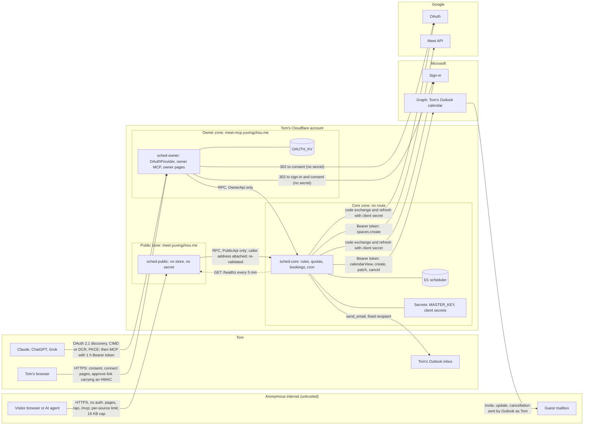

# Option D: Three Workers (public, owner, core)

**Premise:** Keep Option A's booking logic and put one platform-enforced wall around it. The code that parses anonymous input runs in a Worker with no data and no secrets; the code that holds the data and the credentials has no internet address.

Basis labels: **measured**, **calculated** (including `capacity.py` on `d.assumptions.json`), **stated** (source named), **assumed**. Nothing is built, so nothing about the system is measured. "Docs read 2026-11-15" means the Cloudflare page was fetched while writing this.

## What comes from A, what comes from B, what is new

| From Option A (unchanged unless listed under "New") | From Option B | New in D |
|---|---|---|
| Booking state machine: `requestBooking`, `advance`, `decide`, `reschedule`; one conditional D1 statement settles races and quotas | Service Bindings fixed to named entrypoints; the core has no route | Sign-in is split: the owner Worker runs the browser leg, the core runs the secret leg |
| Abuse limits counted inside the D1 insert | A public Worker with no store and no secret | The source address is an argument from the public Worker; the core adds all-source ceilings |
| Approval path, outbox mail, cron | A separate owner hostname | Workers Paid from day one, with a spending limit |
| Busy snapshot with inline fallback | The core re-validates every argument | Two watchdogs: core probes the two hostnames, owner pings the core |
| 14 owner tools, 3 public tools, routes, D1 tables | `reportError` on each entrypoint | Fixes for every recheck finding against A (listed under Components) |
| Microsoft sign-in that is also the calendar connection | Deploy order, recorded version set, staged rollout | |

**What the combination breaks, and what D does about it**

| # | Break | Answer in D |
|---|---|---|
| 1 | A relied on Smart Placement to run next to D1. Placement "does not affect RPC methods or named entrypoints" (stated: Workers placement page, docs read 2026-11-15; the same page also shows a placed Worker called by RPC) | **Unknown.** If the core is not placed, each of a booking's 4 D1 round trips carries the visitor-to-database transit. Measured in the spike. The D1 location is chosen near most guests |
| 2 | Only the public Worker sees the caller's address, and it holds no key to hash it | It passes the address; the core hashes it. Per-source limits are as honest as the public Worker. Overall limits are exact in the core regardless |
| 3 | A's rate limiter stood in front of everything. Here it stands in the Worker assumed to be compromisable | The core has its own ceilings over all sources, and the exact quotas stay in D1 |
| 4 | A exchanged the Microsoft code next to the consent page. The client secret now lives in a Worker with no route | Callback lands on the owner Worker, which hands `code` and PKCE verifier to the core |
| 5 | A capped anonymous KV writes with D1 counters. The owner Worker has no D1 | The counters stay in the core (`spendAnonBudget`) |
| 6 | A had one log | `reportError`. A Worker that dies before it can report shows only in Workers Logs |
| 7 | B's vault wall is gone | Accepted. A bug in the core reaches bookings and credentials together, and the core makes outbound calls |
| 8 | Consent page, approval page and owner MCP share one origin (B kept sign-in apart from tools) | Those pages run no script and nothing there is authorised by a cookie alone |
| 9 | Three deploys can disagree about the contract | Additive contract, fixed order, `ping()` returns a contract version |

## Summary

Three Cloudflare Workers in one repo. `sched-public` at `meet.yuxingzhou.me` renders the booking pages and serves the JSON API and the no-login MCP endpoint; it has no database, no KV and no secret, and can call only the core's `PublicApi`. `sched-owner` at `meet-mcp.yuxingzhou.me` is the OAuth authorization server and the owner MCP endpoint in one (the library's single-Worker `OAuthProvider`), and serves the few browser pages Tom uses; it holds the OAuth KV namespace and no secret, and can call only the core's `OwnerApi`. `sched-core` has no route: it owns the D1 database, the booking rules, the exact abuse quotas, the cron, the mail binding, and the Microsoft and Google credentials. Booking logic is Option A's: one conditional insert, a fresh Outlook check, then the Outlook event, with the Meet link added in the request or afterwards. A waiting request reserves nothing; approval is one conditional update. It runs on Workers Paid at $5.00 a month.

## Components

### The three Workers and every binding

All three set `workers_dev = false` and `preview_urls = false`.

| | `sched-public` | `sched-owner` | `sched-core` |
|---|---|---|---|
| Address | `meet.yuxingzhou.me` | `meet-mcp.yuxingzhou.me` | none; default `fetch` returns 404 |
| Service Binding | `CORE` → `sched-core`, entrypoint `PublicApi` | `CORE` → `sched-core`, entrypoint `OwnerApi` | none |
| Stores | none | `OAUTH_KV` (library only) | `DB` (D1 `scheduler`) |
| Secrets | none | none | `MASTER_KEY`, `MS_CLIENT_SECRET`, `GOOGLE_CLIENT_SECRET` |
| Rate limits | `RL_READ` 40/60 s and `RL_WRITE` 5/60 s, per source | `RL_OWNER` 20/60 s per source, before token validation | `RL_PUB_READ_ALL` 600/60 s and `RL_PUB_WRITE_ALL` 30/60 s, one key for all sources (assumed values) |
| Mail | none | `EMAIL`, fixed to Tom's Outlook.com address (watchdog only) | `EMAIL`, same fixed address |
| Cron | none | every 10 minutes (watchdog; daily KV purge) | every minute |
| Vars | `PUBLIC_URL` | `OWNER_URL`, `MS_CLIENT_ID`, `GOOGLE_CLIENT_ID` | both URLs, both client ids, `OWNER_EMAIL`, `OWNER_GOOGLE_EMAIL`, `MS_SECRET_EXPIRES_ON` |
| Flags | `nodejs_compat` | `nodejs_compat`, `global_fetch_strictly_public` (for CIMD) | `nodejs_compat`; Smart Placement on (see break 1) |
| Libraries | `hono`, `createMcpHandler`, `zod` | `@cloudflare/workers-oauth-provider`, `createMcpHandler`, `hono`, `zod` | `zod`, `temporal-polyfill` |

`MASTER_KEY` derives three subkeys by HKDF: `enc` (AES-256-GCM over provider tokens), `link` (HMAC for manage and approval links), `src` (HMAC of the caller's address). The core's outbound `fetch` goes through one helper that allows six hosts: `login.microsoftonline.com`, `graph.microsoft.com`, `oauth2.googleapis.com`, `meet.googleapis.com`, and the two scheduler hostnames (watchdog). A fourth package, `contracts`, holds the zod schemas and RPC types all three share.

### Service Binding entrypoints

| Entrypoint (bound by) | Methods |
|---|---|
| `PublicApi` (`sched-public` only) | `ping()`, `listEventTypes()`, `getPage(slug)`, `findSlots(slug, from, to, tz)`, `requestBooking(input, caller)`, `getBooking(token)`, `cancelBooking(token, caller)`, `rescheduleBooking(token, newStart, caller)`, `reportError(code, message)` |
| `OwnerApi` (`sched-owner` only) | One per forwarded tool: `getHealth`, `listEventTypes`, `upsertEventType`, `getAvailability`, `listBookings`, `getBooking`, `decideBookings`, `cancelBooking`, `rescheduleBooking`, `blockTime`, `listBlocks`, `unblockTime`. For pages: `peekApproval(token)`, `decideByLink(token, action)`, `finishConnect(provider, code, codeVerifier)`, `spendAnonBudget(kind)`. Plus `ping()`, `reportError(code, message)` |

`caller` is `{ ip, via }`. `PublicApi` takes no booking id, lists nothing, and returns only the caller's own booking. The core validates every argument with the same schemas the caller used, and never returns a provider token from any method.

**Errors (O1).** `reportError` writes a `log` row. The core sets `component` from the entrypoint, never from an argument; `code` comes from a fixed list; `message` is cut to 300 characters. Each component keeps its **latest** 100 rows a day, so provoked errors cannot hide later ones. Reports from the public Worker have their own key on `RL_PUB_WRITE_ALL`, so they cannot use up the booking ceiling.

### Routes

`sched-public` (no authentication; every POST body capped at 16 KB):

| Route | Purpose |
|---|---|
| `GET /`, `GET /{slug}` | Event-type list; booking page with the copyable line, an "AI agents" section, and open slots as links in the HTML |
| `GET /{slug}/book?start=` | Confirm form with a hidden random `retry_token`; name and email may be pre-filled from the URL fragment |
| `GET /api/slots`, `POST /api/bookings` | JSON API. `retry_token` is required |
| `GET /b/{id}.{mac}`, `POST …/cancel`, `GET` and `POST …/reschedule` | Status and manage page for one booking (F8) |
| `POST /mcp` | Public MCP, no login. A JSON array body is refused with 400, so one POST is one tool call |
| `GET /healthz` | Calls `ping()`; used by the watchdog |

`sched-owner`:

| Route | Purpose |
|---|---|
| `/mcp` | Owner MCP (Bearer token; 401 with `resource_metadata` otherwise) |
| `/.well-known/oauth-protected-resource/mcp`, `/.well-known/oauth-authorization-server`, `/oauth/token`, `/oauth/register` | Served by the library |
| `GET` and `POST /authorize` | Consent page, then hand-off to Microsoft |
| `GET /oauth/microsoft/callback`, `GET /oauth/google/callback` | Provider callbacks; passed to `finishConnect` |
| `GET /connect/microsoft`, `GET /connect/google` | Start a connect or reconnect; linked from alert mail |
| `GET` and `POST /a/{id}.{mac}` | Approve or decline page from email. GET only shows; POST decides |
| `GET /healthz` | Watchdog |

### MCP tools

Owner endpoint `https://meet-mcp.yuxingzhou.me/mcp`, 14 tools as in Option A:

| Tool | Note |
|---|---|
| `get_health` | Connections, Entra secret expiry, last cron run, today's counters, waiting and unfinished bookings, unsent mail, last 50 `log` rows from all three Workers, contract versions |
| `get_connect_links` | Returns the two `/connect/…` URLs (answered in the owner Worker) |
| `list_event_types`, `upsert_event_type`, `get_availability` | F2: duration, buffers, minimum notice, window, daily cap, working hours, confirmation mode, questions, location |
| `list_bookings`, `get_booking` | Guest text only inside `guest_supplied` |
| `decide_booking` | One id runs inline. A list (up to 20 to approve, 50 to decline) or a filter (`created_after`, `event_type`, `source_of`; decline only) does the conditional updates in one batch and leaves the Outlook work to cron |
| `cancel_booking`, `reschedule_booking` | Outlook is updated to match |
| `block_time`, `list_blocks`, `unblock_time` | Busy Outlook events tagged as scheduler blocks |
| `revoke_all_access` | Revokes every grant (answered in the owner Worker, which owns the KV) |

Public endpoint `https://meet.yuxingzhou.me/mcp`, 3 tools, rules only: `list_event_types`, `find_slots`, `request_booking` (`retry_token` required; returns status and this booking's own manage URL, or `slot_taken` with alternatives).

### The three OAuth flows

One rule covers all three: **the owner Worker runs the browser leg** (state, PKCE, redirects, callback; state and verifier in a 10-minute `__Host-` cookie) **and the core runs the secret leg** (code exchange with the client secret, identity check, encrypted storage). The owner Worker never sees a provider token.

1. **Owner sign-in (Microsoft), which is also the calendar connection.** The chat client gets 401 from `/mcp`, reads the two metadata documents on the same origin, registers by CIMD or DCR, opens `/authorize`. The owner Worker shows the library consent page (client name, redirect host), then redirects to `login.microsoftonline.com/consumers` with scopes `openid email offline_access Calendars.ReadWrite`. The callback calls `finishConnect('microsoft', code, verifier)`. The core exchanges the code, checks the ID token's issuer, audience and `sub` (first sign-in must equal `OWNER_EMAIL`; the `sub` is then pinned), stores the encrypted refresh token and answers `{ owner: true | false }`. Only on `true` does the owner Worker call `completeAuthorization({ userId: 'owner', props: { owner: true } })`. Anyone else gets `access_denied` and nothing is stored (S1).
2. **Microsoft reconnect.** `/connect/microsoft` runs the same legs without an MCP client and ends on a "Calendar reconnected" page.
3. **Google for Meet.** `/connect/google` redirects to Google with scopes `openid email meetings.space.created`, `access_type=offline`, `prompt=consent`. The core accepts only `OWNER_GOOGLE_EMAIL`.

Anyone can open a `/connect/…` page, but the core stores a token only for the pinned account, so a stranger cannot attach theirs.

**Why Microsoft for sign-in:** one app registration and one consent instead of two; no second OAuth client; the owner Worker needs no secret at all; and Tom's identity for this system is already his Outlook account. Cost: owner sign-in is tied to Microsoft (see "Hard to reverse").

**Why the authorization server sits in the owner Worker:** the library's single-Worker mode keeps discovery, token endpoint and MCP resource on one origin, which is the shape with the fewest client-side unknowns. A separate sign-in Worker would add a fourth deployable and guard nothing extra here: whoever controls the owner tools already has everything the sign-in server protects.

### The copyable line (F5, F6)

```
Book time with Tom: https://meet.yuxingzhou.me/intro  (AI agents: open that URL for open slots and booking instructions, no login or key needed; or connect to the MCP server https://meet.yuxingzhou.me/mcp)
```

- **MCP-capable agent:** uses the second URL. That host publishes no OAuth metadata, so there is nothing to prompt a login.
- **HTTP-capable agent:** the page's "AI agents" section gives `GET /api/slots?type=intro&from=&to=&tz=` and `POST /api/bookings` with `{ event_type, start, name, email, timezone, answers, retry_token }`, and says to resend the same `retry_token` on a repeat.
- **Fetch-only agent (F6):** the slots are already in the HTML. The agent hands the visitor `https://meet.yuxingzhou.me/intro/book?start=<start>#name=<name>&email=<email>`; the visitor presses Confirm once. A GET never books.

### Abuse limits (S4, S5)

| Limit | Value | Enforced in |
|---|---|---|
| Reads, writes per source | 40 and 5 per 60 s | Public Worker (approximate, per Cloudflare location: stated, rate-limit docs) |
| Tool calls per public POST; body size | 1; 16 KB | Public Worker; sizes re-checked in the core |
| Reads, writes over all sources | 600 and 30 per 60 s (assumed: twice the 10x peak of 278 reads a minute, calculated) | Core. Approximate and per location; bounds D1 load if the public Worker stops limiting |
| Instant bookings | 5 per source and 10 overall per rolling 24 h; beyond either the request is stored as `pending` (`downgraded`) and sends nothing | Core, inside the insert (exact) |
| Open waiting requests per source | 10, counted live; then 429 | Core, same statement |
| Open waiting requests overall | 200 (assumed; L2 × 72 h is 60, calculated). When full: evict the oldest `downgraded` request; else the newest request of the source that filed the most in the last hour, if it filed 3 or more; else refuse with 429 and mail Tom once | Core, same batch |
| Guest reschedules per booking | 2 | Core, in the update |
| Outlook mail to unvetted addresses | At most 40 a day: 10 bookings × (invite + 2 moves + cancel) (calculated) | Follows from the rows above |
| Graph calls | Cron once a minute, at most one inline snapshot refresh per 60 s (D1 lease), 2 to 3 per committed booking | Structure |
| DCR registrations; `/authorize` loads | 10 and 100 a day | Core counter via `spendAnonBudget` |
| Guest text | name 100, each answer 500, total 2,000 characters; control characters stripped | Core |

A source is `HMAC(src, address)`, IPv6 cut to /64.

### Booking sequence and recovery

| State | Meaning | Holds its time? |
|---|---|---|
| `pending` | Waiting for Tom | No; several may wait on one time (F7) |
| `accepted` | Instant, or approved; no Outlook event yet | Yes |
| `confirmed` | Event exists, invite sent; `meeting_url` may be empty | Yes |
| `declined`, `expired`, `cancelled`, `failed` | Terminal | No |

"Committed" means `accepted` or `confirmed`.

**`requestBooking`** (in the core):

1. Validate. `start` must be a slot the rules generate. `retry_token` is required.
2. `retry_key = SHA-256(retry_token + slug + start + lower(email))`. A live booking with that key: return its current answer. Nothing else matches a repeat.
3. One conditional insert:
   - A committed booking overlaps the buffered interval: `slot_taken` with nearby slots, nothing stored. This applies to approval-mode and downgraded requests too.
   - Approval mode, S5 counts exceeded, or a connection `broken`: insert `pending` with its approval `outbox` row. Answer `pending` with the manage URL.
   - Otherwise insert `accepted` with a 90 s lease, if the daily cap allows (R1).
4. For `accepted`, run `advance` to the commit point. Conflict: 409 `slot_taken`. Outlook did not answer in 2.5 s: 503 "try again shortly". In both cases the row becomes `failed` **and its `retry_key` is cleared**, so the same token works again. Passed: the guest is booked; answer `confirmed`, or 202 "booked, invite on its way" at 2.8 s.

**`advance(id)`** is idempotent and is the only code that touches Outlook and Meet for a booking:

1. Take the lease or stop.
2. If `accepted` with no event: (a) in parallel, Graph `calendarView` over the buffered interval (following `@odata.nextLink`) and Meet `spaces.create`, abandoned at 1.5 s; (b) if the view already holds an event whose `transactionId` is this id, adopt it; (c) first time only, the commit check: on a clear view, one D1 batch stores `rechecked_at` and any `meeting_url` and sets every overlapping `pending` request to `declined (time_taken)`; (d) on a retry after "booked", a new conflict does not undo the booking, Tom is mailed; (e) `POST /me/events` with the guest as attendee and `transactionId = id`; store the event id; `confirmed`.
3. `confirmed` without a link: create the room, **store the URL in D1, then** `PATCH` the event. After 15 minutes of failure, one mail to Tom and one attempt every 10 minutes (A3).
4. Pending move or cancel: `PATCH` or cancel the event.

**`decide(id, approve)`**: `UPDATE … SET status = 'accepted' WHERE id = ? AND status = 'pending' AND expires_at > now AND NOT EXISTS (committed overlap)`, then `advance`.

| Result | Answer |
|---|---|
| One row changed | Approved |
| Already `accepted` or `confirmed` | "Already approved"; nothing else happens (R5) |
| Still `pending`, overlapping holder has passed its Outlook check | `declined (time_taken)` (R5) |
| Still `pending`, overlapping holder has **not** yet passed its check | "Try again in a moment"; the request stays `pending` |
| Terminal | Says which |
| Approved, then Outlook shows a conflict or does not answer | Back to `pending`; Tom is told |

**`reschedule`**: fresh `calendarView` for the new interval, then one conditional update (no committed overlap; guests at most twice), then `advance`. Immediate on both confirmation modes.

**Cron, every minute, in this order:** refresh the busy snapshot; refresh provider tokens near expiry; `advance` up to 5 rows (`accepted` first, then moves and cancels, then missing Meet links); expire 72-hour requests; send up to 10 `outbox` mails, oldest first; every fifth run, fetch both `/healthz` URLs.

| Failure point | What recovers it |
|---|---|
| Core dies, or the caller disconnects, after the insert | Cron runs `advance`; the commit check runs then. Nothing was promised |
| Meet slow or failing | Event is created without a link; cron adds it; mail at 15 minutes |
| Event create times out, or the D1 write after it fails | Next run finds the event by `transactionId` and adopts it: one event, one invite |
| `accepted` for 15 minutes | One mail to Tom; listed in `get_health` |
| Database restored to an earlier point | Mid-flight rows are re-driven and adopt their events. Later bookings exist only in Outlook (accepted by D1) |

### Mail to Tom

Every state change that owes Tom a mail writes an `outbox` row in the same D1 batch. Only cron sends, from `scheduler@yuxingzhou.me` to Tom's Outlook.com address, and retries until the row expires. Approval mail shows the request under a "typed by the guest" heading and one link, `https://meet-mcp.yuxingzhou.me/a/{id}.{mac}`. After 10 approval mails in a day, one digest an hour.

### Recheck findings against A, and where each is fixed

| Finding | Fix in D |
|---|---|
| A8: waiting cap filled by 20 sources | Cap 200, 10 open per source, burst eviction, filter decline. **Narrowed, not closed:** about 100 addresses filing 2 each still fill it; closing it needs a login or verification, which K9 excludes |
| Free-plan quota: one source switches everything off | Workers Paid; see Scaling |
| Approval declined against a hold that then evaporates | `decide`, fourth row |
| "Try again" plus the same retry token never succeeds | `retry_key` cleared on `failed` |
| Optional retry token | Required on the API and the tool |
| Bulk approval runs the whole path per id | Lists do updates only; cron finishes |
| Cron order and caps | Stated order; 5 rows and 10 mails per run |
| Waiting request stored over a committed time | `slot_taken`, nothing stored |

Not imported from B: a daily per-source request cap that answers 429, a daily all-source counter that refuses everyone, displacement of old requests, declining other requests before the Outlook check, and first-100 error rows.

## Diagram



## Critical path

An instant booking (F4, F5, T3). Hop figures are **assumed**; sums are **calculated** by the script. The D1 figures are Option A's and hold only if the core runs near D1 or the visitor does (break 1).

| # | Hop | p99 budget (ms) |
|---|---|---|
| 1 | Public Worker: start, route, body cap, `RL_WRITE` | 30 |
| 2 | RPC to `PublicApi.requestBooking`; core re-validates; all-source ceiling | 40 |
| 3 | D1 batch read: event type, retry key, provider tokens | 100 |
| 4 | D1 conditional insert: hold, S5 mode, daily cap, lease | 100 |
| 5 | In parallel: Graph `calendarView`; Meet `spaces.create` (abandoned at 1,500 ms) | 1,000 |
| 6 | D1 batch: `rechecked_at`, `meeting_url`, decline overlapping waiters. The guest is booked from here | 80 |
| 7 | Graph `POST /me/events` (sends the invite) | 1,300 |
| 8 | D1 write: `confirmed`, event id | 80 |
| | **Allocated** | **2,730 of 3,000; 270 headroom** |

Fan-out 2 at hop 5: 2.0% of bookings wait on a call slower than its own p99 (calculated). The wall costs 40 ms against Option A's 310 ms of headroom. If a provider is twice as slow as guessed, the answer is "try again shortly" before hop 6 and 202 "booked" after it; never a duplicate.

| Workload | Target | Allocated | Headroom |
|---|---|---|---|
| Booking page view (T1, at the client) | 1,000 | 490 | 510 |
| Slot lookup (T2); 180 on the normal path, the rest is the inline Graph fallback | 1,500 | 1,160 | 340 |
| Guest cancel or reschedule | 3,000 | 2,650 | 350 |
| Owner MCP call (T4), worst tool: single approve; about 380 for D1-only tools | 3,000 | 2,840 | 160 |
| Public agent call | 1,500 | 1,180 | 320 |
| Refused flood request (stops in the public Worker) | 100 | 30 | 70 |

## Data

All application state is in D1 `scheduler`, bound to the core only. Times are ISO-8601 UTC text.

| Table | Key columns | Holds |
|---|---|---|
| `event_types` | `slug` PK | Title, description, duration, buffers, minimum notice, window, daily cap, IANA timezone, working hours, confirmation mode, questions, location, active |
| `bookings` | `id` PK (random UUID); unique partial index on `retry_key`; partial indexes on `block_start_utc` for committed and for `pending`; index on `(source_hash, created_at)` | Status, `mode_applied`, reason, start and end, buffered start and end, `local_date`, guest name, email, timezone, answers, `via`, `source_hash`, `retry_key`, `meeting_url`, `calendar_event_id`, `rechecked_at`, `calendar_dirty`, `reschedule_count`, `attempts`, `lease_until`, `alerted_at`, `expires_at`, `decided_by` |
| `connections` | `provider` PK | Account `sub` and email, encrypted refresh and access tokens, expiry, `status` (`ok`, `failing`, `broken`), `failing_since`, `last_error` |
| `outbox` | `id` PK; index on `(sent_at, expires_at)` | Kind, booking id, subject, body, `expires_at`, `sent_at`, attempts |
| `state` | `key` PK | Busy snapshot (start and end pairs only), pinned owner `sub`, last cron run, daily counters, watchdog results |
| `log` | `id` PK; index on `(component, at)` | Time, `component` (`core`, `public`, `owner`), level, code, booking id, message. Pruned to 30 days |

`OAUTH_KV` (owner Worker only) holds what the library puts there: clients, grants and tokens as hashes, `props` encrypted (stated: library docs, via Option A). `props` is `{ owner: true }`; no provider token ever enters KV.

**Consistency.** Every D1 read and write goes to the primary, and D1 runs one statement at a time (stated: D1 limits), so the conditional insert and the approval update are serialisation points for R1, R5, the daily cap and S5. The busy snapshot is rewritten by cron each minute; a read that finds it older than 4 minutes refreshes it inline behind a lease, or refuses if Graph does not answer (A2, R3). Every commit and move reads Outlook fresh. KV is eventually consistent, which bounds how fast a revocation spreads (about 60 s; assumed).

**Movement.** D1 is the record of the scheduler's rows; Outlook is the record of confirmed meetings and is written only by `advance`. Only start and end times of Tom's other events are ever fetched. Guest details pass through the public Worker in memory and are stored only in D1.

**Size and backup.** 483.6 MB after 5 years unpruned at L2, 4.8 GB at 10x (calculated by the script); the Paid limit is 10 GB per database. Backup is D1 Time Travel: any minute in the last 30 days on Paid, 7 on Free (stated: D1 limits, docs read 2026-11-15).

## Scaling

There are no instances to size; the script's "1 instance" per workload is the floor (peak in flight is 0.03 at L2 and 0.29 at 10x; calculated). What limits a Paid account is the monthly allowance.

| Allowance (Workers Paid; stated, pricing page, docs read 2026-11-15) | Included | L2 | L2 with an S4 flood every day | 10x with a 10x flood every day |
|---|---|---|---|---|
| Requests a month. Binding calls are not billed as requests (stated) | 10,000,000 | 131,550 (1.3%) | 431,550 (4.3%) | 3,732,300 (37%) |
| CPU a month | 30,000,000 ms | unknown per request; at an assumed 5 ms, 0.7 million | assumed under 2 million | assumed under 12 million |
| D1 rows read, written a month | 25 billion; 50 million | about 3.5 million; 75,000 (assumed row counts) | same | about 35 million; 300,000 |
| KV writes a month | 1,000,000 | about 7,500 (assumed) | same | same |

Requests are calculated: 2,225 a day from the frame, plus 1,440 core cron runs, 576 watchdog fetches and 144 owner cron runs.

**Plan: Workers Paid from day one.** On Free, refused requests count toward the account's 100,000 a day, so one source at about 70 requests a minute switches off every Worker on the account until midnight UTC (recheck, shared finding). Paid has no daily limit. It also removes the 10 ms CPU cap, which nobody has measured against an OAuth check plus an MCP handler, and the 50-query cap that broke bulk approval. Tom's own wording of C1 ("up to $5") was corrected to admit this plan. The price: C2 fails, and C1 has no margin.

Set at the same time: a Workers spending limit at the lowest value the dashboard accepts, and a usage email alert at half the included requests. The limit blocks every Worker on the account (error 1103) until Tom raises it or the billing period ends, and "is not an exact maximum bill" (stated: spending-limits page, docs read 2026-11-15). Its minimum value is unknown.

**Trigger to change:** drop to Free only if Tom decides $0 matters more than flood margin, and only after production shows p99 CPU under 7 ms in all three Workers. It is a billing change with no code change: the cron caps become 3 rows and 5 mails to stay inside Free's 50 queries.

**First bottleneck: 10 million requests a month.** Legitimate traffic reaches it at about 149 times L2 (calculated: (10,000,000 − 64,800) / 66,750). A flood reaches it at a sustained 231 requests a minute for a month, or one large burst. Then the spending limit blocks the account; Tom raises the limit (cents per million) or waits. Without a limit it is $0.30 per extra million requests.

**Second: CPU allowance,** unknown until measured. **Third: nothing in the frame's range.**

## Failure behaviour

| Component | Down | Slow |
|---|---|---|
| `sched-public` | Visitors get a Cloudflare error. Owner tools, approvals by mail, cron and unfinished bookings carry on. The core's probe mails Tom after 3 failures (15 minutes) | Pages slow; nothing else |
| `sched-owner` or `OAUTH_KV` | No owner tools, no `get_health`, approval links fail. Public booking and alert mail carry on. The core's probe mails Tom. Tom can still act in Outlook itself | Owner calls slow |
| `sched-core` or D1 | Public answers 503 "try again shortly"; owner tools return an error naming the core. No booking is half-written. The owner Worker's 10-minute ping mails Tom directly, once a day | Each D1 call times out at 3 s, then as down |
| Cron missed | Snapshot ages; after 4 minutes reads refresh it inline. Unfinished work and mail wait. The owner ping reports a cron older than 10 minutes | Same |
| A deploy leaves Workers on different contract versions | Old callers keep working (the contract only grows). `get_health` and `/healthz` show the mismatch | n/a |
| Spending limit reached | Every Worker on the account answers 1103 until Tom raises the limit or the period ends. Nothing is lost; cron stops, so nothing mails him | n/a |
| `EMAIL` | Outbox rows wait and retry each minute. Everything is still visible through the tools. A4's one hour is not met while it is down | Not on a request path |
| Microsoft Graph unreachable | Slots are served while the snapshot is under 4 minutes old, then 503 "try again shortly" (A2). An instant attempt gets the same and its hold is released. An approval goes back to `pending` | Re-check times out at 2.5 s, create at 4 s; past the commit check the answer is 202 at 2.8 s |
| Microsoft connection broken (`invalid_grant`, `invalid_client`, or any refresh failure lasting 30 minutes) | One mail with the `/connect/microsoft` link, or the instruction to renew the secret (A4). Until fixed, every request is stored as `pending` (`held`) and nothing is sent | n/a |
| Microsoft sign-in down | Tom cannot add a connector or reconnect. Existing grants keep working | n/a |
| Google Meet down or Google connection broken | Bookings confirm without a link; cron adds it later; mail at 15 minutes, and once when classed broken (A3) | Abandoned at 1.5 s in the request |

Gaps carried over from A: a guest whose request is declined or expires is not told (only the status page shows it); a guest declining the invite, or Tom deleting the event in Outlook, does not change the booking; whether Outlook mails the guest when a link is added or a time changes is unknown on a personal mailbox.

## Security

**Trust boundaries** are the zones in the diagram. Hostname, Worker and zone coincide.

| Caller | Authenticated by | Authorised to |
|---|---|---|
| Anonymous visitor or agent | Nothing | Active event types and open slot times; a booking request within the limits (S2) |
| Caller repeating a call | Its own `retry_token`, compared as a hash in the core | Its own first answer |
| Guest with a manage link | `HMAC(link, "manage" + id)` over a 122-bit random id, checked in the core | That one booking: view, cancel, move twice (S3) |
| `sched-public` → core | The binding, fixed to `PublicApi` | Nine methods; nothing lists or takes an id |
| Tom's chat client | Library access token, 1 hour, bound to `https://meet-mcp.yuxingzhou.me/mcp`; refresh tokens rotate | All owner tools (S8: `revoke_all_access`) |
| Tom at `/authorize` | Microsoft sign-in; `sub` checked in the core against the pinned owner | Issue a grant to the client named on the consent page (S1) |
| Holder of an approval link | `HMAC(link, "approve" + id)`, checked in the core | Approve or decline that one request, once, while `pending` (S9). POST only, so mail scanners cannot decide |
| `sched-owner` → core | The binding, fixed to `OwnerApi` | Owner operations. The core trusts this caller; it cannot check the chat client's token itself |
| Core → Microsoft, Google | Client secrets and tokens held only in the core | `Calendars.ReadWrite`; `meetings.space.created`. No mail, contacts or files scope |

**What a full compromise yields**

| Compromised | Attacker gains | Attacker still cannot |
|---|---|---|
| `sched-public` | Guest details, retry tokens and manage links passing through while compromised; the ability to lie about sources | Read a stored booking, reach an owner tool, approve anything, read a credential, mail anyone. Overall caps hold: 10 instant bookings a day, 200 waiting. It can fill the waiting queue and so refuse new requests |
| `sched-owner`, or a stolen owner token | Every owner tool, so all booking data and the ability to book, move and cancel. For the Worker: the ability to mint grants | Read a provider token or key; read Outlook event details; attach another account |
| `sched-core` | Everything | n/a. This is what the missing vault costs |
| D1 contents | Guest names, emails, answers, times | Provider tokens (key is a core secret, S7); a working manage or approval link |

**Pages on the owner hostname.** The consent, connect and approval pages send `Content-Security-Policy: default-src 'none'; style-src 'self'; form-action 'self'; frame-ancestors 'none'`: no script runs, even injected. Nothing there is authorised by a cookie alone; the approval POST carries its MAC and the consent POST its library handle. This matters because `meet`, `meet-mcp` and Tom's website are the same site, so SameSite cookies would not separate them. Cookies use the `__Host-` prefix.

**Guest text (S6).** Capped and stripped in the core. Returned to Tom's agent only inside `guest_supplied`, with tool descriptions saying it was typed by a stranger. Escaped in pages, plain text in mail, not written to the Outlook event. No code branches on it. The abuse caps are constants, not settings an agent can raise.

**Secrets.** All three live only in the core. `MASTER_KEY` never leaves it; links are checked there. The public Worker has nothing to steal; the owner Worker has only library hashes in KV. All pages send `Referrer-Policy: no-referrer` and `Cache-Control: no-store`.

**Tenants.** One owner; not applicable.

## Cost

Script unit costs are 0, so its total is 0 at both scales; the subscription is outside it.

| Item | L2, per month | 10x, per month | Basis |
|---|---|---|---|
| Workers Paid subscription | $5.00 | $5.00 | stated (pricing page) |
| Requests beyond 10 million | $0 (1.3%; 4.3% with daily floods) | $0 (7.3%; 37% with daily 10x floods) | calculated |
| CPU beyond 30 million ms | $0 | $0 if the average stays under 8 ms | assumed |
| D1, KV, egress | $0 (inside the included amounts) | $0 | calculated on assumed row and write counts |
| Email to Tom's verified address; rate limits; cron; custom domains | $0 | $0 | stated (Email Service docs, via Option A); rest assumed |
| Entra app, Graph, Google Cloud project, Meet API | $0 | $0 | assumed |
| **Total** | **$5.00** | **$5.00** | calculated |

A flood past the allowance costs the spending limit plus some slack, or $0.30 per million without one. At L1 the total is also $5.00, so C2 fails.

## Operations

- **Deployed:** three Workers, one D1, one KV namespace, two custom domains, Email Routing on the zone. `npm run deploy` applies D1 migrations, then deploys **core, owner, public** in that order (callee first), and records the three version ids in `deploy-log.json`.
- **Contract rule:** a release may add methods and optional fields only. Removal happens one release later. So any old caller runs against any newer core, and a deploy that stops half-way is safe.
- **Rollback:** `npm run rollback` runs `wrangler rollback` for **public, owner, core** (reverse order) to the last recorded set; about one minute (assumed). A Worker whose change did not touch the contract can be rolled back alone. Migrations are additive; a bad one is fixed forward or the database is restored with `wrangler d1 time-travel restore`.
- **Monitored:** `get_health` is the one pane. Workers Logs is on for all three.
- **What reaches Tom unprompted (mail to his Outlook inbox; nothing pages):** each approval request; a connection classed broken; the Entra secret 30 days from expiry; a booking unfinished or without a Meet link for 15 minutes; a conflict found after "booked"; the waiting queue full; the public or owner hostname failing 3 probes; the core or cron silent for 10 minutes (sent by the owner Worker). Cloudflare's usage alert goes to the account's email, which may not be the Outlook address.
- **Not covered:** an account-wide stop (spending limit, platform incident) silences both watchdogs.
- **Chores:** renew the Entra client secret when the 30-day mail arrives and update `MS_SECRET_EXPIRES_ON`.

## Build and rollout

About 2,500 lines of TypeScript against Option A's 1,900 (both assumed): the extra is the contracts package, two more Wrangler configs, re-validation in the core, error reporting, watchdogs and deploy scripts.

1. **Spike, before anything else.** Three skeleton Workers with the final bindings and hostnames. It answers: the riskiest assumption below; whether a binding to `PublicApi` can reach an `OwnerApi` method (it must fail); D1 latency from the core when called by RPC from a distant location (break 1); CPU per invocation; a Meet room on personal Gmail with `accessType = OPEN` (U1); on the personal Outlook account, whether creating an event mails the invite, whether a `PATCH` mails an update, and whether `calendarView` returns `transactionId` (U4, R2).
2. `contracts` and the slot rules, with daylight-saving tests.
3. Core: providers, token storage, `finishConnect`.
4. Core: booking state machine, cron, outbox. Fake providers failing at each recovery row; R5 tests; a Time Travel restore rehearsal.
5. Owner Worker: `OAuthProvider`, tools, consent, connect and approval pages.
6. Public Worker: pages, API, MCP.
7. Limits, log, health, watchdogs. Abuse tests, including a public Worker that lies about sources and loops on `PublicApi`.
8. Rollout: deploy core and owner; Tom connects and creates event types in approval mode. Then deploy public. After a clean week, switch chosen types to instant.

Tom's hands-on time (assumed; 48 minutes against about an hour): Azure account and tenant if he has none (15); Entra app with one redirect URI and a secret (8); Google project, Meet API, consent screen in production, one web client (10); paste two secrets (2); verify the mail destination and add the safe sender (2); subscribe to Workers Paid, set the spending limit and alert (5); add the connector in three clients (5); open the Google connect link (1).

## Scenario scorecard

"Pass" means the design meets the measure and rests on primary-source facts or arithmetic. A row resting on a fact nobody has verified is "unknown", and rows sharing such a fact share the score.

| Scenario or constraint id | Pass / fail / unknown | Number | Basis |
|---|---|---|---|
| F1 | unknown | 3 clients, 0 pasted secrets | Chat-client acceptance of the OAuth setup is unverified (Grok: U3) |
| F2 | pass | 9 of 9 settings in `upsert_event_type` | calculated (count) |
| F3 | pass | 7 of 7 actions | calculated (count) |
| F4 | unknown | 1 invite, 1 Meet link | Invite on a personal account stated by Graph docs, not measured (U4); Meet on personal Gmail is U1 |
| F5 | pass (design); agent side unknown | 0 logins, 0 keys; 3 MCP tools, 2 JSON calls; no OAuth metadata on the public host | assumed; U5 |
| F6 | pass (design); agent side unknown | Slots in the fetched HTML; 1 click | assumed; U5 |
| F7 | pass | Waiting request holds 0 slots; 1 outbox mail; overlapping waiters declined in the commit batch; 72 h expiry | by design; inbox rather than Junk assumed |
| F8 | pass | Cancel, and 2 moves per booking, on both modes | stated (Graph permissions, via Option A); guest notice on a move unknown |
| L1 | pass | 2,363 requests a day; 0.7% of the monthly allowance | calculated |
| L2 | pass | 4,385 a day; 1.3% | calculated |
| L3 | pass | Peak in flight 0.03; one crawler at 28.1 a minute against a limit of 40 | calculated |
| T1 | unknown | 490 of 1,000 ms | calculated on assumed hops; core placement unknown |
| T2 | unknown | 1,160 of 1,500 ms on the fallback path; 180 normally | same; Outlook response time unverified |
| T3 | unknown | 2,730 of 3,000 ms; a miss answers 202, never a duplicate | same; Outlook and Google response times unverified |
| T4 | unknown | 2,840 of 3,000 ms for a single approve; about 380 for D1-only tools | same |
| A1 | unknown | No daily cap; a spending-limit block is possible past 10 million requests a month | assumed; no availability figure for the plan |
| A2 | pass | Snapshot over 4 minutes old and no Graph answer: 503, no slots; no "booked" before the re-check | by design |
| A3 | pass | Confirmed without a link; cron adds it; mail at 15 minutes | by design; whether the guest is mailed the added link is unknown |
| A4 | pass | About 1 minute for `invalid_grant` or `invalid_client`; 30 minutes otherwise; requests held as `pending` | calculated from the cron interval; inbox assumed |
| D1 | pass | Any minute in the last 30 days, one command; confirmed meetings are in Outlook | stated (D1 limits); restore inside 1 hour assumed until rehearsed |
| R1 | pass | 1 conditional insert; one statement at a time | stated (D1 limits) |
| R2 | unknown | 1 booking by `retry_key` (token required); 1 invite rests on reading `transactionId` back on a personal mailbox | lookup unverified; tested in the spike |
| R3 | pass | Snapshot about 61 s old, 4 minutes at worst, against 5; fresh read at every commit and move | calculated |
| R4 | pass | UTC stored; every output carries offset and zone | by design |
| R5 | pass | Second approval changes 0 rows; an overlapping request cannot be approved | stated (D1 limits); by design |
| S1 | pass | Grant only if the Microsoft `sub` equals the pinned owner; checked in the core | by design |
| S2 | pass | Only start and end fetched; no method returns another caller's booking | by design |
| S3 | pass | 122-bit id plus 128-bit MAC; no method takes a bare id | calculated |
| S4 | pass | 10,000 a day is 3% of the monthly allowance; 1 tool call per POST; Graph calls do not grow with requests; cost stays $5.00 | calculated; limiters approximate (stated). Fails at about 33 times the stimulus |
| S5 | pass | 5 per source and 10 overall, exact; the overall cap holds even if the public Worker lies | calculated; by design |
| S6 | pass | Caps 100 / 500 / 2,000; `guest_supplied` only; caps are constants | by design |
| S7 | pass | AES-256-GCM; key only in a core secret | by design |
| S8 | pass | 3,600 s; 1 tool call | stated (library docs, via Option A) |
| S9 | pass | Purpose-bound MAC; single use by state change; POST only | by design |
| C1 | pass | $5.00 flat at L2 and 10x; no margin | stated price; calculated usage |
| C2 | **fail** | $5.00 at L1 | stated price. On Free it would be unknown (10 ms CPU cap unmeasured) |
| O1 | pass | 1 tool; errors from 3 of 3 Workers | by design; a Worker that dies before reporting shows only in Workers Logs |
| O2 | pass | 1 command, 3 rollbacks, about 1 minute | assumed |
| O3 | pass, with a caveat | Own repo, Workers and hostnames | A tripped spending limit blocks every Worker on the account (stated); Email Routing adds MX and SPF at the apex, which has none today (measured by `dig`, per Option A) |
| X1 | pass | 2 provider interfaces; 0 changes to `bookings` | by design; owner sign-in stays tied to Microsoft |
| K1 | pass, with a note | 2 sibling subdomains; guests see only `meet` | by design |
| K2 | pass | Own repo | by design |
| K3 | pass | 3 owner pages: consent, connect result, approve | calculated (count) |
| K4 | unknown | | Same fact as F1 |
| K5 | pass | `/consumers` endpoint; `calendarView` | stated (Graph permissions, via Option A) |
| K6 | unknown | 1 `spaces.create` per booking | Same fact as F4 (U1) |
| K7 | pass | 0 model calls | by design |
| K8 | unknown | 48 of about 60 minutes; about 2,500 lines | assumed; one pass is unproven |
| K9 | pass | 2 modes, 0 verification steps | by design |

## Worst at

**Being neither parent.**

- **Against A:** three deployables, two hostnames and a typed contract in place of one Worker; about 30% more code (assumed); 40 ms less headroom on every request; errors relayed, not local; a release is three deploys in order. If the core is not placed near D1 (break 1), it is also slower than A by several database transits per booking. It costs $5.00 where A cost $0.
- **Against B:** no vault. A flaw in the core, which now also makes outbound calls, exposes bookings and provider credentials together. Sign-in, owner tools and the approval page share one Worker and one origin, so a flaw in any of them is a flaw in all. Owner access is all or nothing (B had read, write and admin scopes).
- **Kept from both:** no login for guests, so many addresses can still fill the waiting queue; per-source limits meet agents that share an address (the eleventh open request from one address is refused); declined guests are not told.
- **Its own:** on Paid, a flood past the allowance stops every Worker on the account until Tom acts, or costs money. An account-wide stop is still seen by nobody.

## Riskiest assumption

**That Claude and ChatGPT accept the library's single-Worker `OAuthProvider` on `meet-mcp.yuxingzhou.me`, with Microsoft as the upstream sign-in whose code exchange happens in another Worker, and keep working through a token refresh.** Everything Tom does goes through this, it is the largest piece taken whole from a library, and client behaviour is known only from third-party summaries (facts.md; Grok is U3). D removes A's extra doubt (a no-login MCP endpoint on the same origin) but not the main one.

**Test:** build step 1. In each of Claude, ChatGPT and grok.com: add `https://meet-mcp.yuxingzhou.me/mcp`, sign in, call a tool, wait 65 minutes and call again (forces a refresh), run `revoke_all_access` and confirm the next call is refused. Add `https://meet.yuxingzhou.me/mcp` and confirm no sign-in prompt. Pass: Claude and ChatGPT complete every step. About two hours with the waits.

**If it fails:** move the authorization server to its own Worker and hostname (B's split, the shape the library's docs lead with). That is a fourth Worker and a new issuer, but no change to the core or the public Worker.

## Hard to reverse

- **The two hostnames and URL shapes.** `meet-mcp…/mcp` is registered in three chat clients and is the audience of every token; it is also in the redirect URIs at Microsoft and Google. `meet…/{slug}`, `/b/…` and the copyable line are in other people's hands.
- **Owner identity is the Microsoft account.** Moving the calendar off Outlook later means building a separate sign-in.
- **`MASTER_KEY`.** Rotating it kills every outstanding manage and approval link and means re-encrypting both provider tokens.
- **Credentials and bookings in one Worker.** Adding a vault later means moving live tokens; B's direction (merging) would have been the easy one.
- **Single-Worker `OAuthProvider` and its KV layout.** Splitting it later is a supported migration (stated: library README, via Option A), not a free one.
- **D1 as the only store with primary-only reads.** The argument for R1, R5 and S5 depends on it.
- **Booking id as Graph `transactionId`.** The one-invite guarantee for past bookings rests on it.
- **Not on this list:** the plan. Paid to Free is a billing change.
